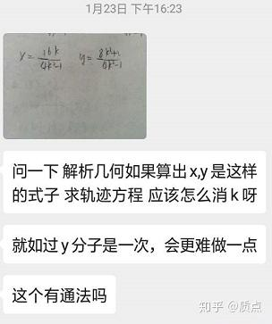

# 圆锥曲线题目的三维矢量解法

高中遇到的圆锥曲线题目，虽然大部分很丑陋，除了练习计算以外没什么意义，但是其中仍有许多漂亮的题目。这些题目的条件看似莫名其妙，但我们看到最终的结果时，常常感到柳暗花明。

这些漂亮的题目中许多又具有这样的特点：虽然结果简洁漂亮，但要想求得这个答案，无论是用解析几何方法，还是用平面几何方法，都需要进行大量的复杂计算。乱七八糟的式子化简出来，那些多余的项竟然成对消去，难道只是巧合吗？应该不是。因此，有理由认为，存在一种新的，不同于解析几何以及平面几何的方法，在处理这些问题时可以更加优美地得到答案。

我在高中三年遇到了很多这样的题目，于是便苦思其中的奥秘。虽然进展不多，但是脑中已经有了一些思路，同时因为学习竞赛，掌握了射影几何与线性代数的知识。最后是在高三寒假，我因为缺少零食饥渴难耐，想到有某家店铺的杂粮煎饼惊人地好吃，于是便进去买煎饼，顺便看看风景，放松一下身心。正在散步时，我突然看到同学发来的微信：

这样的式子并不奇怪，相信很多人都见过这样的参数方程。而参数方程的解，毫无疑问地，是一条圆锥曲线。就事论事的话，消去 $k$ 是不难的，但通法又该怎么找？我便去想这个轨迹的几何意义。很容易找到一个场景产生这样的方程（动直线与椭圆联立的韦达定理），而这个场景在射影几何的范畴内。但是虽然在射影几何的范畴内，却没有很好的工具来描述，更别提找到一个“通法”来解出这条圆锥曲线了。于是我决定整理我的思路，在我已有的思考上继续挖掘，发明一套理论来解决许多圆锥曲线问题。我发现在思考时，如果不把自己的思路记录下来，是很容易遗忘或发生混乱的。于是便有了知乎上的这些文章。

知乎上很多人讲圆锥曲线时都有数学竞赛的基础。然而我从来没有学过数学竞赛，我用的数学工具（线性代数和射影几何）是在物理竞赛以及个人兴趣中学到的，因此和别人的讲法会有很大差异。这套理论对于物理竞赛生使用相对论或许有一些帮助（原因是，相对论是竞赛中唯一用到非欧几里得度规的场景，并且圆锥曲线和闵氏度规有一点相似）

我意识到，要想系统地理解这些问题，需要群表示、李代数、范畴论什么的更基础的东西作为支撑，不过我目前就不懂了。因为我还没有学习到那些东西，我只能基于我已经知道的东西写下这篇文章。这篇文章是我自己学习到这个阶段留下的痕迹，其中有我到现在为止，高中大部分的思考内容。或许以后我从更高观点回望时，看到我高中的这些痕迹，会有一些感触吧。

我的高中除了应试以外，自己独立的不那么无聊的发现，在圆锥曲线方面是最集中的了。

现在我班上的同学还有4个月就要高考了。写完这篇文章后，我毫不怀疑，我已经能解决他们问我的任何圆锥曲线问题了...

---

我认为，解析几何强调代数过多，而我看的射影几何教材又令我迷惑不解：看那书上密密麻麻的辅助线、完全四点形，真实令人头大。明明已经给出了“齐次坐标”的定义，为什么不用它来解决问题呢？于是我便发展了“齐次坐标”这一想法，用线性代数中的概念描述几何对象的性质，用其中的代数运算描述几何对象间的关系。我的解法以三维矢量的运算为根基，解决实际问题时，射影几何与代数运算同时使用。我目前看过的书中，还没有人这么做的（事实上讲射影几何的书貌似很少，我无论看哪一本书，都是在书的末尾顺嘴提了一句，并且缺少代数层面上的论证。我还看到有的书，讲的是射影几何，但是在各种地方冒出来“圆”、“焦点”这些之前没有定义过的似是而非的概念，令人困惑。如果有人知道好书，希望能给我推荐一下）

在课内，圆锥曲线解题过程中一般使用的手段是解析几何，比如设点(x,y)，设直线y=kx+b，然后把已知的关系表示成代数方程。然而，这样做有一些缺点：

1.所有的几何对象都被表示成了若干个实数,比如点被表示成了(x,y)两个实数.可是,x与y并不仅仅是两个实数,它们之间有重要的联系-----它们在一起通过一种特定的方式代表了平面上的一个点.把所有几何对象都表示成一些实数,固然可以解决所有的问题,但是在解决的步骤中,这些实数之间的关系会显得十分的松散(在几何对象比较多的时候更是如此),这种松散,常常会使简洁的过程变得复杂,明显的结论难以看出,简单的几何关系变成了结构复杂的加减乘除运算.**如果有一种方法,可以把一个几何对象作为一个整体进行代数运算**(就像矢量一样,矢量可以直接进行运算,可以做加法、数乘和点乘，而不需要把它拆分成许多分量进行运算),并且这种代数运算满足一些适当的规律(比如交换律,分配律),那么对问题的处理显然会简洁许多.这是这篇文章主要做的事情。之后将会发现，平面上点、线的运算和三维矢量的运算有相似之处。为了引入这些运算，我们需要先知道关于矢量和张量的一些背景知识。

2在解题中，预判将会涉及到哪些知识内容有时是有好处的。举一个不太恰当的例子，在做解析几何时，我几乎可以肯定我不会使用指数函数和对数函数，因此，这部分知识我可以完全不管它。圆锥曲线的题中所涉及到的几何学其实是分层的，比如说，可以分成射影几何，仿射几何，欧式几何等等几层。不同层级中的几何中包含了不同的运算方式。欧式几何里的运算最多，射影几何中的运算最少。比如说，在欧式几何中，你可以求线段的长度，但在射影几何中是没有线段长度这个概念的。当我遇到一道圆锥曲线题，会先关心题目条件中涉及到了哪种运算：如果要求线段的长度，我就明白我必须使用欧式几何的知识；如果不需要，我就可能仅仅用射影几何的知识就能解决。判断一个问题属于哪个几何的范畴，有助于直接看到问题的答案。

这个理论的简要概括写在了这个回答中：

我在完善这个理论的过程中，会不断对已有的内容进行修改，这导致你昨天看到的定义今天可能就变了样；也可能这一节使用的是昨天的定义，而那一节已经用的是新的定义了。类似的，概念的称呼，以及符号描述，我都有可能会作出修改。这造成的不便请大家见谅。

以后我打算尝试利用这个工具研究共形时空，只需要把圆锥曲线逐点构造成纤维丛即可。虽然时空是4维的，但或许研究3维的时空也可以产生一些有用的结论。

在正文的基础上，我计划加入一些例题，它们和正文的内容互相补充。

---

## 第一部分：三维矢量的语言

第一节：矢量和对偶矢量

第二节：张量和指标缩并

第三节：指标升降、点乘和叉乘

## 第二部分：关系的建立

第四节：齐次坐标

## 第三部分：点与线的射影几何

第五节：点矢量和线矢量

第六节：无穷远

## 第四部分：认识圆锥曲线

第七节：椭圆、双曲线、抛物线和极点极线

第八节：退化圆锥曲线

第九节：交比、对合与调和点列

## **第五部分：圆锥曲线的更多性质**

第十节：二次点列和二次对合

*第十节例题：*圆锥曲线第十节例题

第十一节：平行与正交

第十二节：焦点与准线

第十三节：曲线系、笛沙格对合定理与圆锥曲线光学性质

## **第六部分：二次曲线的代数运算**

第十四节：二次点乘与二次叉乘

第十五节：圆锥曲线的对角化

第十六节：I型二次除法与共轭双曲线

第十七节：*写得不满意，暂不发表*

## **第七部分：圆锥曲线上的线性空间**

第十八节：指标分裂与二次嵌入

第十九节：再谈二次点列

第二十节：洛伦兹变换与帕斯卡定理

## 第八部分：例题（本部分已过时！不要看它！）

例题1：从中点轨迹问题谈起

质点：圆锥曲线的待整理题目

## **第九部分：立体几何与二次曲面**

第二十一节：点线面的射影几何与二次曲面分类

第二十二节：二次曲面的直纹性

---

写一些后记吧...

大概在初三下的时候，我搞到了一本射影几何的书，上面讲到了齐次坐标。于是我就拿着这个东西瞎折腾，用点乘、叉乘什么的证明了梅涅劳斯定理、塞瓦定理、笛沙格定理。但是也没想别的。

大约是在高二学物理竞赛的时候，听蔡子星老师讲四大力学课，讲电动力学的四维形式的时候，我听说了有一种东西叫做“上下指标”，并且还有“爱因斯坦求和约定”这种神奇的东西。用这种东西上上下下，竟然能推出场论中无数的等式。我感到十分高兴，就想到了我正在读的某本关于射影几何的书。这本书虽然用3维齐次坐标来表示点和线，然而计算时都是一个个实数在加减乘除，那书写量可是相当庞大...我便想，直接用一个字母加上一个指标来代表一个点 $a_i$ 或线 $l_i$ ，那就方便多了。之后我又想到，**点和点做缩并，线和线做缩并都没有几何意义，然而点和线做缩并有几何意义。这不天然就是上指标和下指标的关系吗**？于是我写下了一个等式 $a^il_i=0$ 。然而我对这个等式发呆半天，也没法搞出什么别的东西，只好到此为止。

之后的一段时间后我学到了更多的知识。我看了一点点线性代数，获得了许多运算技巧，知道了二次型的号差；我终于弄清楚了有序数组和矢量、矩阵和线性映射并不是一个东西；我听说了“等价类”与“代表元”，以表述多对一的映射；我看了梁灿彬的书的前三章，终于搞清楚了张量的意义，也能区分出“实际指标”和“抽象指标”。我在这一年，也悟出了对合变换与调和点列的关系，想到了二次点列的概念，并意识到，如果把这个概念加以完善，将可以解决那个著名的“过定点问题”。但我仍然没有想到如何用上下指标来解决其他问题。由于学业实在是太忙，学习成绩又不好，其实也没什么功夫去想它。

进队后我便又拿出了梁灿彬的书翻了翻。我看到**度规**时，突然眼前一亮。圆锥曲线不应该定义成曲线上的那些点，而应该定义成它的系数组成的结构——那么它必然是一个对称张量。我又立刻意识到，度规可以升降指标，这毫无疑问应该和极点极线有关……我验算了一下，果然是对的。最后我又意识到，叉乘需要的 $\epsilon_{ijk}$ 实际上就是一个**体元**，而空间中的体元几乎是确定的。之前我还想，要定义点和线的运算需要在三维空间中附加什么结构；此时我便肯定，射影几何可以直接在三维矢量空间中表示出来。

情况看上去是很好，但我意识到和书上讲的射影几何相比，我还缺少一些重要的工具。比如说，**我完全不知道怎么描述极点和极线形成的调和点列**。于是我开始胡乱折腾，写了一堆草稿纸（那些草稿纸现在已经不知所终了）后，我终于找到了正确的路径。我首先考虑一条直线上的射影几何，把调和点列写成了矢量形式。当我把其中的两个点丢掉，只留下剩下两个点确定的张量时，**我发现它们摆成了对称张量积的形式**。

**然后我就想到，在三维空间中也可以进行对称的张量积**。我立刻寻找它的几何意义，并且在极点极线上找到了这个张量。我发现，对称积得到的张量是退化的，它可以描述一个二维子空间上的调和点列。我意识到这正是我需要的工具。然后我令一条直线与椭圆相交，竟然得到了两个交点的对称张量积，于是我证明了极点和极线形成的调和点列。因为我觉得我的这些知识太不系统，我决定在知乎上一节节地写出来以整理我的思路。因为我搞出来了能描述调和点列的语言，最后整理出来一个概念，叫做”退化二次曲线“，因此我这套语言是行得通的了。我把这个概念放到了**“直线与椭圆相交”这一节。这可以说是最重要的一节**。

使用的语言很大程度上决定了我思考的方向。我已经知道，对合变换就是退化的二次曲线。写完第八节后的一天，我突然灵光一闪：**把圆锥曲线的3维张量限制在一个2维子空间上就得到了对合变换。或者说，把圆锥曲线的3维张量朝2维子空间做投影，就得到了那个“退化的二次曲线张量”**。比如，直线与椭圆相交得到的 $l^2g-ll$ 其实就是做投影而已。因此，极点极线形成的调和点列变成了十分显然的事情。**我相信如果不使用这套语言，没有人会这么思考问题**。

我的感受是，这套语言可以指引你研究什么内容：研究**不依赖于坐标系也不依赖于规范的张量**表达式。这种表达式是有几何意义的。我做了几道题，发现很多的问题的答案具有 $h+\lambda h:gg$ 的形式，这看上去是一个曲线系。但是，无论 $\lambda$ 取什么值，这是一个有几何意义的张量，我觉得接下来如果我研究一下这个张量，或许能解决一类问题。然而，和直接从几何来研究几何，从代数手段入手显得更为简洁而清晰。（**我实在受不了射影几何教材中那无数根线╯﹏╰完全四点形四个点就能连出六条线，然后跟别的东西相交又是一堆点一堆线啊……**）

两条圆锥曲线似乎还可以研究出一些性质。比如 $g:h=0$ 这个式子。如果其中一个是退化的，那这个式子的意义很明显。但如果都不退化，这个东西意味着什么？另一个麻烦是， $(g^{-1})^{ij}h_{ij}=0$ 与 $(h^{-1})^{ij}g_{ij}=0$ 并不等价。这说明这个关系关于这两条圆锥曲线不是对称的。如果要加加减减以使其对称，又可能破坏了规范不变的性质……还有，两个二次型可以相减求特征值方程，它的特征向量还可以讨论出一些性质。

我的学长叫我赶快学正式的数学。然而**现在是放假期间**，并且处于**防疫停课中**，我就先不搞那些东西，先研究这些东西作为娱乐吧....哈哈O(∩_∩)O~

2020年2月6日

我又注意到了一件事情，就是利用度规可以构造形如 $\frac{(m\cdot n)^2}{m^2n^2}$ 的函数。这毫无疑问与二次点列的交比有关，它应当是用交比构造出来的函数，并且交换相邻元素不会使函数变成倒数，而是使函数不变。这个函数应当赋予四点交比中两两的对换对称性。这是调和点列的推广。如果保证一条直线不变而动另一条直线，使得交比不变的动直线就会画出二次曲线。**这个二次曲线将是十分重要的推广，能统一二次对合与退化双曲线。只不过是 $\lambda l^2g- l l$ 中的 $\lambda$ 取0或者1而已。**

然而现在元宵节已经过去了，我的同学明天就开始上课。因此我要先干一些别的内容。虽然我意识到还有许多内容可以发掘，但这篇文章将几乎停止更新。等我干了一些其他事情后再说吧。

2020年2月10日

通过一个点a和一个点l可以构造一个投影，即一个退化的（1,1）型张量 $\tau^i_j=a\cdot l \delta^i_j-a^il_j$ 。它的特征是：把任意一点投影到l上的点，并且它在l上的限制为恒等变换。因此，它在一定情况下可以表示子空间上的恒等变换，而不需要借助二维矢量。比如说，对于退化的张量，虽然不能找到它的逆张量，但是可以找到一个张量，使得它们的乘积是在一个子空间上的投影。

在几何上，这一个张量可以和透视变换相联系。多次透视变换形成射影变换。

如果有一个圆锥曲线g，那么可以用 $\tau^i_j=a^2\delta^i_j-a^ia_j$ 来构造一对极点极线间的投影。

有趣的一点是：

如果我们有一个g和一个a。那么 $g$

作为（2,0）型张量在线a上的限制（得到线a上的对合）为 $f^{ij}=a^2g^{ij}-a^ia^j$

作为（0,2）型张量在点a上的限制（得到点a上的对合）为 $f_{ij}=a^2g_{ij}-a_ia_j$

因为g的上指标定义为其下指标的逆，因此g满足 $g^{ij}g_{jk}=\delta^i_k$ 。然而张量f的上下指标通过 $g$ 来升降，而不是（也不能，因为f不可逆）通过f的逆来定义。然而，如果计算 $f^{ij}f_{jk}=a^2\delta^i_k-a^ia_k$ 。得到了a的极点极线间的投影。如果限制在a上，那么它就退化成恒等张量。

这体现了这样的道理：两个张量是互逆的。如果把这些张量（以及单位张量）全都限制在一个子空间上，它们仍然是互逆的。

可以研究，如果有一个g和两个投影可以构造出什么。也可以研究如何投影到二次曲线上。

2020年2月20日

受到启发，我发现可以研究二次曲线的代数。

2020年3月27日

我把《微分几何与广义相对论》看到了第8章。讲了类光标架法。我问学长为什么要这么干，他告诉我光锥编码了时空的重要信息，为了引入旋量。我怀疑旋量是个很不错的东西，有必要把它引入到圆锥曲线问题中。这样可能能够彻底解决二次点列的问题。

2020年5月8日

我看完了《微分几何与广义相对论》的上册。接下来我要休息一下。于是我继续研究圆锥曲线了。

2020年5月17日

今天终于把帕斯卡定理解决了。目前计划的内容差不多结束了。当初我开始写这一系列文章时，脑子中的知识框架只构建到了第10节。在不断写下去的过程中，内容翻了超过一倍，写到了20节。真是令人感叹。

2020年6月5日
