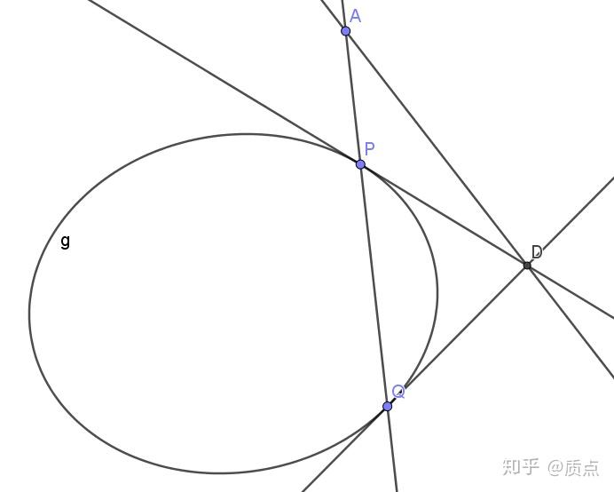
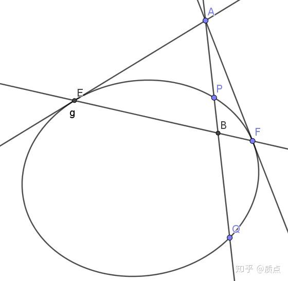
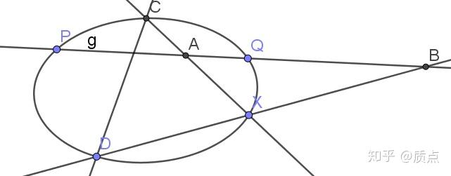
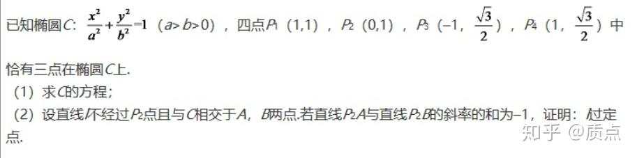
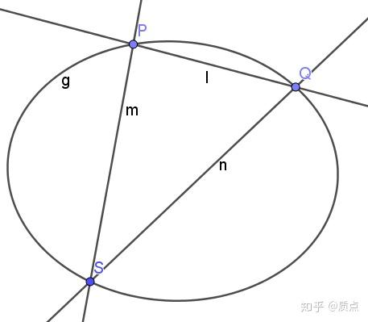
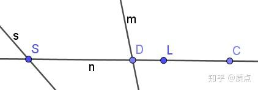
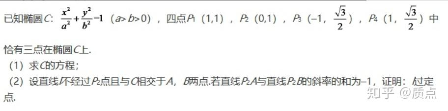
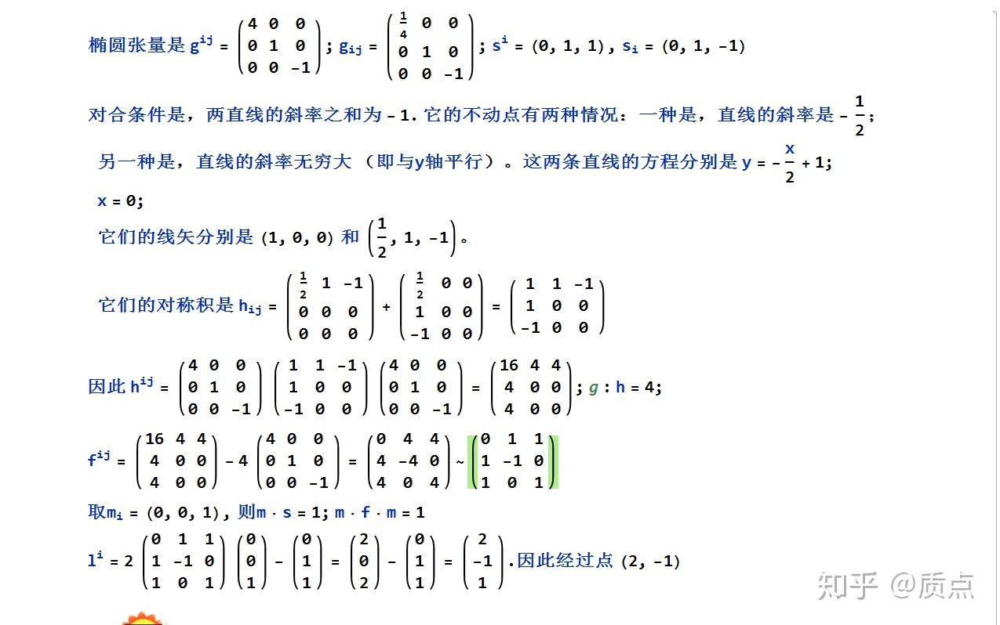
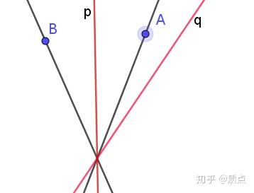
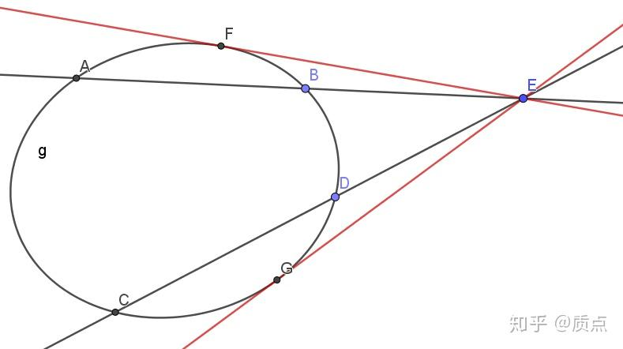

# 圆锥曲线第十节：二次点列与二次对合

目录链接：质点：圆锥曲线题目的三维矢量解法

用圆锥曲线张量定义度规后，如果几个点矢量 $a,b,c,d$ 的模方都是0，那么它们都在圆锥曲线上。当我们在讨论这些点的时候，就把它们叫做二次点列。

重要的是，二次点列可以定义交比，就像直线上的点列一样。这一定义基于如下的事实：

在二次曲线上任取一点 $P$ （不能和a，b，c，d重合），则可以把平面上的每一个点对应为经过那个点与P点的直线。这样， $a,b,c,d$ 也就对应着四条直线。这四条直线在一个一次线束上，我们可以定义它的交比，并作为 $a,b,c,d$ 的交比。重要的结论是，只要P点在二次曲线上，那么如此定义的交比与P点的选取无关！！！

我们来证明这个结论。按照我们的语言，如此定义的交比的数学表达式是 $J=\frac{[Pac][Pbd]}{[Pad][Pbc]}$

。为了利用 $a^2=b^2=c^2=d^2=P^2=0$ 的条件化简这个表达式，我们进行一些巧妙的处理。先对这个式子进行平方，得到 $J^2=\frac{[Pac]^2[Pbd]^2}{[Pad]^2[Pbc]^2}$ 。

然后，我们要利用线性代数中的重要公式。因为混合积可以写成行列式的形式，而行列式与矩阵之间满足关系 $\text{det}(AB)=(\text{det}A)(\text{det}B)$ 。因此 $[Pac]^2=det\begin{pmatrix}   P\cdot P&P\cdot a&P\cdot c\\  a\cdot P&a\cdot a&a\cdot c\\ c\cdot P&c\cdot a&c\cdot c\\  \end{pmatrix}=det\begin{pmatrix}   0&P\cdot a&P\cdot c\\  a\cdot P&0&a\cdot c\\ c\cdot P&c\cdot a&0\\  \end{pmatrix}=2(P\cdot a)(P\cdot c)(a\cdot c)$

如此改写后，可以得到 $J^2=\frac{4(a\cdot c)(b\cdot d)(P\cdot a)(P\cdot b)(P\cdot c)(P\cdot d)}{4(a\cdot d)(b\cdot c)(P\cdot a)(P\cdot b)(P\cdot c)(P\cdot d)}=\frac{(a\cdot c)(b\cdot d)}{(a\cdot d)(b\cdot c)}$ 将P消去了。

因为 $J^2$ 与P无关，而显然， $J$ 应该随着P连续变化，因此它只能是常数。

**现在我们完成了二次点列的定义。但是这一定义并不完美：它似乎没有涉及到二次点列的本质。对二次点列的本质的讨论在很多节以后：见指标分裂与二次嵌入与再谈二次点列。目前我们讨论二次点列的一般问题是困难的，目前我们只能讨论它的一个简单场景：二次对合问题。**

如果$J^2=1$ ，那么只能有 $J=-1$ ，即四条直线调和分割。因为无论P点在二次曲线上怎样选取，四条连线都是调和的，可以很合理地定义 $a,b,c,d$ 称为二次调和点列。二次调和点列的条件可以写成更简单的形式：把 $1=\frac{(a\cdot c)(b\cdot d)}{(a\cdot d)(b\cdot c)}$ 的分母乘到左边，再移项到右边，成为 $0=(a\cdot c)(b\cdot d)-(a\cdot d)(b\cdot c)$ 。而右边的等式不是别的，正是我们在第三章求过的表达式： $(a\times b)\cdot (c\times d)$ 。因此二次调和点列的条件可以写成： $(a\times b)\cdot (c\times d)=0$ 。这个式子有明显的几何意义。它意味着，直线AB与CD是共轭的；而直线的共轭引出了两块内容：1意味着它们互相经过对方的极点，引出了极点极线的知识；2引出了一维的对合变换。

有了$(a\times b)\cdot (c\times d)=0$这个漂亮的条件以后，我们可以定义二次曲线上的对合变换。回忆一下，一维的对合变换由两个不动点 $p,q$ 确定，与 $p,q$ 构成调和点列的两个点 $a,b$互相对合。

二次点列的情景是相似的。**把**$p,q$**固定，在二次曲线上与**$p,q$**构成调和点列的两个点**$a,b$**称为互相对合。**$p,q$ 两个点可以用过 $p,q$ 的直线 $l=p\times q$ 代替，因此，**对于任意直线**$l$**（还得要求它不与二次曲线相切）方程**$(a\times b)\cdot l=0$**给出了由**$l$**确定的对合变换。如果**$l$**与曲线有交点，则交点是对合的不动点；如果没有交点，则对合没有不动点。**

和二阶点列相似，所有与椭圆相切的直线称为二阶线束。二阶线束也可以定义交比、对合、调和等关系。这些关系与切点构成的二阶点列的关系是相同的。

（对合变换似乎与交点在二次曲线上的退化二次点列有关系？待研究！）

注：当 $a,b$ 重合时，应想象成它们错开了无穷小距离，因此 $a\times a$ 的含义是在 $a$ 的切线。

在二次曲线上任取一点可以把二次点列的交比转化成一次线束的交比。**类似地，在二次曲线上任取一点可以把二次点列上的对合转化成一次线束上的对合。**

作出了直线 $a\times b$ ，它和二次曲线的两个交点$a,b$也就能够确定了。$(a\times b)\cdot l=0$意味着，直线$a\times b$恒过 $l$ 的极点。换句话说，$a\times b$是一个一次线束。这导致了极其重要的结论：

**二次曲线**$g$**外（只要不在**$g$**上）有一定点**$a$**。则过**$a$**的线束中与**$g$**相交的直线的两个交点确定一个对合关系。**

它的对偶命题同样成立：

**二次曲线**$g$**外（只要不与**$g$**相切）有一定直线**$l$**。则**$l$**上的点列中与**$g$**的两条切线确定一个对合关系（当然，两个切点也是对合的）**

我们画两个图来直观地看这件事情。

在下图中，A是定点。过A的动直线l交g于P、Q。P、Q的切线交于D点。则图中共有三个对合关系：

**P、Q是对合的二阶点列；P、Q处的切线是对合的二阶线束；直线APQ、AD是对合的一阶线束**。对合的不动点是A到g的两条切线（或者切线的切点），图上未画出。

在下图中，PQ是定直线L，A是L上的动点，两条切线切于E、F，EF连线交L于B。则图中共有三个对合关系：

E、F是对合的二阶点列（不动点是P、Q）；AE、AF是对合的二阶线束，不动点是P、Q处的切线；A、B是对合的一阶点列，不动点是P、Q。

有趣的是，**二次曲线能产生直线（或点）上的对合，而直线（或点）又能产生二次曲线上的对合**。因此，二次曲线和点、直线在一起，可以产生丰富的数学内容。

再来看一个例子：

$PQ,CD$ 是一对共轭的定直线。X是圆锥曲线上的动点。则图中的两个交点 $A,B$ 满足以 $P,Q$ 为不动点的对合变换。

证明：因为 $p\times q,c\times d$ 共轭，因此$c,d,p,q$ 是二次调和点列，因此 $CX,DX,PX,QX$ 是调和线束，因此 $A,B,P,Q$ 是调和点列，因此满足对合变换。

运用二次对合，我们可以处理一类在知乎上被广泛讨论的问题，这类问题通常被叫做“**双斜率过定点问题**”。我们现在来举一个例子。因此，我随手从知乎上搬了一道题，来演示一下我如何思考这个问题的：

2017年全国1理

这个椭圆的方程求出来后是 $\frac{x^2}{4}+y^2=1$ 。我们直接来看第二问。

首先我看到，A、B两点是 $l$ 与椭圆的两个交点，它们的地位是**对称**的。**对称**让我联想到了**对合**。接下来，我看到我们要证明的是 $l$ **过定点**。首先，“过定点”是射影几何中可以讨论的关系；其次，联系到我们前文得到的重要定理，**过一定点的直线可以产生二次点列上的对合关系**。因此，我们只需要证明 $A,B$ 满足对合关系就行了；最后看到中间那句话，两条**过P2的直线**“斜率之和为-1”，这很明显是过P2的一维线束的一个对合关系。而从本节最开始的讨论我们知道，因为P2在椭圆上，因此**椭圆上点的对合等价于过P2的直线的对合**。因此我们的证明便大功告成了：

$P_2A,P_2B$**的斜率满足**$k_1+k_2=1$**确定了这两条直线的对合关系，进而确定了椭圆上A、B的对合关系。椭圆上的对合由一条定直线确定，互相对合的点所连直线经过这条定直线的极点。证毕。**

我们事实上已经完全解决了这个问题。但是有时候，我们需要具体求出来这个点。因此，我们来考虑一般的问题：

有椭圆 $g$ 。点 $s$ 在g上。 $h_{ij}$ 是交点为s的退化二阶点列，诱导出过 $s$ 的线束的对合，再诱导出 $g$ 上二阶点列的对合。求g上对合点连线过的定点。我们想知道能否纯粹用张量语言 （**不涉及解二次方程**）来解决这个问题。

我们画出来这个图。 $h$ 是直线m，n构成的，m、n均为h对应的对合的不动直线。因此 $P,Q$ 是二次曲线上对合的不动点。P、Q均与自己对合，因此连出的直线就是分别切于P、Q两点的切线。它们的交点正是那个定点。而根据极点极线的性质，这个点正是 $l$ 的极点。换言之，只要我们能表达出直线 $l$ ，就能求出定点了。主要的麻烦是，虽然我们知道 h是m，n的对称积，$h_{ij}=m_in_j+m_jn_i$ ，但不解二次方程，我们是无法得到 $m,n$ 的。在只知道 $h$ 的情况下，我们有没有可能求出 $l$ 呢？**这个问题并不能一眼看出答案**。

与这个问题相反的问题会更简单一些。我们已知 $l,s$ ，现在来求出 $h$ 的表达式。首先，利用”直线与椭圆相交“一节的知识，P、Q两点的对称积为 $(pq)^{ij}=l^2g^{ij}-l^il^j$ 。接下来，**只要把这个张量的每一个分量都与**$s$**叉乘，就得到了直线**$m,n$**的对称积** $h$ 。写成分量式， $h_{ij}=(mn)_{ij}=\epsilon_{ikm}s^k\epsilon_{jln}s^l(l^2g^{mn}-l^ml^n)$ 。用度规升降指标，再利用行列式来把叉乘符号去掉，经过一些有点复杂的化简，可以得到答案：

$h_{ij}=l_is_j+s_il_j-(l\cdot s)g_{ij}$ ，或 $h=ls+sl-(l\cdot s)g$

有了这个表达式以后，我们再把它看作关于未知矢量 $l$ 的方程。如果在等式两边同时乘以 $g^{ij}$ ，那么会得到 $g^{ij}h_{ij}=g^{ij}l_is_j+g^{ij}s_il_j-(l\cdot s)g^{ij}g_{ij}$ 。

等式左边是一个已知的实数，我把它写作 $g:h$ （有两个点表示做两个点乘...)右侧的前两项都等于 $l\cdot s$ ；右侧的第三项要利用 $g_{ij}g^{jk}=\delta^k_i$ ，以及 $\delta^i_i=3$ （因为在3维空间，每维都贡献一个1），因此我们得到 $g:h=-l\cdot s$ 。因此，我们的方程化简为 $h-(g:h)g=ls+sl$ 。换句话说，我们知道对称积 $(ls)$ 与一个元素 $s$ ，要求另一个元素 $l$ 。这相当于已知二次方程的一个根求另一个根，这毫无疑问是可以办到的。我把 $h^{ij}-(g:h)g^{ij}$ 记为 $f^{ij}$

然而，我们想仅仅用 $f^{ij}=l^is^j+s^il^j$ 、 $s^i$ 就想算出 $l^i$ 是很困难的，因为我们能够使用的运算太少。为了解决这个问题，我们只好任意选取一些新的矢量来参与运算。我们**任意地**引入一个线矢 $m_i$ ，看看我们能构造什么东西。

m会和直线n有交点D。但是因为我们还没有表示出来n，因此我们写不出交点D。但是，我们可以用f和m做运算 $c^i=f^{ij}m_j$ ，得到C点，应用“交比、对合与调和点列”一节的知识，可知C点在直线n上，且构成调和点列 $(sl;cd)=-1$ 。构造出c以后，就可以构造出 $n=c\times s$ ，于是可以构造出来 $d=m\times n$ 。于是可以构造 $cd$ 诱导的退化二次点列 $(cd)$ 。把这个（2,0）型张量作用在任意一个经过S点的直线（比如说S点的极线s），就得到了点L。

具体的计算有一些复杂。 $d=m\times (c\times s)=(m\cdot s )c-(m\cdot c)s$ ，代入$c^i=f^{ij}m_j$可以得到 $d^i=f^{ij}m_jm^ks_k-f^{jk}m_jm_ks^i$ 。 $c,d$ 作对称积可以得到很长的式子 :

$(cd)^{il}=2f^{ij}m_jm_ks^kf^{ln}m_n-f^{jk}m_jm_ks^if^{ln}m_n-f^{jk}m_jm_ks^lf^{in}m_n$

接下来我们用它点乘 $s_l$ 就得到了 $l^i$ 。令人十分高兴的是，因为s在椭圆上，因此 $s^ls_l=0$ ，所以第三项会被消掉。结果是 $l^i=2f^{ij}m_jm_ks^kf^{ln}m_ns_l-f^{jk}m_jm_ks^if^{ln}m_ns_l$ 。这个式子还可以化简，因为右边的两项中都含有 $f^{ln}m_ns_l$ ，可以丢掉。因此

$l^i=2f^{ij}m_jm_ks^k-f^{jk}m_jm_ks^i$ 。如果用点乘表示，就是 $l=2(m\cdot s)f\cdot m-(m\cdot f\cdot m)s$ 。

推导出这些公式以后，我们再求解类似的问题就很简单了，无非三步：

**1.写出对合张量**$h$

**2.利用**$f=h-(g:h)g$**求出张量**$f$

**3.利用**$l=2(m\cdot s)f\cdot m-(m\cdot f\cdot m)s$**求出矢量**$l$

现在我们来算一算这个问题中的定点到底是哪个点。椭圆的方程是 $\frac{x^2}{4}+y^2=1$

因为知乎里敲矩阵太累，我直接贴图片了。**在计算分量时一定要注意指标的上下！**

目录链接：质点：圆锥曲线题目的三维矢量解法

---

## 注：以下内容似乎没有价值，但是是否真的没有用还不敢肯定。建议不要阅读。

我们通过一次线束的交比定义二次曲线上A、B、C、D四点的交比（的平方）： $J_{ab,cd}^2=\frac{(a\cdot c )(b\cdot d)}{(b\cdot c )(a\cdot d)}$ 。然而大多数情况下，我们并不是给出了二次曲线上的四点，而是给出了两条直线 $m,n$ ，其中m与二次曲线交于A、B两点，n与二次曲线交于C、D两点。我们希望用线矢 $m,n$ 来表示这个交比，即找到函数 $J^2_{ab,cd}(m,n)$ 。

很容易看出一个问题：$J_{ab,cd}^2=\frac{(a\cdot c )(b\cdot d)}{(b\cdot c )(a\cdot d)}$关于 $a,b$ （以及 $c,d$ ）的地位不对称（交换后交比变成倒数），然而$a,b$是直线与椭圆的两个交点，它们的地位应当是对称的。因此我们需要构造另外的一个量。我们采用“交比、对合与调和点列”末尾讲到的方法，构造函数 $<m,n>^2=\frac{(m\cdot n)^2}{m^2n^2}$ 。这个函数是规范不变的，因此它有几何意义，很可能与交比有关。现在我们要研究 $<m,n>^2,J_{ab,cd}$ 之间有怎样的关系。

我们代入 $m=a\times b,n=c\times d$ ，可以得到 $<m,n>^2=\frac{((a\times b)\cdot (c\times d))^2}{{(a\times b)^2 (c\times d)^2}}=\frac{((a\cdot c)(b\cdot d)-(b\cdot c)(a\cdot d))^2}{{(a^2b^2-(a\cdot b)^2)(c^2d^2-(c\cdot d)^2)}}\\=\frac{((a\cdot c)(b\cdot d)-(b\cdot c)(a\cdot d))^2}{(a\cdot b)^2(c\cdot d)^2}=\frac{(\frac{(a\cdot c)(b\cdot d)}{(b\cdot c)(a\cdot d)}-1)^2}{(\frac{(a\cdot b)(c\cdot d)}{(b\cdot c)(a\cdot d)})^2}$

其中分子的那个比值正是 $J^2_{ab,cd}$ ，而分母却含有 $J^2_{db,ca}$ 。我们利用在“交比、对合与调和点列”中讲到的公式 $J_{db,ca}=1-J_{ab,cd}$ 消掉$J^2_{db,ca}$，可以得到 $<m,n>^2=\frac{(J_{ab,cd}^2-1)^2}{(1-J_{ab,cd})^4}=(\frac{J_{ab,cd}+1}{J_{ab,cd}-1})^2$ 。这就是$<m,n>^2,J_{ab,cd}$之间的关系。

在“交比、对合与调和点列”一节中，我们发现在直线上 $<a,b>$ 与 $J_{ab,pq}$ 的关系是 $<a,b>_{(pq)}^2=\frac{(1+J)^2}{4J}$ 。**这一关系可以推广到平面上的退化二次点列**。请看下图：

如图， $h=(pq)$ 是 $p,q$ 两条直线生成的退化二次点列。A、B分别是平面上任意两点。则 $<a,b>_{(pq)}^2=\frac{(a\cdot h\cdot b)^2}{(a\cdot h\cdot a)(b\cdot h\cdot b)}$ 与图中四条直线的交比 $J$ 满足$<a,b>_{(pq)}^2=\frac{(1+J)^2}{4J}$ 。

此时有人可能会提出疑问，退化二次点列是特殊的圆锥曲线，但为什么退化二次点列满足的公式$<a,b>_{h}^2=\frac{(1+J_{ab,pq})^2}{4J_{ab,pq}}$ ，与我们在圆锥曲线里发现的公式 $<m,n>^2_g=(\frac{J_{ab,cd}+1}{J_{ab,cd}-1})^2$ 完全不同呢？这是因为两者的 $J_{ab,cd}$ 与 $J_{ab,pq}$ 并不是相互对应的。请看如下的图：

$J_{ab,cd}$是圆锥曲线上四点的交比，在退化二次点列上没有对应物；而$J_{ab,pq}$在圆锥曲线上的对应物是图中过 $E$ 点的四条直线的交比（留作习题）。因此，$J_{ab,cd}$ 与 $J_{ab,pq}$不同实际上表明了图中四条直线的交比并不等于 $a,b,c,d$ 四点的交比，这是没有疑点的。
