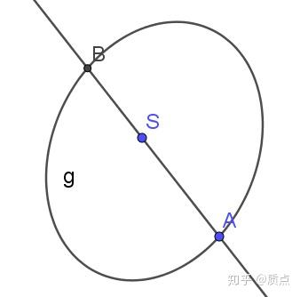
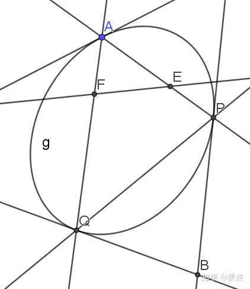
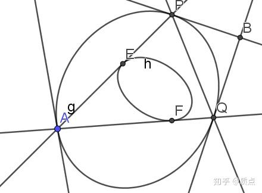
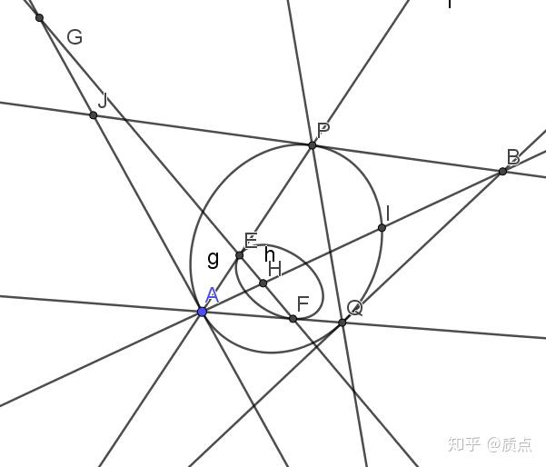
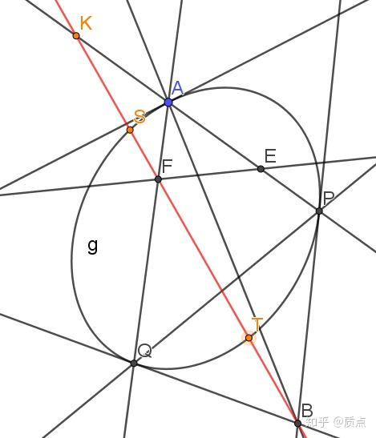

# 圆锥曲线第十节例题

目录：质点：圆锥曲线题目的三维矢量解法

*我本来想给这些例题起一个题目的...然而实在没想到起什么题目。*

这些题目可以作为第9、10节以及之前知识的练习，我们会使用调和点列的知识以及初等的代数运算来解决它们。它有助于解决这个问题：这是不是高考范围内最难的圆锥曲线问题，这题已经做到怀疑人生，大家有什么思路吗？。

利用逆二次叉乘的方法（这一方法我还没有发表），可以更加简洁漂亮地解答这些题目，但是这里并不给出。

**【例1】**：

已知圆锥曲线 $g$ 及其上的一点 $a$ 。点 $s$ 在圆锥曲线外， $a\times s$ 与 $g$ 交于两点，其中一点是 $a$ ，另一点设为 $b$ 。求 $b$ 的表达式。

**解：**因为 $a,b,s$ 共线，可以设 $b=a+\lambda s$ 。因为 $b$ 在 $g$ 上，因此 $b^2=(a+\lambda s)^2=a^2+2\lambda a\cdot s+\lambda^2 s^2=\lambda  (2a\cdot s+\lambda s^2)=0$ 。因此 $\lambda=-\frac{2a\cdot s}{s^2}$ 。因此 $b$ 的一个解为 $b=a-\frac{2a\cdot s}{s^2}s$ ，或 $b=s^2a-2(a\cdot s) s$ 。

值得注意的是，**$b$ 是 $s$ 的二次函数，又是 $a$ 的线性函数**。

既然$b$ 是 $s$ 的二次函数（换句话说， $s$ 是以二次点 $ss$ 的形式出现的），我们不妨尝试把$s$ 换成其他种类的二次点，比如 $k^{ij}=(ef)^{ij}$ ，看看会怎么样。**于是我们的题目可以改成：**

**【例2】：**已知圆锥曲线 $g$ 及其上的一点 $a$ 。二次点 $k=(ef)$ ，如图作出点 $b$ 。求 $b$ 。

**解：**这个问题是例1的简单应用。由例1的结论，可以得到 $p=e^2a-2(a\cdot e) e$ ， $q=f^2a-2(a\cdot f) f$ 。因此 $b=p\times q=(e^2a-2(a\cdot e) e)\times(f^2a-2(a\cdot f) f)\\=-2f^2(a\cdot e) e\times a-2e^2(a\cdot f)a\times f+4(a\cdot e) (a\cdot f) e\times f\\$

表面上看，这个式子很难化简，似乎唯一可以做的就是约掉一个2，得到 $-f^2(a\cdot e) e\times a-e^2(a\cdot f)a\times f+2(a\cdot e) (a\cdot f) e\times f\\$ 了。但实际上，上式完全相等于 $((a\cdot f) e+(a\cdot e)f-(e\cdot f)a)((e\times f)\cdot a)$ 。（*你可以验证，无论用 $a,e,f$ 中哪一个与这两个表达式作点乘，得到的结果都一样。两个表达式与3个线性无关的矢量点乘的结果都相同，那么它们必定是相同的。*），因此最简的答案是：

$b=(a\cdot f) e+(a\cdot e)f-(e\cdot f)a$ 。如果用 $k=(ef)$ 代替，就是 $b=(k:g)a-2k\cdot g\cdot a$ （这里乘以了-2作为系数）

我们已经讨论了两种退化二次点的情况，接下来我们来看非退化二次点的情况。

**【例3】：**已知圆锥曲线 $g$ 及其上的一点 $a$ 。且有二次点 $h$ （我们这里假设它是可逆的）。过 $a$ 作 $h$ 的两条切线，分别交 $ g$ 于 $p,q$ 两点（不同于 $a$ ）。作 $p,q$ 的两条切线，交于 $b$ 。求 $b$ 。

解：如果 $h$ 退化为两个点 $E,F$ ，这个问题就退化成了上一个问题。事实上，在这个问题中， $h$ 完全可以被 $E,F$ 两个点代替，而得到同样的 $b$ 点！ $k=(ef)$ 和 $h$ 的关系是： $k^{ij}=((h^{-1})_{kl}a^ka^l)h^{ij}-a^ia^j$ 。利用例2的结果，我们可以立刻用 $k$ 来表示 $b$ ： $b=(k:g)a-2k\cdot g\cdot a$ 。现在我们再把 $k$ 用 $h$ 表示出来，就得到了 $b=((((h^{-1})_{kl}a^ka^l)h-aa):g)a-2(((h^{-1})_{kl}a^ka^l)h-aa)\cdot g\cdot a$

利用 $g_{ij}a^ia^j=0$ （ $a$ 在 $g$  上），表达式中的第2、4项都是0。此时第1、3项的系数 $(h^{-1})_{kl}a^ka^l$ 可以消去，因此我们得到了最终的结果 $b=(h:g)a-2h\cdot g\cdot a$ 。

---

**【例4】**：在例3的背景下，求证 $A,B$ 和 $A$ 在 $g$ 处的切线关于 $h$ 的极点共线。

证明如图（我们要证明图中的直线过B点）：

图中EF是A关于 $h$ 的极线， $EF$ 与A处的切线交于 $G$ 。设 $A$ 处的切线关于 $h$ 的极点是 $H$ 。因为 $H$ 的极线过 $A$ ，因此 $A$ 的极线过 $H$ ，即 $H$ 在 $EF$ 上；由极点极线的性质知 $E,F,G,H$ 成调和点列。因此 $EA,FA,GA,HA$ 成调和线束。因此 $P,Q,A,I$ 构成二次曲线 $g$ 上的调和点列。因此 $AI$ 与 $PQ$ 共轭，因此 $AI$ 通过 $PQ$ 的极点，这正是B。因此 $A,H,B$ 共线。

我们从中得知 $b$ 的表达式具有如下的形式：$b^i=\lambda a^i+\mu h^{ij}g_{jk}a^k$ ，其中 $\lambda,\mu$ 是待定实数。我们在例3中求得的$b=(h:g)a-2h\cdot g\cdot a$ 是符合这一形式的。

**【例5】**在例2的背景下（忽略下图的直线 $AB$ ，它是我不小心画的，没有任何用处），求证：$FB$ 与 $AE$ 的交点 $K$ 与 $F$ 关于 $g$ 共轭。

**证：**因为 $FB$ 过 $PQ$ 的极点 $B$ ，因此 $FB,PQ$ 共轭，因此 $S,T,P,Q$ 成 $g$ 上的二次调和点列，因此 $AS,AT,AP,AQ$ 成调和线束，因此 $S,T,K,F$ 成调和点列，因此 $K,F$ 关于 $g$ 共轭。

如果我们把这个条件用代数方法表示出来，就可以直接解得

$b=(a\cdot f) e+(a\cdot e)f-(e\cdot f)a$ ，而不需要前文步骤中“同时约掉 $(e\times f)\cdot a$ ”这一神奇的代数变形。步骤如下：

$K,F$ 关于 $g$ 共轭的条件是 $k\cdot f=0$ 。而 $k=(b\times f)\times (a\times e)$ 。因此 $((b\times f)\times (a\times e))\cdot f=0$ 。利用混合积，改写为 $((b\times f)\times f)\cdot (a\times e)=0$ 。设 $b=\mu a+(a\cdot f) e+(a\cdot e)f$ （例4的结论保证了我们可以这么设！），得到 $((\mu a\times f+(a\cdot f) e\times f)\times f)\cdot (a\times e)=0$ ，利用二重外积公式，得到 $\mu( (a\cdot f)f-f^2a)\cdot (a\times e)+(a\cdot f)( (e\cdot f)f-f^2e)\cdot (a\times e)=0$ 。由于 $a\cdot(a\times e)=e\cdot(a\times e)=0$ 上式化简为 $\mu (a\cdot f)f\cdot (a\times e)+ (a\cdot f) (e\cdot f)f\cdot (a\times e)=0$ 。于是解得 $\mu=-e\cdot f$ ，即：

$b=(a\cdot f) e+(a\cdot e)f-(e\cdot f)a$

目录：质点：圆锥曲线题目的三维矢量解法
