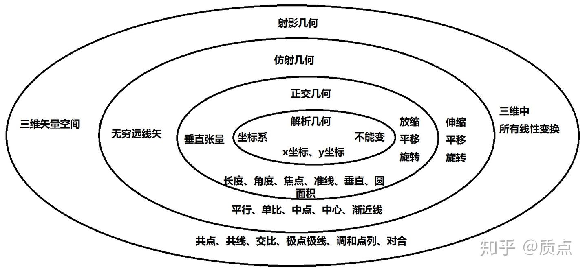
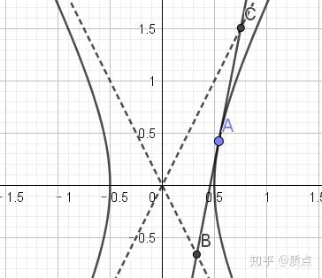

# 圆锥曲线第十一节：平行与正交

目录链接：质点：想整理一篇关于高中的圆锥曲线的文章

在这一节中，我们的任务是对圆锥曲线的几何特性进行分层。目前为止，我们把平面几何从低到高分成了三层：射影几何、仿射几何、解析几何。不同的层次中的几何元素中定义了不同的关系，也定义了不同的运算。**高层次的关系可以表示低层次的关系，但低层次的关系未必能表示高层次的关系。高层次的运算可以表示低层次的运算，但低层次的运算未必能表示高层次的运算。举例：**用点的坐标满足的方程（解析几何）可以给出三点共线的条件（射影几何），但用射影几何的关系不能表示”两个点的x坐标相等“（解析几何）。”写出过两点的直线方程“（解析几何）可以表示”做两个点矢的叉乘“（射影几何）；但用射影几何的关系不能表示”过一点作一条直线的平行线“（仿射几何）

**理论上说，我们可以把所有的关系以及所有的运算都用最高层次的表示。然而，用高层次的东西表示低层次的东西通常会比较复杂。因此，我们应该用尽可能低层次的方法来解决问题。**

假设我们有一道题，给出了一些几何元素abcde，已知它们满足关系ABC，求证它们满足关系X。我们首先判断ABC是否仅仅含有射影几何的关系。如果是，我们将用射影几何的运算来证明它们满足关系X。如果含有非射影几何的关系，我们再判断它是否仅仅含有仿射几何的关系。如果是，我们将用仿射几何的运算来证明它们满足关系X。否则，我们将用解析几何的运算来证明它们满足关系X。

需要注意的一点是，题目常常会有一些多余的条件。比如，明明A点在任何位置时命题都成立，题目却偏偏假设A在x轴上；明明命题对任何双曲线都成立，题目却给定双曲线是等轴双曲线；这时候，只能通过合理的推断以及猜测来判断应该用什么层次的方法来解决问题。

射影几何的内容我们在之前已经讨论过一些。射影几何，也就是没有附加结构的三维矢量空间中，有意义的概念是“点在直线上”、”共点和共线“、”圆锥曲线“、”极点和极线“、”对合与调和点列“等等。

我们举一个例子，用高层次运算表示低层次运算。同一直线 $l$ 上的四点 $a,b,c,d$ 可以定义交比 $(ab;cd)=\frac{[ac][bd]}{[ad][bc]}$ 。它是坐标系无关的，因此我们可以在任意一个坐标系下写出它的值。我们选一个比较方便的坐标系，使得这条直线上的所有点矢的第二个分量为0，再取合适的规范使得第三个分量为1。这时它们的坐标是 $(x_A,0,1),(x_B,0,1),(x_C,0,1),(x_D,0,1)$ 。在这个坐标系下， $(ab;cd)=\frac{(x_C-x_A)(x_D-x_B)}{(x_D-x_A)(x_C-x_B)}$ 。纯粹的射影几何中，交比是几何量，而$x_C-x_A$等数值却并不是几何量（因为选不同的坐标系时它的值不一样）。然而，我们可以利用解析几何赋予$x_C-x_A$这种量”两点间长度“的意义（实际上，这相当于我们选取了一个**特定的坐标系**）。**此时，我们可以用两点间长度（解析几何的概念）之比来表示四点的交比（射影几何的概念）**。然而，由于这个表达式过于复杂，这样做通常并没有什么好处。

在定义了无穷远点后，三维矢量空间有了一个平行结构。这时可以自然地定义更多的概念。

比如，我们已经讨论过的是直线的平行，圆锥曲线到椭圆、双曲线、抛物线的分类，圆锥曲线的中心和双曲线的渐近线。

有了 $l_{\infty}$ 以后，$l$上多出了一个特殊的点 $\infty$ ，表示 $l,l_{\infty}$ 的交点。此时我们可以定义一个只含三个几何量 $a,b,c$ 的函数 $(ab;c\infty)=\frac{[ac][b\infty]}{[a\infty][bc]}$ ，称为单比。可以看到，单比是特殊的交比。选取一个坐标系后，单比的值为$(ab;c\infty)=\frac{(x_C-x_A)(x_\infty-x_B)}{(x_\infty-x_A)(x_C-x_B)}$。然而，当我们用解析几何赋予$x_C-x_A$这种量以”两点间长度“的意义时，无穷远点的坐标就必然是无穷大。在满足这个意义的坐标系下，单比有更简单的解析式：$(ab;c\infty)=\frac{x_C-x_A}{x_C-x_B}$。换句话说，**单比就是一条直线上的两线段长度之比（注意，必须在同一直线上）**。我们可以看到，单比（仿射几何的概念）可以用长度（解析几何的概念）表示，而且表达式还是相对简单的。但是，长度是不能用仿射几何的运算表示的。

如果 $a,b,c,\infty$ 成调和点列，则 $\frac{x_C-x_A}{x_C-x_B}=-1$ 。这表明 $C$ 是 $A,B$ 的中点。因此，**中点是仿射几何的概念**（在射影几何中是不能定义中点的）。

在”直线与椭圆相交“一节中，我们看到了蒙日圆问题，它虽然涉及到了”垂直“这一不属于射影几何也不属于仿射几何的概念，但我们的解题过程几乎都是坐标系无关的。因此，我们来考虑一下能不能类似定义”平行结构“而定义所谓”垂直结构“。我们已经通过引入了一个特殊的线矢 $l_{\infty}$ 得到”平行结构“，因此我们猜测，我们可以通过引入一个特殊的张量来得到”垂直结构“。比如我们记这个这个张量为 $\theta$ ，并定义直线 $m,n$ 垂直的条件为 $\theta^{ij}m_in_j=0$ （可以看到，这个等式是规范不变的）。

我们知道，如果直线 $m,n$ 垂直，那么所有与 $m,n$ 分别平行的直线也相互垂直。而和 $m$ 平行的直线可以写成 $m+\lambda l_{\infty}$ ,因此，只要$\theta^{ij}m_in_j=0$就有 $\theta^{ij}(m+\lambda l_{\infty})_i(n+\mu l_{\infty})_j=0$ 。可见必有 $\theta^{ij}l_{\infty i}=0$ 。可见$\theta$必定是退化的，它乘以$l_{\infty}$后会得到零矢量。

我们知道，一条直线不应该与自己垂直，因此对 $m\ne l_{\infty}$ ，$\theta^{ij}m_im_j\ne0$。因此它不能是不定的。所以把$\theta$对角化后，它的号差是 $(1,1,0)$ 。

因此我们定义：**如果在三维矢量空间中指定了一个（2,0）型，号差为**$(1,1,0)$**的对称张量**$\theta^{ij}$**，则称在三维矢量空间对应的射影几何中有一个正交结构**。只要有了正交结构，平行结构就随之而确定了。从代数观点看，可以定义满足$\theta^{ij}l_{\infty i}=0$的线矢是无穷远直线；从几何观点看，如果两直线垂直于同一条直线，那么这两条直线平行。因此，正交结构包含了平行结构**。**

和解析几何联系紧密的坐标系下，正交张量的矩阵形式为 $\theta^{ij}=\begin {pmatrix}1&0&0\\0&1&0\\0&0&0\end {pmatrix},l_{\infty i}=(0,0,1)$ .

正交结构不仅能判断两条直线是否垂直，还能给出它们的角度具体是多少。要度量角度，我们需要给出一个规范不变的实数作为线矢量的函数。很明显，如下的构造满足要求： $<m,n>=\frac{m\theta n}{\sqrt{(m\theta m)(n\theta n)}}$ ，其中 $m\theta n$ 是 $\theta^{ij}m_in_j$ 的简写。

设 $m_i=(k_1,-1,b_1),n_i=(k_2,-1,b_2)$ 则 $<m,n>=\frac{k_1k_2+1}{\sqrt{k_1^2+1}\sqrt{k_2^2+1}}=\text{cos}(\theta_2-\theta_1)$ 。这样我们度量了角度。在任意三角形中使用正弦定理，我们可以度量边的比值。

虽然我们仅仅引入了一个张量，但这样做的结果将是，我们可以度量角度，也可以度量任意线段的比。换句话说，我们得到了平面几何的所有内容。**它和解析几何的区别已经不大，仅剩下我们还没有固定坐标系的原点、方向以及单位长度**。对长度的度量使得一些运算变得复杂，因此基于三维矢量的方法在一些场景已经不具有什么优势，但为了让理论的结构比较清晰，我们还是作出一些讨论。此外，如果不涉及 $<m,n>$ 这类运算（比如蒙日圆），三维矢量方法还是有可能产生比较好的效果的。

通过写出解析式很容易验证，以下两个结论是正确的：

$g:\theta=0$ （含义是 $g_{ij}\theta^{ij}=0$ ）的条件是， $g$ 是等轴双曲线

可以写成 $\theta^{ij}=l_{\infty}^2g^{ij}-l_{\infty}^il_{\infty}^j$ 的条件是， $g$ 是圆（这个结论可以用复数容易地证明）

从射影几何、仿射几何、正交几何到解析几何，我们的结构越来越多；与之同时，坐标系的变化范围也越来越少。射影几何中，可以在三维空间中任意变化；仿射几何中，坐标变换得保证无穷远不变，也就是只允许拉伸、旋转、平移；正交几何中，坐标变换得保证角度不变，只允许旋转、平移、整体放大；解析几何中，坐标系是固定的，不允许变化。

我画了一个图来方便判断一个关系属于什么层次。

现在我们来做几道例题。

例题：有一条双曲线，A在双曲线上。作A的切线交两条渐近线于B、C。求证AB=AC

证：用三维语言表述。双曲线g作为度规，无穷远直线 $l_{\infty}$ 。两条渐近线m，n是无穷远直线与g相交的两点处的两条切线。A点的切线交无穷远直线于$\infty=a\times l_{\infty}$。AB=AC实际上就是 $\infty,a$ 于 $b,c$ 构成调和点列。这个问题可以直接用二次对合理论证明，但我们还是使用比较麻烦的方法。利用“直线与椭圆相交”一节讲到的内容，渐近线的对称积可以写成 $(mn)_{ij}=l_{\infty}^2g_{ij}-l_{\infty i}l_{\infty j}$ 。 $a,b,c,\infty$ 成调和点列当且仅当 $(mn)_{ij}a^i\infty^j=0$ ，即

$(mn)_{ij}=(l_{\infty}^2g_{ij}-l_{\infty i}l_{\infty j})a^i(a\times l_{\infty})^j=0$ 。从叉乘的性质可以看出，这个式子明显成立，因此AB=AC。

例：蒙日圆问题。有一个椭圆 $\frac{x^2}{a^2}+\frac{y^2}{b^2}=1$ ，一个动点在椭圆外，两条切线互相垂直。求动点的轨迹。

解：设椭圆 $g$ ，动点 $a$ 。则两条切线m,n的对称积为 $(mn)_{ij}=a^2g_{ij}-a_ia_j$ 。切线垂直的条件等价于 $(mn)_{ij}\theta^{ij}=0$ ，即 $a^2g_{ij}\theta^{ij}-\theta^{ij}a_ia_j=0$ 。照着圆锥曲线的形式进一步改写为 $(\theta_{ij}-(g:\theta )g_{ij})a^ia^j=0$ 。换句话说，动点 $a$ 的轨迹由（0,2）型**张量 $h=\theta-(g:\theta)g$ 描述**，可见这是一条圆锥曲线。

现在我们来验证， $h$ 是一个圆。为此我们选取坐标，使得 $g_{ij}=\begin {pmatrix}\frac{1}{a^2}& 0&0\\0&\frac{1}{b^2}&0\\0&0&-1\end {pmatrix}$ , $g^{ij}=\begin {pmatrix}a^2& 0&0\\0&b^2&0\\0&0&-1\end {pmatrix}$ 。 $\theta^{ij}=\begin {pmatrix}1& 0&0\\0&1&0\\0&0&0\end {pmatrix}$ ， $\theta_{ij}=\begin {pmatrix}\frac{1}{a^4}& 0&0\\0&\frac{1}{b^4}&0\\0&0&-1\end {pmatrix}$ 。由此 $g:\theta=\frac{1}{a^2}+\frac{1}{b^2}$ 。因此 $h_{ij}=\theta_{ij}=\begin {pmatrix}\frac{1}{a^4}& 0&0\\0&\frac{1}{b^4}&0\\0&0&-1\end {pmatrix}-(\frac{1}{a^2}+\frac{1}{b^2})\begin {pmatrix}\frac{1}{a^2}& 0&0\\0&\frac{1}{b^2}&0\\0&0&-1\end {pmatrix}\\=\begin {pmatrix}\frac{1}{a^2b^2}& 0&0\\0&\frac{1}{a^2b^2}&0\\0&0&-\frac{1}{a^2}-\frac{1}{b^2}\end {pmatrix}$ ，它等价于张量 $h_{ij}=\begin {pmatrix}1& 0&0\\0&1&0\\0&0&-(a^2+b^2)\end {pmatrix}$ 。因此它是圆 $x^2+y^2=a^2+b^2$

例：有一个椭圆 $\frac{x^2}{a^2}+\frac{y^2}{b^2}=1$，有一直线l，交椭圆于 $c,d$ ，椭圆中心为O。若 $OC,OD$ 垂直，求 $l$ 的条件。

解：这个问题略微麻烦在于，我们要表达 $OC,OD$ 垂直，似乎要先把点C、D和原点O叉乘得到直线，再和正交张量内积。但是事实上并没有这个必要。因为我们可以，干脆定义另一个张量 $\Theta_{ij}$ ,使得 $\Theta_{ij}c^id^j=0$ 为$OC,OD$ 垂直的条件。 $\theta,\Theta$ 两个张量并不相同，也不能用升降指标相联系，只能通过有些复杂的等式来表达。可以证明：当且仅当用圆定义度规时，$\theta,\Theta$ 两个张量可以用升降指标相联系。

因为解析几何中，垂直条件可以写为 $x_1x_2+y_1y_2=0$ ，因此很容易得到$\Theta_{ij}$的分量 $\Theta_{ij}=\begin {pmatrix}1& 0&0\\0&1&0\\0&0&0\end {pmatrix}$ 。

现在问题就很简单了。 $l,g$ 的两个交点的对称积 $(cd)=l^2g-ll$ ，它们与原点的连线垂直的条件是 $l^2g^{ij}\Theta_{ij}-l^il^j\Theta_{ij}=0$ 。因此 $l$ **相切于一条圆锥曲线h，它对应的（2,0）型张量为 $h=\Theta-(g:\Theta)g$ 。**可见这个命题**的确和蒙日圆问题是很类似**的。由于$g^{ij}=\begin {pmatrix}a^2& 0&0\\0&b^2&0\\0&0&-1\end {pmatrix}$，$g_{ij}=\begin {pmatrix}\frac{1}{a^2}& 0&0\\0&\frac{1}{b^2}&0\\0&0&-1\end {pmatrix}$所以 $g:\Theta=a^2+b^2$ 。 $h_{ij}=\begin {pmatrix}1& 0&0\\0&1&0\\0&0&0\end {pmatrix}-(a^2+b^2)\begin {pmatrix}\frac{1}{a^2}& 0&0\\0&\frac{1}{b^2}&0\\0&0&-1\end {pmatrix}=\begin {pmatrix}-\frac{b^2}{a^2}& 0&0\\0&-\frac{a^2}{b^2}&0\\0&0&a^2+b^2\end {pmatrix}$ 。注意这里的度规仍然是用g定义的。因此我们要先用g得到 $h^{ij}$ . $h^{ij}=\begin {pmatrix}-a^2b^2& 0&0\\0&-a^2b^2&0\\0&0&a^2+b^2\end {pmatrix}$ ，等价于 $h^{ij}=\begin {pmatrix}1& 0&0\\0&1&0\\0&0&-(a^{-2}+b^{-2})\end {pmatrix}$ 。因此我们得到了一个（2,0）型张量。现在我们用它自己给自己降指标，得到 $h_{ij}=\begin {pmatrix}1& 0&0\\0&1&0\\0&0&-(a^{-2}+b^{-2})^{-1}\end {pmatrix}$ 。因此，这是一个圆，圆的半径r满足 $\frac{1}{r^2}=\frac{1}{a^2}+\frac{1}{b^2}$ 。

注：在涉及到多条圆锥曲线时，指标的使用会出现一种歧义。如果只有一条圆锥曲线 $g_{ij}$ 并且把它作为度规，那么 $g^{ij}$ 可以理解为用度规升指标后的结果，也可以理解为$g_{ij}$的逆张量，这两种理解是等价的。但是如果涉及到另一条圆锥曲线 $h_{ij}$ ，用g升指标得到的张量与对h求逆得到的张量就是不同的。为了避免混淆，约定： $h^{ij}$ 指用g升指标得到的张量，而h的逆用 $(h^{-1})^{ij}$ 表示。

目录链接：质点：想整理一篇关于高中的圆锥曲线的文章
