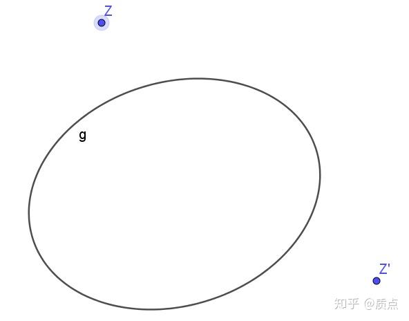
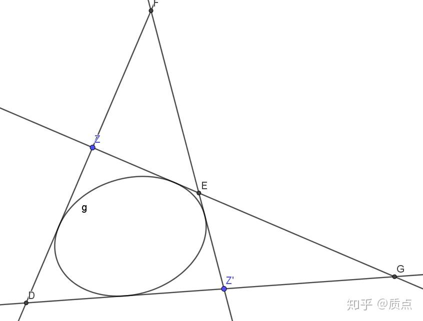
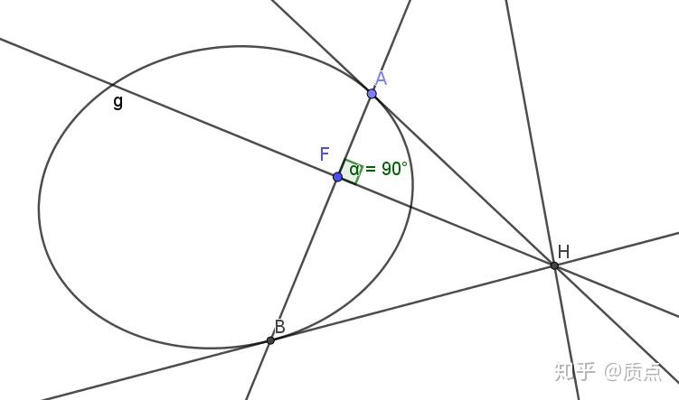
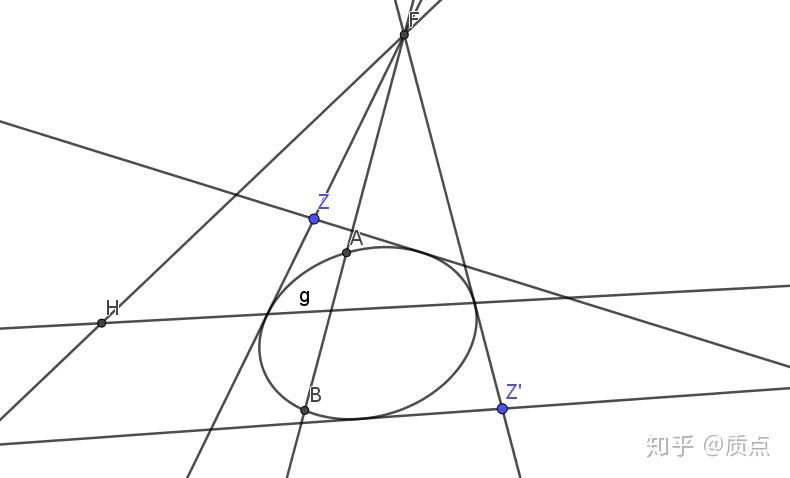
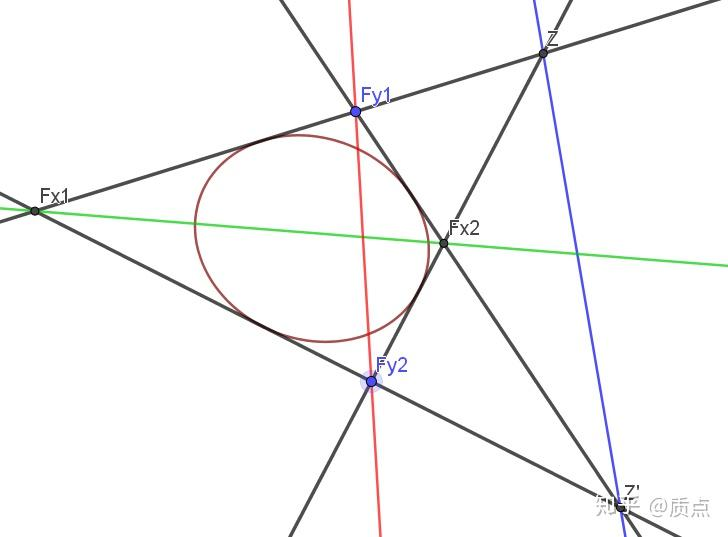
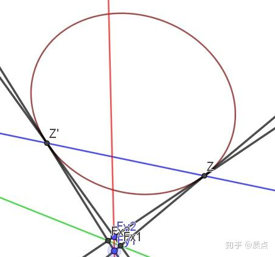

# 圆锥曲线第十二节：焦点和准线的射影几何性质

目录链接：质点：想整理一篇关于高中的圆锥曲线的文章

在“平行与正交”一节的末尾，我们提到正交张量可以用两个无穷远处的“复数点”的对称积构成， $\theta=(z\bar z)$ 。在通常的坐标下 $z^i=(1,i,0),\bar z^i=(1,-i,0)$ 。接下来，我们会经常使用这两个复数点。**限于我的水平，我不会处理含复数的点。因此在全文中，我将把这类点当作实数的点看待，并不管它的坐标是否是复数。经验证明，一般情况下它是否有虚部并没有什么影响。**

我们在这一节中考虑如何用三维矢量方法定义焦点和准线，这一定义会和我们在解析几何中使用的定义有所不同。**用三维矢量定义的焦点共有6个**，而解析几何中的焦点只有2个。这6个焦点中，有2个在无穷远，有2个坐标为虚数，只有剩下的2个我们可以在解析几何的平面内看见。剩下的这2个就是我们通常处理的焦点。

**定义：设**$g$**为圆锥曲线，**$\theta$**为垂直结构，则**$\text{det}(\theta^{ij}-\lambda g^{ij})=0$**称为焦点方程。**

我们先不管这个方程为什么叫做“焦点方程”，而是关心这个方程中哪些东西有几何意义（即，哪些东西是规范不变的）。**因为这个方程如此简单，我们几乎无法用更少的笔墨写下一个不平凡的方程，因此，这个方程必定有十分基本的意义**。

这个方程属于线性代数学中的特征值方程， $\lambda$ 称为特征值。在3维空间中， $\det$ 是3次的，因此这个方程是关于$\lambda$的3次函数，共有3个解。$\theta$是一个退化的张量， $\det \theta^{ij}=0$ ，因此明显 $\lambda=0$ 是其中的一个解。剩下的是一个二次方程，可以求出这两个解 $\lambda_1,\lambda_2$ ，不妨设 $\frac{\lambda_2}{\lambda_1}\leq1$ 。规范的选择可以使 $\theta,g$ 分别乘以任意的常数，这导致 $\lambda_1,\lambda_2$ 会随着规范变化。然而，比值 $\frac{\lambda_2}{\lambda_1}$ 却是规范无关的（因此它有几何意义），因此我们可以定义 $e=\sqrt{1-\frac{\lambda_2}{\lambda_1}}$ ，**称为圆锥曲线的离心率。**

$\lambda_1,\lambda_2$分别对应两个行列式为0的张量 $X^{ij}=\theta^{ij}-\lambda_1 g^{ij}$ , $Y^{ij}=\theta^{ij}-\lambda_2 g^{ij}$ （显然它们是规范无关的）。一个（2,0）型对称张量的行列式为0，意味着它能写成两个点的对称积，因此我们设 $X=(f_{X1} ,f_{X2}),Y=(f_{Y1},f_{Y2})$ ，并称 $f_{X1},f_{X2},f_{Y1},f_{Y2}$ 为圆锥曲线的焦点。类似地，因为$\theta=(z\bar z)$是 $\lambda=0$ 对应的张量，它和 $X,Y$ 的性质是相似的。于是我们把 $z,\bar z$ 也当作圆锥曲线的焦点。这样一来，**圆锥曲线有**$f_{X1},f_{X2},f_{Y1},f_{Y2},z,\bar z$**共6个焦点。这6个焦点两两配对，配对的焦点的对称积分别是**$X,Y,\theta$ 。

因为 $\det X^{ij}=0$ ，所以存在非零线矢 $x_{i}$ ，使得 $X^{ij}x_j=0$ 。 $x_{i}$ 在特征方程中是 $\lambda_1$ 对应的特征向量。利用在“直线与椭圆相交”一节的知识很容易看出， $x$ 的几何意义是 $f_{X1},f_{X2}$ 的连线，因此我们把 $x$ 称为圆锥曲线的 $x$ 主轴。同理， $\lambda_2$ 对应的特征向量 $y_i$ 使 $Y^{ij}y_j=0$ ，是 $f_{Y1},f_{Y2}$ 的连线，称为y主轴。 $\lambda=0$ 对应的特征向量 $l$ 要求 $\theta^{ij}l_j=0$ ，很明显，这正是无穷远直线 $l_{\infty}$ 。

我们重新叙述一下以上的结论：

**焦点方程是特征值方程，特征值**$\lambda$**有3个解**$\lambda_1,\lambda_2,0$**，**$e=\sqrt{1-\frac{\lambda_2}{\lambda_1}}$**称为离心率。每个特征值**$\lambda$**对应的特征向量称为主轴，分别记为**$x,y,l_{\infty}$**，分别称为x主轴、y主轴、无穷远直线，这三条直线两两关于椭圆共轭（可自行证明）。每个特征值**$\lambda$**对应一个退化二阶线束**$X,Y,\theta$**，其线束中心**$f_{X1},f_{X2},f_{Y1},f_{Y2},z,\bar z$**称为焦点。主轴是配对的焦点的连线。**

这条圆锥曲线当 $\frac{\lambda_2}{\lambda_1}>0$ 时称为椭圆， $\lambda_2=0$ 时称为抛物线， $\frac{\lambda_2}{\lambda_1}<0$ 时称为双曲线。特殊地，当 $\lambda_1=\lambda_2$ 时称为圆（即特征方程有重根）， $\lambda_1+\lambda_2=0$ 时称为等轴双曲线。

*注：*

*1.在这里，这三对焦点具有相似的地位。之后我们使用几何手段进行研究时，可以更明显地看到这一点。*

*2.我们目前讨论的是由垂直结构*$\theta$*引出的6个焦点。但是我们有时并没有一个垂直结构，而是随意给出两个点*$p,q$*。只要有这两个点，就可以构造它们的对称积*$(pq)$*，就可以写出方程*$\det(g^{ij}-\lambda(pq)^{ij})=0$*，用相同的方法进行构造。我们推广地说，这样构造出的6个点是*$p,q$*生成的焦点。*

*3.之前我们处理的是*$g^{ij},\theta^{ij}$*等（2,0）型张量。我们当然也可以处理（0,2）型张量，比如求解方程*$\text{det}(\theta_{ij}-\lambda g_{ij})=0$*。这个方程的特征值与*$\text{det}(\theta^{ij}-\lambda g^{ij})=0$*的特征值是相同的，我们从这个方程构造出的几何量也基本相同，无非是差了一个指标的升降而已。这里不作过多陈述，只说一点：**我们把焦点的极线称为准线**。准线自然也有3对，共6个，但是我们一般只能看到其中的一对。*

---

接下来我们用解析几何具体写出来这些点，来证明我们的定义与常规的定义是吻合的。

设椭圆 $\frac{x^2}{a^2}+\frac{y^2}{b^2}=1$ ，则 $g^{i j}=\left( \begin{array}{ccc}  a^2 & 0 & 0 \\  0 & b^2 & 0 \\  0 & 0 & -1 \\ \end{array} \right)$ 。因为 $\theta ^{i j}=\left( \begin{array}{ccc}  1 & 0 & 0 \\  0 & 1 & 0 \\  0 & 0 & 0 \\ \end{array} \right)$ ，所以 $\theta ^{i j}-\lambda  g^{i j}=\left( \begin{array}{ccc}  1-{\lambda }{a^2} & 0 & 0 \\  0 & 1-{\lambda }{b^2} & 0 \\  0 & 0 & \lambda  \\ \end{array} \right)$ ， $\det \left(\theta ^{i j}-\lambda  g^{i j}\right)=\lambda     \left(1-{\lambda }{a^2}\right) \left(1-{\lambda    }{b^2}\right)$ ，因此 $\lambda _1=\frac{1}{b^2},\lambda_2=\frac{1}{a^2}$ ，确实 $e=\frac{c}{a}=\sqrt{1-\frac{\lambda_2}{\lambda_1}}$ 。把 $\lambda _1=\frac{1}{b^2}$ 代入，得到 $X^{i j}=\left( \begin{array}{ccc}  -\frac{c^2}{b^2} & 0 & 0 \\  0 & 0 & 0 \\  0 & 0 & \frac{1}{b^2} \\ \end{array} \right)$ 。乘以常数后写成 $X^{i j}=\left( \begin{array}{ccc}  -2c^2 & 0 & 0 \\  0 & 0 & 0 \\  0 & 0 & 2 \\ \end{array} \right) =\left( \begin{array}{c}  c \\  0 \\  1 \\ \end{array} \right)\left( \begin{array}{ccc}  -c & 0 & 1 \\ \end{array} \right)+\left( \begin{array}{c}  -c \\  0 \\  1 \\ \end{array} \right)\left( \begin{array}{ccc}  c & 0 & 1 \\ \end{array} \right)$ 。因此它是两个点 $f_{X1}=(-c,0,1),f_{X2}=(c,0,1)$ 的对称积。因此，两个焦点的坐标分别是 $(-c,0),(c,0)$ 。这是我们所熟知的。

如果把 $\lambda _2=\frac{1}{a^2}$ 代入，会得到 $Y^{i j}=\left( \begin{array}{ccc}  0 & 0 & 0 \\  0 & \frac{c^2}{a^2} & 0 \\  0 & 0 & \frac{1}{a^2} \\ \end{array} \right)$ ，即 $Y^{i j}=\left( \begin{array}{ccc}  0 & 0 & 0 \\  0 & {2c^2} & 0 \\  0 & 0 & {2}\\ \end{array} \right)=\left( \begin{array}{c}  0 \\  ic \\  1 \\ \end{array} \right)\left( \begin{array}{ccc}  0& -ic & 1 \\ \end{array} \right)+\left( \begin{array}{c}  0 \\  -ic \\  1 \\ \end{array} \right)\left( \begin{array}{ccc}  0 & ic & 1 \\ \end{array} \right)$ 。因此 $f_{Y1}=(0,ic,1),f_{Y2}=(0,-ic,1)$ ，这两个焦点在y轴上，它们的直角坐标是 $(0,ic),(0,-ic)$ ，这是我们在解析几何中看不到的。无穷远处的$z^i=(1,i,0),\bar z^i=(1,-i,0)$自然也看不到。所以，解析几何中，我们通常考虑的焦点是在x轴上的两个焦点$(-c,0),(c,0)$。

---

我们现在的材料有 $g,z,\bar z$ ，如图。

**现在来研究如何用几何手段构造焦点**。我们从焦点方程出发，寻求 $\theta^{ij}-\lambda_1 g^{ij}=X^{ij}$ 的几何意义。最简单的方式是从曲线系入手。曲线系理论告诉我们，由两条曲线生成的曲线系必定经过这两条曲线的交点。 $\theta^{ij}-\lambda g^{ij}$也可以看成是 $\theta,g$ 生成的曲线系，只是略有区别（注意上下指标）： $\theta^{ij}$ 是退化二次线束（即经过 $z,\bar z$ 之一的所有直线）， $g^{ij}$ 是二次线束（即与圆锥曲线相切的所有直线），因此它们生成的曲线系不是过定点，**而是包含**$\theta,g$**共同含有的直线**。这些直线实际上就是下图的四条切线：

因此， $X^{ij}$ 也必定包含这四条直线。同时，因为 $\det X^{ij}=0$ ， $X$ 应该是一个退化二次线束。而这只有两种可能：或者由D、E两点构成，或者由F、G两点构成。而这恰好是 $\lambda_1,\lambda_2$ 对应的两对焦点。因此，如下说法都是正确的：

**1.**$z,\bar z$**关于圆锥曲线的切线相交于焦点。**

**2.过焦点作圆锥曲线的两条切线，它们分别经过**$z,\bar z$**。**

**3.圆锥曲线的四条切线交于6个点。在这6个点中，取一对不在同一直线上的点生成垂直结构，则这6个点成为焦点。**

有了这些作为工具之后，我们就可以仅仅连几条线而解决许多涉及到焦点的问题了。比如下面的例题：

**F是椭圆的焦点，过F作直线交椭圆于A、B，求证：A、B处的切线交于准线上的H点，且AF与FH垂直。***（其实我证是在考虑这个问题的时候想到焦点方程的）*

证明：因为H的极线AB经过F，所以F的极线经过H。故H在准线上。

因为AB的极点H在直线FH上，因此直线AB、FH关于椭圆共轭。这样一来，我们只需要证明：**过F点的两条直线共轭当且仅当它们垂直**。

因为涉及到虚交点等问题，我们改用之前的图。忽略椭圆，先只看点Z、Z'、H与直线ABF，由定义可以得知 $FH\bot FA$ 当且仅当 $FH,FA,FZ,FZ'$ 构成调和线束。接下来忽略Z、Z'，只看椭圆和F、H、直线FAB，由“交比、对合与调和点列”一节的内容可知， $FH,FA$ 共轭当且仅当它们与F点到椭圆的两条切线形成调和点列。而这里**因为F是焦点，这两条切线恰好就是**$FZ,FZ'$ 。所以“$FH\bot FA$”自然和“$FH,FA$ 共轭”是等价的。

我们现在来粗略看一下离心率 $e$ 在图中的体现。我们在“二次点列与二次对合”一节熟知，椭圆的四条切线可以进行交比；空间中任意两点 $p,q$ 可以计算 $<p,q>_g$ ；这些都是有几何意义的实数。因为有垂直结构的圆锥曲线唯一的参量就是它的离心率，因此它们都和离心率有关。我们借用坐标系来计算。

$z^i=(1,i,0),\bar z^i=(1,-i,0)$ 因此 $<z,\bar z>^2=\frac{(\frac{1*1}{a^2}+\frac{i*(-i)}{b^2}+0)^2}{(\frac{1*1}{a^2}+\frac{i*(i)}{b^2}+0)(\frac{1*1}{a^2}+\frac{(-i)*(-i)}{b^2}+0)}=(\frac{a^2+b^2}{a^2-b^2})^2$

$<f_{X1},f_{X2}>^2=\frac{(\frac{c(-c)}{a^2}+\frac{0}{b^2}-1)^2}{(\frac{c^2}{a^2}+\frac{0}{b^2}-1)(\frac{(-c)^2}{a^2}+\frac{0}{b^2}-1)}=(\frac{a^2+c^2}{a^2-c^2})^2$

$<f_{Y1},f_{Y2}>^2=\frac{(\frac{0}{a^2}+\frac{ic(-ic)}{b^2}-1)^2}{(\frac{0}{a^2}+\frac{ic^2}{b^2}-1)(\frac{0}{a^2}+\frac{(-ic)^2}{b^2}-1)}=(\frac{b^2-c^2}{b^2+c^2})^2$

设过Z、Z’两点的各两条切线得到的交比（即直线 $ZF_{X1},ZF_{X2};Z'F_{X1},Z'F_{X2}$  的交比）为 $J_\theta$ ，则可利用第十节附录给出的公式： $<m,n>^2=(\frac{J_\theta+1}{J_\theta-1})^2$ 得到 $J_\theta=\frac{b^2}{a^2}=1-e^2=\frac{\lambda_2}{\lambda_1}$ 。类似地，把上述Z、Z’换成FX1，FX2以及FY1，FY2，可以得到 $J_X=e^2,J_Y=1-e^{-2}$ 。因此我们直观地看到了离心率的体现。

我们可以考虑几个特殊情况。当 $J_\theta=-1$ （成调和线束）时，对应 $e=\sqrt{2}$ ，这是等轴双曲线。当 $J_\theta=0$ 时，直线 $F_{Y1}F_{X2},F_{Y2}F_{X2}$ 重合， $F_{X2}$ 位于圆锥曲线上，圆锥曲线与无穷远直线相切。这对应 $e=1$ ，是抛物线；当 $e=0$ 时， $z,\bar z$ 均位于圆锥曲线上，这时它到椭圆的两条切线退化成一条，四个焦点重合到圆锥曲线的中心（即无穷远直线的极点），这是圆。

想象一下如何把长轴在x轴上的椭圆沿水平方向捏成一个长轴在y轴上的椭圆：最初，x轴上有两个实焦点，y轴上有两个虚焦点；当离心率被压缩得越来越小时，这四个焦点同时向原点接近；当离心率变成0时，四个焦点聚到一起；继续压缩时，四个焦点开始分开，但x轴上的焦点变成虚焦点，y轴上的焦点变成实焦点了。

圆锥曲线和它的六个焦点。黑线是四条切线

接近圆时，四个焦点聚集到了一起

*在这一节里，我们使用三维矢量以及射影几何的手段构造了椭圆的6个焦点和6条准线。这种手段能简单地处理某些解析几何中复杂的结论，但处理某些解析几何中最简单的东西却十分棘手（比如说椭圆的第一定义和第二定义）。因此，这一节的目的是提供有关焦点的平台与大致图像，而它具体能解决什么问题还需要进一步讨论。*

*举一个例子：如果我们有两个椭圆*$g,h$*，我们可以构造焦点方程*$\det(g-\lambda h)=0$*，这个方程的解会产生这两个椭圆的公共焦点。另外一方面，如果我们有椭圆*$g$*及其4条切线、6个焦点，那么**所有与***$g$***的4条切线均相切的椭圆***$h$***会和***$g$***有共同的焦点**。**这可能是一个很好的研究共焦点椭圆的方法**。据我所知，处理共焦点椭圆可以使用椭圆坐标或者双曲函数，然而这些都是函数的角度。从线性代数*$\det(g-\lambda h)=0$*的角度以及几何的角度或许能作为一个很好的补充。*

目录链接：质点：想整理一篇关于高中的圆锥曲线的文章
