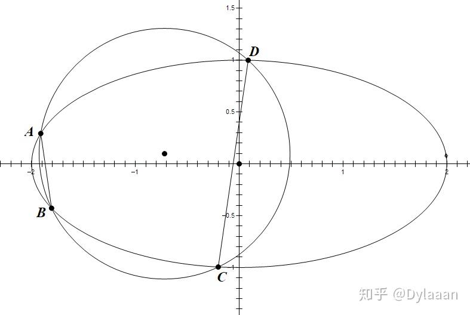
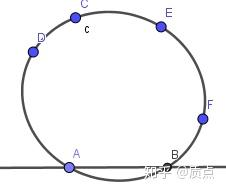
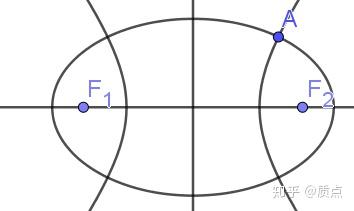
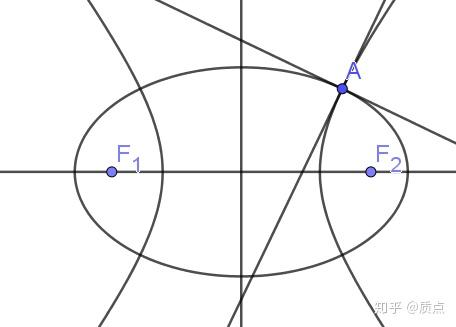
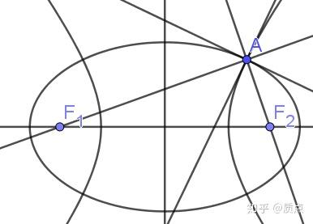
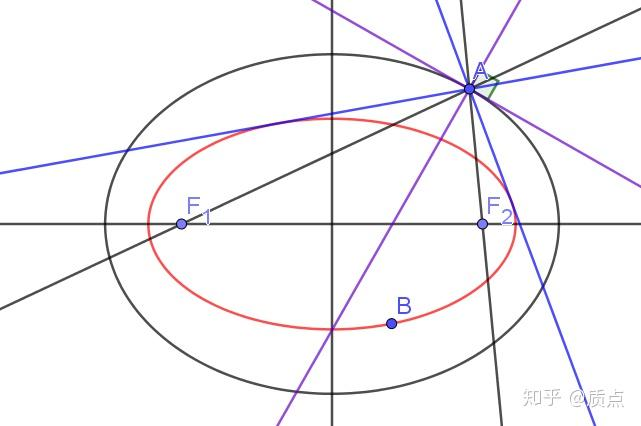
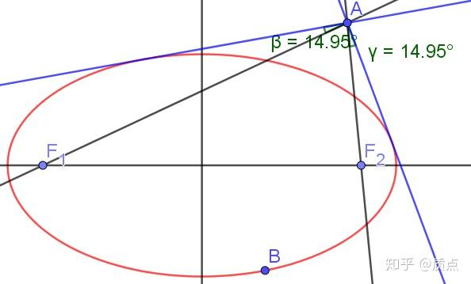

# 圆锥曲线第十三节：曲线系、笛沙格对合定理与圆锥曲线光学性质

目录：质点：圆锥曲线题目的三维矢量解法

*在这篇文章中，我们用三维矢量方法继续寻找部分和焦点相关的性质，而它们粗看起来是不能用射影几何解答的。*

我们首先给出曲线系的概念。在解析几何中灵活地使用曲线系可以大幅简化计算，这些技巧可以在很多辅导书中找到，因此我仅仅给出必要的概念，而不介绍这些技巧。

**1.设 $g,h$ 为不同的二次点，则所有形如 $g+\lambda h$ 的二次点构成的集合称为 $g,h$ 生成的二次点系。其中 $\lambda$ 不仅可以取所有实数，还可以取 $\infty$ （这是为了确保 $h$ 在这个集合中）**

**2.设 $g,h$ 为不同的二次线，则所有形如 $g+\lambda h$ 的二次线构成的集合称为 $g,h$ 生成的二次线系。其中 $\lambda$ 不仅可以取所有实数，还可以取 $\infty$**

**3.二次点系与二次线系 统称二次曲线系**

请注意，并不是任意一些圆锥曲线的集合就算作曲线系，因为集合中的元素必须满足定义中的形式。此外，二次点系与二次线系是有区别的，这是因为 $(g+\lambda h)^{-1}\ne g^{-1}+\lambda h^{-1}$ 。如果 $l$ 是 $g,h$ 的公切线，即  $g^{ij}l_il_j=h^{ij}l_il_j=0$ ，那么对任意 $\lambda$ ，$(g^{ij}+\lambda h^{ij})l_il_j=0$ ，这说明**二次点系具有共同的切线**；如果 $a$ 是$g,h$ 的交点  $g_{ij}a^ia^j=h_{ij}a^ia^j=0$ ，那么对任意 $\lambda$ ，$(g_{ij}+\lambda h_{ij})a^ia^j=0$ ，这说明**二次线系过某些定点**。这两个性质显然在几何上是不同的。

也可以这么表述：在二次点系中，如果有两条曲线相切于一条直线，那么所有的直线都得和它相切；在二次线系中，如果有两条曲线均经过一点，那么所有的曲线都得经过这一点。

“切于定直线”、“过定点”给出了二次曲线系的必要条件。另一方面，它也可以给出二次曲线系的充分条件（用线性代数很容易证明它们）：

**相切于四条定直线的所有二次点构成二次点系。**

**经过四个定点的所有二次线构成二次点系。（这四个点不能共线）**

在应用中，我们口中的“曲线系”一般指“二次线系”（它比“二次点系”更常用一些）。对两个圆锥曲线 $g,h$ ，它们的方程分别写为 $G(x,y)=0$ 和 $H(x,y)=0$ ，可以用这两个方程构造出新的方程： $G(x,y)+\lambda H(x,y)=0$ 。当 $\lambda$ 变化时，这一系列的方程描述的正是 $g,h$ 生成的二次线系。*这一内容的详细介绍在很多辅导书上都有，因此此处跳过。*

相切于四条定直线的“二次点系”不太直观，因此在解析几何中并不常用。它主要的应用是共焦曲线系：

**所有以 $f_1,f_2$ 为焦点的圆锥曲线构成二次点系，称为共焦曲线系。共焦曲线系中的元素可以写成 $g^{ij}=X^{ij}+\lambda \theta^{ij}$ 的形式。其中 $X=(f_1f_2),\theta=(z\bar z)$ 。**（见*质点：圆锥曲线第十二节：焦点和准线的射影几何性质*的原文）

我们举个例子来看一下曲线系的应用。比如，考虑一个椭圆和一个圆生成的曲线系：

Dylaaan：【解析几何】圆锥曲线中四点共圆的优美性质

**定理** (椭圆上四点共圆的充要条件)椭圆 $\Gamma:\frac{x^2}{a^2}+\frac{y^2}{b^2}=1$ 上四点 $A$ 、 $B$ 、 $C$ 、 $D$ 共圆的充要条件是 $k_{AB}+k_{CD}=0$ ．

把 $x,y$ 方向上的无穷远点分别记为 $x_{\infty},y_{\infty}$ 。椭圆记为 $g$ ，圆记为 $h$ 。则 $g_{ij}x_{\infty}^iy_{\infty }^j=0$ 并且 $h_{ij}x_{\infty}^iy_{\infty}^j=0$ 。直线 $AB,CD$ 的对称积具有 $f=g+\lambda h$ 的形式，因此 $f_{ij}x_{\infty}^iy_{\infty}^j=0$ 。于是x轴上的无穷远点与y轴上的无穷远点关于这两条直线（交点的连线）形成调和线束，因此斜率之和为0.

---

现在我们来介绍 Desargues对合定理：

**过四个定点的所有圆锥曲线与一条定直线相交于互相对合的两点**。

详细的描述是： $C,D,E,F$ 为四个定点， $l$ 是一条定直线。我们可以作一族圆锥曲线经过 $C,D,E,F$ 四个定点，这族圆锥曲线与 $l$ 交于两个动点 $A,B$ 。则存在 $l$ 上的一个对合变换 $f$ ，使得 $A,B$ 关于 $f$ 对合。如果圆锥曲线与直线相切，则切点是对合的不动点。

我们通过一系列的改写来证明这一定理。我们已经证明，过四个定点的所有圆锥曲线是二次线系的充分必要条件（我们在复数范围内他讨论，使得任意两条圆锥曲线都有四个交点）。因此Desargues对合定理可以改写成：

**二次线系与一条定直线相交于互相对合的两点**。

我们设这一二次线系为 $g_{ij}+\lambda h_{ij}$ 。我们在“交比、对合与调和点列”一节讲过，三维矢量空间（0,2）型张量可以通过**限制**映射为子空间上的（0,2）型张量，并且**这一映射是线性的**。我们设 $g,h$ 在限制映射后的像分别为 $g',h'$ ，则二次线系中的所有元素在限制映射后的像为 $g'_{ij}+\lambda h'_{ij}$ （这里利用了映射的线性）。请回忆，圆锥曲线在一条直线上的限制是它与这条直线的两个交点的对称积。因此，我们有 $g'_{ij}+\lambda h'_{ij}=a_ib_j+a_jb_i$ ，或 $g'+\lambda h'=(ab)$ ，其中 $a_i=\epsilon_{ij}a^j，b_i=\epsilon_{ij}b^j$ ， $\epsilon$ 是直线上的反对称张量。因此，如果我们要证明Desargues对合定理，我们只需要证明：

**设$g',h'$ 是二维矢量空间上的（0,2）型对称张量，设两点 $a,b$ 使得 $g'+\lambda h'=(ab)$**

（我们可以这么设，是因为二维矢量空间上的任意对称张量都可以唯一地写为对称积的形式）**，则 $a,b$ 满足一个对合关系。**

**$a,b$ 满足对合关系当且仅当存在 $f^{ij}$ 使得 $f^{ij}a_ib_j=0$ 对任意满足 $(ab)=g'+\lambda h'$ 的 $a,b$ 都成立。而$f^{ij}a_ib_j=0$可以改写为 $f:(ab)=0$ ，即 $f:(g+\lambda h)=0$ 。它对于任意 $\lambda$ 成立，当且仅当 $f:g=0$ 且 $f:h=0$ 均成立。**

而方程组$f:g=0$ 且 $f:h=0$ 的解是存在的： $f=(g\cdot \epsilon\cdot  h)$ ，其中的小括号表示对称化操作，完整的表达式为 $f_{il}=g_{ij}\epsilon^{jk}h_{kl}+g_{lj}\epsilon^{jk}h_{ki}$ （可以自行验证这个解是正确的）。因此我们证明了Desargues对合定理。

回顾一下我们的证明过程。定理的原始表述是非常几何化的，并且含有 $a,b,c,d$ 非常多的待定元素，我们的第一个步骤是利用曲线系的性质把它代数化，同时减少了待定元素的个数。

代数化的好处体现在第二个步骤，它便于表述限制映射，来把平面上的曲线系转化为直线上的“曲线系”，大大减少了多余的几何元素。

在第三个步骤中，利用直线上“曲线系”的线性性质，把无数个等式转化为两个等式，并求出它们的解，就完成了。

我们在第三个步骤中证明的结论是比较漂亮的，这里换种语言重新表述一遍：

**设 $c,d,s,t$ 是直线上的四点，则存在一个对合变换 $f$ 使得 $c,d$ 互相对合且 $s,t$ 互相对合。对直线上任意两点 $a,b$ ，它们关于 $f$ 对合的条件是存在 $\lambda$ 使得 $(ab)=(cd)+\lambda(st)$ 。**

**特殊地，设** $p,q$ **为直线上的两点， $f$ 为以它们为不动点的对合变换，则对直线上任意两点**$a,b$**，它们关于**$f$**对合的条件是存在**$\lambda$**使得**$(ab)=pp+\lambda qq$。

我们如果把笛沙格对合定理中的点改成线，线改成点，就可以得到它的对偶命题：

**一个定点到 与四条定直线相切的所有圆锥曲线 的两条动切线是对合的。如果这条圆锥曲线经过这个定点，那么此时的切线是对合的不动点。**

以及用曲线系的表述：

**定点到二次点系的两条动切线是对合的。如果二次点系中的某条圆锥曲线经过这个定点，那么此时的切线是对合的不动点。**

共焦曲线系作为二次点系的重要特例，对应地有

## **定点到共焦曲线系的两条动切线是对合的。**如果其中某条圆锥曲线经过这个定点，那么此时的切线是对合的不动点。

## **这是一个重要的结论，我们可以据此得到焦点的一系列性质！**

---

现在考虑如下的场景。我们有x轴上的两个点 $f_1,f_2$ 以及x轴外的一点 $a$ ，我们要讨论以这两个点为焦点的圆锥曲线 $g$ 的性质（自然同时包括椭圆和双曲线）。

根据我们已经证明的结论， $a$ 到 $g$ 的两条切线是对合的，而对合必有两个不动点。因此，以$f_1,f_2$为焦点的圆锥曲线中，一定有两条经过 $a$ 的。根据常识，这两条中一条是椭圆，一条是双曲线，如图：

在 $A$ 点可以分别作这两条圆锥曲线的切线。设椭圆的切线为 $p$ ，双曲线的切线为 $q$ ，

则 $p,q$ 是对合变换的不动点。对于形如 $g=(f_1f_2)+\lambda \theta$ 的任意圆锥曲线， $a$ 到它的两条切线 $m,n$ 是对合的。我们知道，对合的两点被对合的不动点调和分割。因此 $p,q,m,n$ 构成调和线束。这个条件也可以等价地写为 $g:(pq)=0$ 。

现在我们取 $\lambda=\infty$ ，则 $g=\theta$ （第一项太小，被忽略了）。因为 $a$ 到 $\theta$ 的切线难以画出，因此我们使用$g:(pq)=0$这个条件，而它此时等价于 $\theta^{ij}p_iq_j=0$ 。回忆“平行与正交”一节中的内容，它意味着 $p,q$ 两条直线垂直。因此我们得到：

**对于定点 $A$ ，以 $F_1,F_2$ 为焦点的圆锥曲线中，有一个椭圆和一个双曲线经过 $A$ 点，且它们在 $A$ 点处的切线相互垂直。**

**接下来我们取** $\lambda=0$ ，即 $g=(f_1f_2)$ ，这时 $a$ 到 $g$ 的两条切线分别是 $AF_1,AF_2$ ，它们应该和 $p,q$ 成调和点列。不难证明欧式几何中的如下结论：**如果 $p,q,r,s$ 是共点的直线，且 $p\bot q$ ，那么 $p,q,r,s$ 成调和点列当且仅当 $p,q$ 均为直线 $r,s$ 的角平分线**。把这个结论应用到我们的问题上，就可以得到以下结论：

**若 $A$ 在以 $F_1,F_2$ 为焦点的椭圆上，则 $A$ 点处的法线平分 $\angle F_1 AF_2$ 。**

**若 $A$ 在以 $F_1,F_2$ 为焦点的双曲线上，则 $A$ 点处的法线平分 $\angle F_1 AF_2$ 的补角。**

在物理上它对应如下事实：如果从一个焦点发出的光经过椭圆反射后，反射光必定会聚于另一个焦点；如果从一个焦点发出的光经过双曲线反射后，反射光的反向延长线必定会聚于另一个焦点。

接下来我们放开 $\lambda$ 的取值，把 $g$ 取为如下的椭圆（用红色表示）。 $a$ 到 $g$ 的切线用蓝色表示， $p,q$ 用紫线表示。

出于同样的原因，紫线是两条蓝线的角平分线。而我们已经证明过，紫线是两条黑线的角平分线。结合这两点，我们得到：

**设 $A$ 为椭圆外一点，如图作它与两个焦点的连线，以及它到椭圆的两条切线，则图中形成的两个角相等。**

*这个结论很容易记忆，但却没几个老师给我讲过它....真是奇怪....*

---

最后指出关于曲线系的一个结论。我觉得把这个结论放在任何一处都会打断文章的思路，于是我只好把它放在文章的末尾顺带提一句。这个结论的证明留作习题。

经过 $a,b,c,d$ 四点的曲线系中包含3条退化圆锥曲线，这三条圆锥曲线均可写成四点两两连线的对称积。

这个曲线系可以用如下方式生成： $g=((a\times d),(b\times c))+\lambda((a\times c),(d\times b))$ 。它由2条退化圆锥曲线生成。

上式中的 $\lambda$ 是有几何意义的：其几何意义是 $a,b,c,d$ 四点在 $g$ 上的交比。

当 $\lambda=-1$ 时$a,b,c,d$构成 $g$ 上的调和点列；当 $\lambda=1$ 时， $g$ 是第3条退化二次曲线 $((a\times b),(c\times d))$ 。

目录：质点：圆锥曲线题目的三维矢量解法
