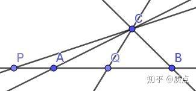
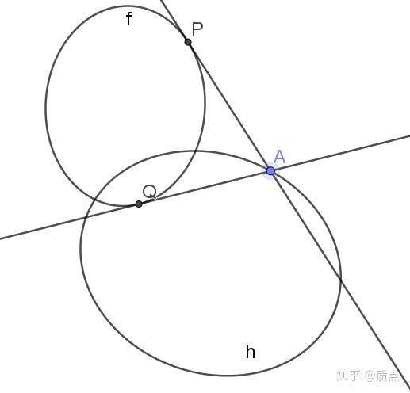
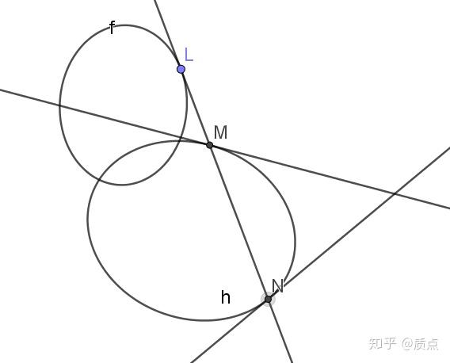
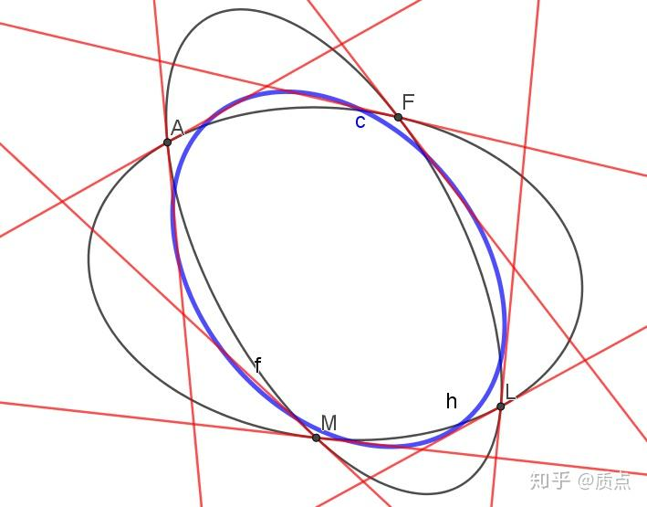
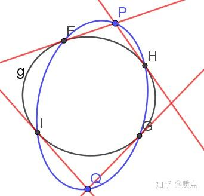
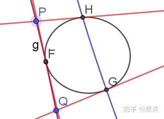
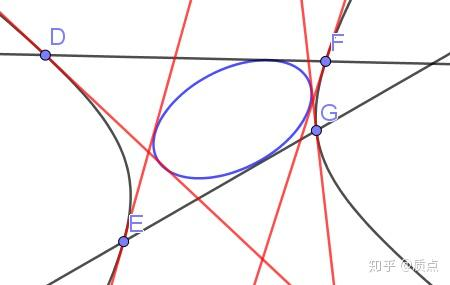
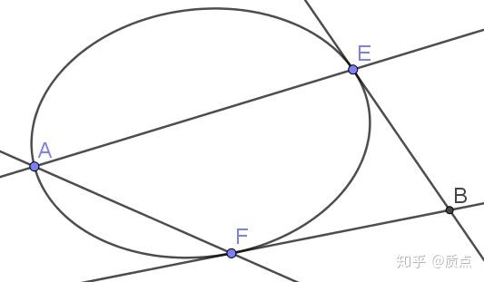
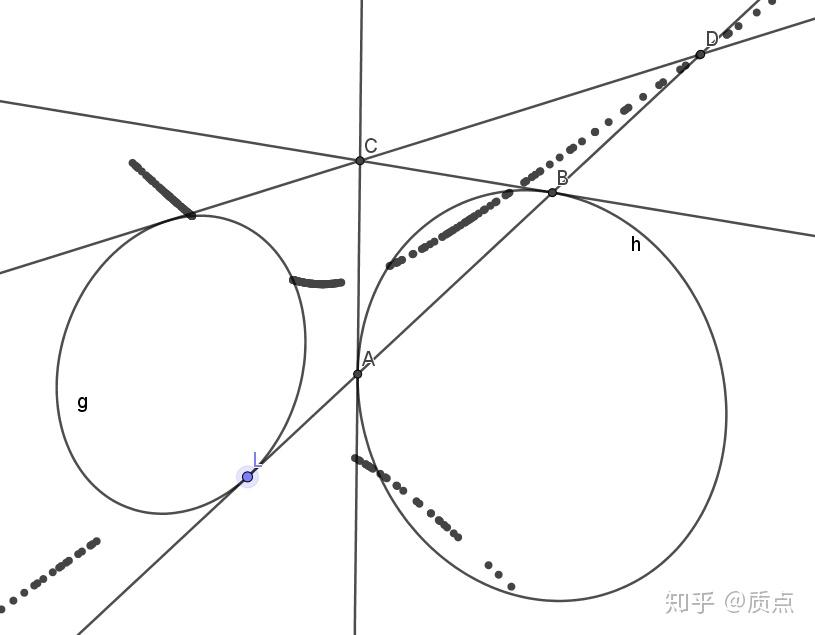
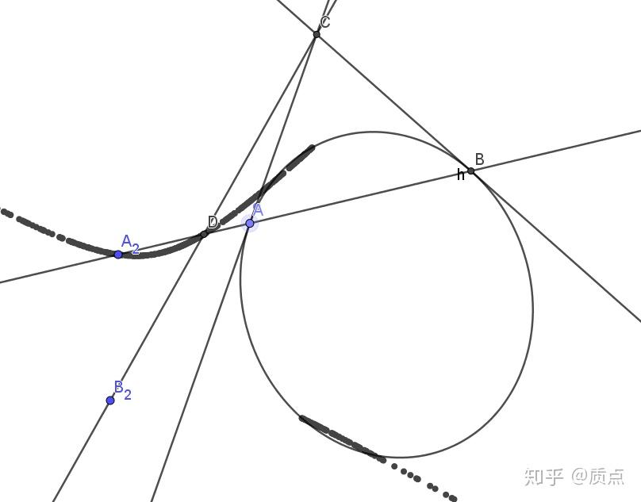

# 圆锥曲线第十四节：二次点乘与二次叉乘

目录：

我们在第八节中已经涉及到了“二次点”和“二次线”（它们统称二次曲线）的概念，我们现在要更深入地讨论它们。在这一节中我们将不选取度规，因此对（0,2）型张量与（2,0）型张量会进行明确的区分。

我们把形如 $l_{ij}=l_il_j$ 的二次线称为I型二次线，形如 $h_{ij}=a_ib_j+a_jb_i$ 的二次线称为II型二次线，把不可逆的 $g_{ij}$ 称为III型二次线。对二次点同理。

二次曲线和点、线相比有更加丰富的运算。我们接下来讨论其中的两个运算，它们分别是点乘与叉乘的推广。我们将讨论它们的代数等式及几何意义：

**设**$h_{ij}$**为二次线，**$f^{ij}$**为二次点，则它们之间的二次点乘**$f:h=h:f$**为实数，定义为**$f:h=h:f=f^{ij}h_{ij}$**。若** $f:h=0$ **，称二次点**$f$**在二次线**$h$**上。**

**设**$f_{ij},h_{ij}$**为二次线，则它们之间的二次叉乘** $f\times h$ **为二次点，定义为**$(f\times h)^{kl}=\epsilon^{imk}\epsilon^{jnl}f_{ij}h_{mn}$ （可自行验证，这样得到的张量仍然是**对称**张量）

**设**$f^{ij},h^{ij}$**为二次点，则它们之间的二次叉乘** $f\times h$ **为二次线，定义为**$(f\times h)_{kl}=\epsilon_{imk}\epsilon_{jnl}f^{ij}h^{mn}$

其中反对称张量 $\epsilon$ 的非零分量都取正负1，而这就导致它依赖于坐标系。但实际上，它对坐标系的依赖并不明显，唯一的表现是我们有时会用到（0,2）型与（2,0）型张量的行列式。而只有（1,1）型张量的行列式才不依赖于坐标系。

如果我们只讨论I型二次曲线，就能看出来二次点乘与二次叉乘分别是点乘与叉乘的推广： $aa:ll=(a\cdot l)^2$ ， $(aa\times bb)_{ij}=(a\times b)_i(a\times b)_j$ 。即，如果 $a$ 在 $l$ 上，那么 $aa$ 在 $ll$ 上；两个点对应的二次点的二次叉乘等于两个点叉乘对应的二次线。点、线的点乘、叉乘与I型二次曲线的二次点乘、二次叉乘之间是同构的。

---

叉乘满足反交换律，但二次叉乘却满足交换律： $f\times h=h\times f$ ，这是因为在二次叉乘的定义式中有两个反对称张量，交换 $f,h$ 时它们同时产生负号，于是便抵消了。

三个二次点或三个二次线之间可以定义混合积 $(f\times g):h$ 。在三维矢量间，交换混合积中元素的顺序时有时需要变号，有时不需要。而在二次曲线的混合积中，可以任意交换混合积的顺序而不变号！具体地说， 比如对三个二次线，$(f\times g):h=(g\times f):h=(g\times h):f=(h\times g):f=(h\times f):g=(f\times h):g=\epsilon^{imk}\epsilon^{jnl}f_{ij}h_{mn}g_{kl}$ 。

反交换律被交换律代替，最重要的影响就是不再有 $g\times g=0$ 了，而是 $g\times g=(2\det g)g^{-1}$ ：对于可逆的二次曲线，和自己叉乘竟然可以得到自己的逆！

之后的一些等式需要用到以下公式：

$g_{il}\epsilon^{ijk}\epsilon^{lmn}=(\det g)((g^{-1})^{jm}(g^{-1})^{kn}-(g^{-1})^{jn}(g^{-1})^{km})$

这个等式是 $\epsilon^{ijk}\epsilon_{imn}=\delta^j_m\delta^k_n-\delta^j_n\delta^k_m$ 的推广（只要将 $g$ 作为度规，就可以看出这一点）

**二次叉乘中含有两个**$\epsilon$**，这时它们可以同时消去并留下来一个行列式函数作为系数**。因此，二次叉乘可以用逆以及缩并等张量运算表示出来（用刚介绍的等式证明），表达式有些复杂，是

$g\times h=((g^{-1}:h)g^{-1}-g^{-1}\cdot h\cdot g^{-1})\det g=((h^{-1}:g)h^{-1}-h^{-1}\cdot g\cdot h^{-1})\det h$

或者也有公式：

$(\det g)f\times h=(f:g)(h:g)g+(g\cdot f\cdot g\cdot h\cdot g)-(f:g)g\cdot h\cdot g-(h:g)g\cdot f\cdot g-\text{tr}(g\cdot f\cdot g\cdot h)g$ ，其中 $ g$ 是任意张量。

虽然这个等式很复杂，但用它可以证明出一些形式简单一些的等式，其中一个正是上文的$g\times g=(2\det g)g^{-1}$。其他等式还有

$(g\times h):g=(2\det g)g^{-1}:h$（这个等式可以用混合积的交换性立即得到）

$(g\times h)\times g^{-1}=(h:g^{-1})g+h$

$(g\cdot A\cdot g)\times g=(\det g)((A:g)g^{-1}-A)$

二重外积公式也变得更复杂了一些：

$(g\times h)\times f=((g:f)h-g\cdot f\cdot h)+((h:f)g-h\cdot f\cdot g)$

以下这个等式是正确的，它体现了点与线的对偶性。

$(g\cdot f\cdot g)\times (g\cdot h\cdot g)=g^{-1}\cdot (f\times h)\cdot g^{-1}(\det g)^2$

---

现在我们研究一下这个问题：对于一个二次点 $f$ 和二次线 $h$ ，“ $f$ 在 $h$ 上”直观上表明它们具有怎样的几何关系？

如果 $f=aa$ 是I型二次点，那么几何关系就是 $a$ 在 $h$ 对应的曲线上（圆锥曲线、两条直线或一条直线），这是我们早就研究过的。

如果 $f=(ab)$ 是II型二次点， $h=ll$ 是I型二次线，那么$f:h=0$意味着 $(a\cdot l)(b\cdot l)=0$ ，即 $l$ 通过 $a,b$ 之一。

如果 $f=(ab)$ 是II型二次点， $h=(mn)$ 是II型二次线，那么 $f:h=0$ 意味着它们之间有调和点列的关系。如图，f是A、B两点的对称积，h是CP、CQ两线的对称积，则$f:h=0$等价于 $A,B,P,Q$ 成调和点列，或 $CA,CB,CP,CQ$ 成调和线束。自然，也可以从对合变换的角度进行理解。

如果$f=(ab)$ 是II型二次点， $h$ 是III型二次线（圆锥曲线），则 $f:h=0$ 等价于 $h_{ij}a^ib^j=0$ ，即 $a,b$ 关于 $h$ 共轭，或者说 $a,b$ 两点互在对方的极线上。

如果 $f$ 是III型二次点（圆锥曲线）， $h=ll$ 是I型二次线，则 $f:h=0$意味着 $l$ 与圆锥曲线相切。

如果 $f$ 是III型二次点（圆锥曲线）， $h=(mn)$ 是II型二次线，则 $f:h=0$意味着 $m,n$ 关于 $f$ 共轭，或者说它们互相穿过对方的极点。

如果 $f$ 是III型二次点， $h$ 是III型二次线，那 $f:h=0$ 的意义似乎并不很明显。为了寻找它的几何意义，我们在 $h$ 上取一点 $a$ ，再过 $a$ 作 $f$ 的两条切线，切于 $p,q$ 。按照我们在“退化圆锥曲线”一节学到的公式，有 $(pq)=(a\cdot f^{-1}\cdot a)f-a a$ ，因此 $h:(pq)=(a\cdot f^{-1}\cdot a)h:f-h:a a$ 。因为 $a$ 在 $h$ 上，自然有 $h:aa=0$ 。如果 $a$ 不在 $f$  上，那么 $(a\cdot f^{-1}\cdot a)\ne 0$ ，这时 $h:f=0$ 当且仅当 $h:(pq)=0$ ，即 $p,q$ 关于 $h$ 共轭。整理一下语言，我们有：

$f$**是III型二次点，**$h$**是III型二次线，取点**$a$**在**$h$**上但不在**$f$**上。则**$a$**到**$f$**的两条切线的切点关于**$h$**共轭当且仅当**$f:h=0$

类似地，

$f$**是III型二次点，**$h$**是III型二次线，取线**$l$**切于**$f$**但不切于**$h$**。则**$l$**和**$h$**的两个交点的切线关于**$f$**共轭当且仅当**$f:h=0$

再次强调， $f^{ij}h_{ij}=0$ 并不意味着 $(f^{-1})_{ij}(h^{-1})^{ij}=0$ 。

---

现在我们来讨论两个二次曲线叉乘的几何意义。我们的讨论以二次点的叉乘为主。

设 $f=aa$ 为I型二次点， $h=(bc)$ 为II型二次点，则 $f\times h=aa\times (bc)=(a\times b)(a\times c)+(a\times c)(a\times b)=((a\times b),(a\times c))$ ，即 $h$ 的两个点分别与 $f$ 对应的点连线所得到的两条直线形成的二次线。

设 $h=aa$ 为I型二次点， $g$ 为III型二次点（圆锥曲线）。利用公式 $g\times h=((g^{-1}:h)g^{-1}-g^{-1}\cdot h\cdot g^{-1})\det g$ ，并把 $g$ 作为度规以简化代数式，得到 $g\times aa=a^2g-aa$ ，**这是II型二次线：如同我们在“退化二次曲线”一节讨论过的，它是过点**$a$**作两条**$g$**的切线的对称积**。如果 $a$ 在 $g$ 上，两条切线重合，它再退化成I型二次线。

设 $f=(ab),h=(cd)$ 均为II型二次点，则 $f\times h=(a\times c)(b\times d)+(b\times d)(a\times c)+(a\times d)(b\times c)+(b\times c)(a\times d)\\=((a\times d),(b\times c))-((a\times c),(d\times b))$ 其中第二步把它化成了对称积的形式。这是由 $((a\times d),(b\times c)),$ $((a\times c),(b\times d))$两条退化二次线生成的圆锥曲线系，参数 $\lambda=-1$ 。可以证明这个曲线系的特点： $a,b,c,d$ 四点在 $\lambda$ 对应的圆锥曲线上的交比正是 $\lambda$ ——这意味着这四点形成了二次调和点列。因此结论是：

**设**$f=(ab),h=(cd)$**均为II型二次点，则**$f\times h$**是这样一条圆锥曲线：它经过**$a,b,c,d$**四点，且**$a,b$**与**$c,d$**关于这条圆锥曲线构成二次调和点列。**

这一结论可以利用混合积的性质轻易地证明。设 $p$ 在 $f\times h$ 上，则 $(f\times h):pp=0$ 。运用混合积的交换性，把它改写为 $(f\times pp):h=0$ ，即 $((ab)\times pp):(cd)=0$ 。这涉及到I型二次点与II型二次点的叉乘，这是我们已经讨论过的，因此上式等价于 $((p\times a),(p\times b)):(cd)=0$ ，即 $p\times a,p\times b,p\times c,p\times d$ 四条线构成调和线束。我们在“二次点列与二次对合”一节讲过，当且仅当 $p$ 在 $g$ 上时， $g$ 上四点的交比等于这四点与 $p$ 连线的交比。因此满足以上条件的 $p$ 在使得 $a,b,c,d$ 构成调和点列的二次曲线上。证毕。

可以自行讨论两个特殊情况：1. $a,c$ 两点重合。2. $a,b,c$ 三点共线。这里略去。

设 $g,h$ 均为III型二次点（圆锥曲线），则 $a$ 在$g\times h$ 上意味着 $(g\times h):aa=0$ ，即 $(g\times aa):h=0$ 。前者我们已经讨论过，它是从 $a$ 到 $g$ 的两条切线。这两条切线关于 $h$ 共轭，等价于它们与$a$ 到 $h$ 的两条切线形成调和点列。因此结论是：

**设**$g,h$**均为III型二次点，则**$g\times h$**是这样一条圆锥曲线：**$a$**在**$g\times h$**上当且仅当**$a$**到**$g$**和**$h$**的四条切线形成调和线束。**

这条曲线具有奇妙的几何性质。我们看下面的图：

两条黑色的椭圆分别是 $g,h$ ，红色的线是它们的四条公切线，产生8个切点。从图上看，这8个切点在同一条圆锥曲线上，我们可以证明它正是二次点的叉乘 $g\times h$ ：设 $a$ 在 $g$ 上，则 $g\times aa$ 是 $a$ 点处的切线对应的I型二次线。如果 $a$ 又在 $g\times h$ 上，那么 $(g\times h):aa=0$ ，即 $(g\times aa):h=0$ 。这一等式成立当且仅当 $g\times aa$ 对应的切线与 $h$ 相切。证毕。因此我们得到了以下结论：

**设**$g,h$**为两条圆锥曲线，它们有4条公切线，产生8个切点，则存在一条圆锥曲线同时经过这8个点，它的代数表达式正是**$g\times h$**（作为二次点的叉乘）。**

**要确定一条圆锥曲线需要5个点。现在我们有8个点，竟然能同时处在一条圆锥曲线上，这是十分神奇的！**

如果$g,h$ 相切，那么 $g\times h$ 会退化成I型或II型二次线。

需要注意的是，上面$g\times h$是两个二次点的叉乘。**如果换成两个二次线的叉乘，得到的将不是同一条圆锥曲线。**从代数上， $(g\times h)^{-1}\ne (g^{-1})\times (h^{-1})$ 。从几何上，如下图：

这条圆锥曲线是我手工拟合的，因此并没有严格相切。

**设**$g,h$**是两条圆锥曲线，它们有4个交点，在交点处有8条切线。则存在一条圆锥曲线同时与这8条直线相切，它的表达式正是**$g\times h$**（作为二次线的叉乘）。**

最后再来讨论III型二次点 $g$ 与II型二次点 $h=(pq)$ 的叉乘 $g\times h$ 。与以上的方法类似，可以证明，**点**$a$**在**$g\times h$**上当且仅当**$a\times p,a\times q$**关于** $g$ **共轭。**

如果把 $g$ 作为度规，那么$g\times h$作为（0,2）型张量可以简写为 $2(p\cdot q)g-(pq)$

另一个表述是：**任意两点**$p,q$**以及它们到**$g$**的四条切线的4个切点，共6个点，在同一条二次线上。这条圆锥曲线正是**$g\times(pq)$ ，如图：

我们再考虑 $g\times (pq)$ 的几个特殊情况。

1.如果 $p,q$ 重合，那么退化成I型二次点与 $g$ 叉乘的情景

2.如果直线 $p\times q$ 与 $g$ 相切，那么上图中的 $P,Q,F,I$ 四点位于同一直线上（并且 $F,I$ 重合），$g\times (pq)$退化成II型二次线 $PQ\times GH$ ，如图：

3.如果 $p,q$ 关于 $g$ 共轭，那么$g\times (pq)$得到的是 $p,q$ 分别作极线后的对称积。这是因为在把 $g$ 作为度规后，$g\times (pq)=2(p\cdot q)g-(pq)$在 $p\cdot q=0$ 时得到 $-(pq)$ 。

接下来简短地通过几个图来感受一下III型二次线 $g$ 与II型二次线 $(mn)$ 的叉乘：

这个图也是我手动拟合的

以及它的第2个特殊情况：

设 $m=AE,n=AF$ ，则 $g\times (mn)=(ab)$ 。

在以上的例子中，我们发现，有许多看似复杂的几何关系都可以用二次叉乘表示，特别是利用二次叉乘，我们能够用两条二次曲线生成新的二次曲线。这体现了二次叉乘的巨大威力。

对于两条III型二次点 $g,h$ ，可以用如下方式作出一个 $g\times h$ 上的点：

任取一条 $g$ 的切线 $l$ ，与 $h$ 交于两点 $a,b$ 。分别作 $a,b$ 处的切线，交于 $c$ 。过 $c$ 作某条关于 $g$ 的切线，交 $l$ 于 $d$ ，则 $d$ 在 $g\times h$ 上。如图：

对II型和III型也是类似的：

---

接下来还剩一些简单的收尾。

我们可以对二次叉乘的可逆性进行讨论。所谓可逆性，就是指对于固定的 $g$ ，映射 $h\Rightarrow g\times h$ 是否是满射（因为是同维空间的线性映射，因此，只要是满射就一定是一一映射）。一次叉乘是不可逆的，这是因为对于映射 $x\Rightarrow a\times x$ ，映射的像处在子空间 $\left\{y|a\cdot y=0 \right\}$ 中。然而二次叉乘却并非如此。

我们已经讨论过二次叉乘的几何意义。从中可以看出，如果 $g$ 是I型二次点，无论 $h$ 是什么种类的二次点， $g\times h$ 一定是I型或II型二次点，因此是不可逆的。如果 $g=(pq)$ 是II型二次点，$g\times h$作为点集一定经过 $p,q$ 两点，因此也是不可逆的。如果 $g$ 是III型二次点，那么写出公式 $g\times h=((g^{-1}:h)g^{-1}-g^{-1}\cdot h\cdot g^{-1})\det g$ 。设 $g\times h=f$  ，那么：

用 $ g$ 作用于 $f$ 的两边可以得到 $g\cdot f\cdot g=((g^{-1}:h)g-h)\det g$ ；

用 $g$ 右乘 $f$ 再求迹可以得到 $f:g=g\times h=\text{tr}((g^{-1}:h)g^{-1}\cdot g-g^{-1}\cdot h\cdot g^{-1}\cdot)\det g\\=((g^{-1}:h)\text{tr}I-\text{tr}(g^{-1}\cdot h))\det g\\=2(g^{-1}:h)\det g$

联立两式，可以得到 $h\det g=\frac{1}{2}(f:g)g-g\cdot f\cdot g$ 。忽略系数 $\det g$ ，则有

$h=(f:g)g-2g\cdot f\cdot g$ 。这便是 $f=g\times h=(g^{-1}:h)g^{-1}-g^{-1}\cdot h\cdot g^{-1}$ 的逆。可以看到，这两个表达式竟然有些相似，区别主要在于后面的2。

因此我们的结论是：**映射 $h\Rightarrow g\times h$ 可逆当且仅当 $g$ 是可逆的。**

**如果** $g$ 不可逆，那么就必定存在一类 $h$ 使得 $g\times h=0$ 。结论是这样的：

**如果 $g=(ab)$ ，那么 $g\times h=0$ 当且仅当 $h=(pq)$ 且 $p,q,a,b$ 在一条直线上且是调和点列。**

**如果 $g=aa$ ，那么 $g\times h=0$ 当且仅当 $h=(ax)$ ，其中 $x$ 为任意点矢。**

设 $g$ 为III型二次线（圆锥曲线）， $h$ 为二次点（不要求它是什么型的），则可以构造和 $h$ 同型的二次线 $f=g\cdot h\cdot g$ ，称为“用 $ g$ 对 $h$ 作配极变换”。具体而言，如果线 $l$ 过 $h$ ，那么 $l$ 关于 $g$ 的极点在 $f$ 上。换句话说，通过用两个 $ g$ 对二次曲线作“夹心”，得到的效果是把那个二次曲线的每个元素（点/线）都变成了它关于 $g$ 的极线/极点。自然， $h=g^{-1}\cdot f\cdot g^{-1}$ 也算作配极变换。

可以讨论的一个问题是，如果 $g,h$ 是III型二次点且满足 $g^{-1}:h=0$ ，那么 $g\times h$ 具有怎样的性质？这个问题可以利用$g\times h=((g^{-1}:h)g^{-1}-g^{-1}\cdot h\cdot g^{-1})\det g$来解答。因为 $g^{-1}:h=0$ ，因此这个表达式中只剩下了后一项 $g^{-1}\cdot h\cdot g^{-1}$ 。也就是说， $h$**关于**$g$**作配极变换形成的圆锥曲线与它们叉乘形成的圆锥曲线重合。**

作为例题，我们可以利用本节的理论求解这个问题：

这是不是高考范围内最难的圆锥曲线问题，这题已经做到怀疑人生，大家有什么思路吗？

@心潮逐浪 同学给出的解答在心潮逐浪：二次点与二次线中给出。事实上，我这一节正是对他的理论的整理。*（虽然我确信，仅仅通过二次叉乘，这道题的内容还没有被完全挖掘出来，要完美地解答它还需要搞出一套处理二次射影变换的理论）*

目录：

质点：圆锥曲线题目的三维矢量解法
