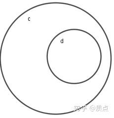
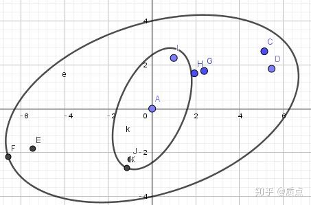
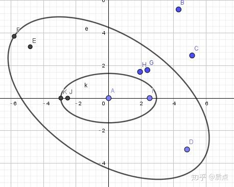
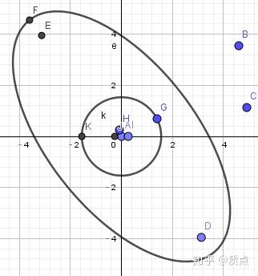
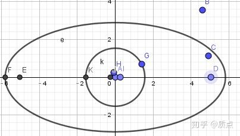
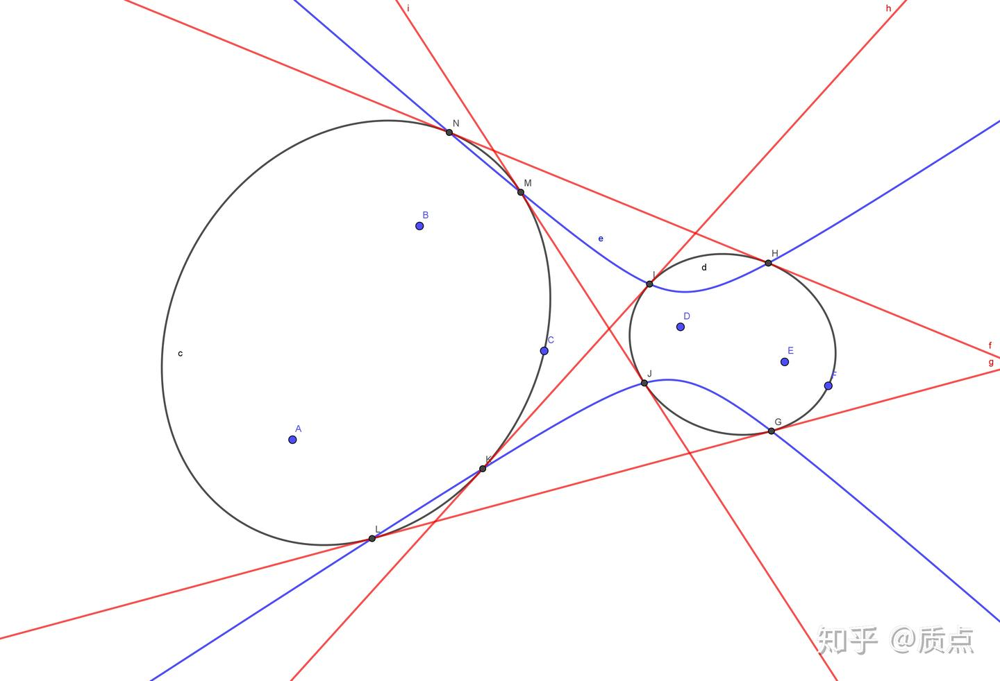
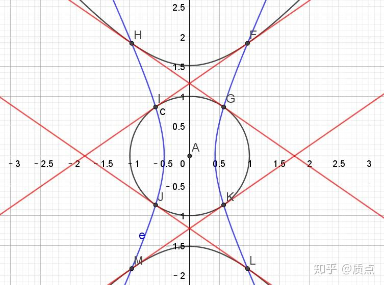
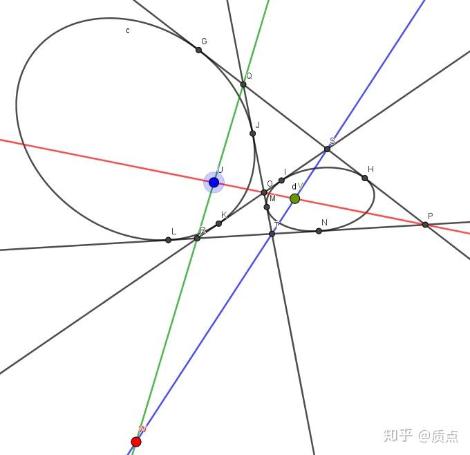

# 圆锥曲线第十五节：把椭圆摆正的方法与蒙日圆问题

目录：质点：圆锥曲线题目的三维矢量解法

*所谓“摆正”，指的是化为标准方程——这正是在解析几何中我们所熟悉的。正因如此，这一节相比于前面几节，将会更加轻松愉快一些。在标准方程下，几何意义丰富却运算困难的二次叉乘终于具有了简单的形式，这使得我们可以秒杀许多问题。*

椭圆的一般方程形如 $Ax^2+2Bxy+Cy^2+2Dx+2Ey+F=0$ ，但我们通常偏爱形如 $\frac{x^2}{a^2}+\frac{y^2}{b^2}=1$ 的椭圆方程。为了把椭圆方程化为这个形式，我们需要选取一个特殊的坐标系。在这个坐标系中，椭圆张量的9个分量具有简单的形式： $g_{ij}=\text{diag }\left\{ 1/a^2,1/b^2,-1 \right\}$ 以及 $g^{ij}=\text{diag }\left\{ a^2,b^2,-1 \right\}$ 。它的代数本质是对张量 $g$ 进行对角化。因此，我们借助线性代数中的定理（不证明）：

**设 $g,h$ 是两个实对称（0,2）型张量，则它们可以同时对角化：即存在一个坐标系，使得它们的分量均具有 $\text{diag}\left\{ \lambda_1,\lambda_2,\lambda_3 \right\}$ 或 $\text{diag}\left\{ \mu_1,\mu_2,\mu_3 \right\}$ 的形式，其中** $diag$ 表示对角矩阵**。**

从几何意义上考虑，在这个坐标系下，两条圆锥曲线的方程变成了 $\lambda_1x^2+\lambda_2y^2+\lambda_3=0$ 以及 $\mu_1x^2+\mu_2y^2+\mu_3=0$ ，于是它们都得到了标准方程，被“摆正”了。换句话说，如果一个圆锥曲线关于x轴与y轴均对称，那么它是被摆正了的。**这一定义同样适用于退化圆锥曲线的情况**。

因为“换坐标系”的观点与“对点做射影变换”的观点等价，所以这这一定理也可以说成：

**可以通过一个射影变换把任意两条圆锥曲线同时摆正。**（当然你也可以进一步变换，把其中一个变成圆，或者变成等轴双曲线，等等）

现在我们对它作一些直观的理解。

---

首先强调一点：要想把任意两条圆锥曲线摆正，一般需要借助射影变换的全部自由度，而不能仅仅使用平移、旋转、拉伸（它们是仿射变换，是射影变换的的子集，特点是保持了无穷远直线不变）。比如说，图中不同心的两个圆，你就不能用仿射变换把它摆正（因为无论你怎么搞它，这两个圆仍然是不同心的）

对于同心的两条圆锥曲线，问题比较简单：我们仅仅使用仿射变换就够了。比如下图的两个椭圆：

不要在意图中的那些点。那是用来作图的

我们可以通过若干步仿射变换把它摆正。首先，我们进行旋转，把里面的小椭圆摆正

接下来，把它们沿x方向一起压扁，使得小椭圆被压成圆

接下来再进行旋转，把大椭圆摆正。因为小椭圆已经被压成了圆，而圆无论怎么旋转都是正的，因此我们就同时把两条圆锥曲线都摆正了。

在摆正的过程中，我们使用了仿射变换，使得无穷远不变。如果我们有更高的要求，保证直线间的夹角不变（称为正交变换）的话，我们就需要保证垂直张量 $\theta$ 不变（回忆第十一节平行与正交的内容）。通常我们最初选取的坐标系下， $\theta^{ij}=\text{diag}\left\{ 1,1,0 \right\}$ **已经**被化成了对角的。因此，“保证垂直张量不变”说的其实正是“把 $\theta$ 化为对角”。如果我们有一个椭圆 $g$ ，那么用我们给出的线性代数结论，就可以把它和 $\theta$ “同时对角化”。即：**可以通过正交变换（旋转、平移、放缩）把圆锥曲线化为标准形式（其实这是一句废话，因为这是众所周知的......）**

举个例子：

反比例函数 $y=1/x$ ，化为圆锥曲线的一般形式就是 $xy-1=0$ 。做代换 $x=X+Y,y=X-Y$ （对应旋转45度后再放缩 $\sqrt{2}$ 倍）后得到 $X^2-Y^2=1$ ，是一条等轴双曲线。

对勾函数 $y=1/x+kx$ ，化为一般形式就是 $kx^2-xy+1=0$ ，它的两条渐近线是y轴与 $y=kx$ 。为了化为标准形式，我们应该逆时针转 $\beta=(\pi/2-\alpha)/2$ 度，其中 $\alpha=\arctan k$ ，即 $x=\cos( \beta )X+\sin (\beta)Y,\\y=\cos (\beta)Y-\sin (\beta)X$

用 $\beta$ 表示 $k$ ，得到 $k=\cot 2\beta=\frac{\cos^2\beta-\sin^2\beta}{2\sin\beta\cos\beta}$ ，代入圆锥曲线的方程得到 $(\cos( \beta )X+\sin (\beta)Y)(\frac{\cos^2\beta-\sin^2\beta}{2\sin\beta\cos\beta}(\cos( \beta )X+\sin (\beta)Y)-\cos (\beta)Y+\sin (\beta)X)+1=0$ 化简为 $\cos^2( \beta )X^2-\sin^2 (\beta)Y^2+2\sin\beta\cos\beta=0$ ，得到了标准形式。

一般不可能用正交变换同时把两个圆锥曲线 $g,h$ 摆正。因为那相当于同时把三个张量 $g,h,\theta$ 对角化了...

---

我们之所以要把椭圆摆正，大概有两个原因：一个原因是，在端端正正的坐标系下，一些看上去不平凡的命题变得明显了；另一个原因是，我们将会从中看到一些代数性质。

在第十三节二次点乘与二次叉乘中，我们证明了和二次叉乘相关的以下命题——下图中的这八个切点在同一条圆锥曲线上。这似乎十分惊人，因为一个椭圆只有5个自由度，而我们却有8个点。由此看来，这个命题似乎包含了3个巧合。

但如果我们把这两个椭圆 $g,h$ 同时摆正后，就会看到这样的图：

当蓝色的双曲线关于 $x,y$ 两轴对称时，只要它经过了 $F,G$ 两个点，那通过对称性就能断定，它一定同时能经过这8个点。而双曲线的标准方程有 $a,b$ 两个自由度，经过 $F,G$ 的条件提供了两个方程，刚好有唯一解！既然如此，存在同时经过这8个点的圆锥曲线就是顺理成章的了。这体现了把椭圆摆正处理的好处。

从中我们还可以看到一个事实：**当 $g,h$ 在某个坐标系下被摆正时，那么 $g\times h$ 在这个坐标系下也被摆正**。实际上，类似的结论可以推广到诸多的运算（而不限于二次叉乘这一种）。因此我们有必要继续研究。

**定义：**设 $f,g,h,...$ 为若干（至少3个）二次点/二次线。如果存在一个坐标系，使得在这个坐标系下，它们的分量矩阵同时被对角化，那么这些二次点/二次线被称为是**对角的**。如果我们约定好了选取哪个坐标系，也可直接说“ $f$ 是对角的”。设 $\tau$ 为某个（1,1）型张量，若 $\tau$ 在这个坐标系下的分量是对角的，我们也用相同的方法称呼它。

当我们选取了一个坐标系后，对角的圆锥曲线共有2个自由度。

**命题：以下结论均成立：**

1.若 $g$ 是对角的，则 $g^{-1}$ 是对角的

2.若 $g,h$ 均是对角的，则 $g+h$ 是对角的（无论是作为二次点的加法还是二次线的加法）

*注：这说明它们生成的曲线系是对角的*

3.若 $g,h$ 均是对角的，且 $g\cdot h$ 有定义，则 $g\cdot h$ 是对角的（1,1）型张量

4.若 $g,h$ 均是对角的，则二次叉乘 $g\times h$ 是对角的

5.若 $f,g$ 是对角的， $g$ 可逆，且 $f=g\times h$ ，那么 $h$ 是对角的

这些结论容易证明（用矩阵乘法即可）并且符合直觉。如果用一句话概括它，那就是：

**当我们有对角的 $g,h$ 时，我们用这两个东西做出的任何正常的代数运算的结果都是对角的**。

换句话说，这些对角的圆锥曲线构成了一个代数封闭的集合 $\Sigma$ ，对 $\Sigma$ 中的两个元素做任意运算后的结果还在集合中。
 $\Sigma$ 有两个自由度。这意味着我们用两个参数 $\xi,\eta$ 表示。换句话说，可以把 $\Sigma$ 与$(\xi,\eta)$为坐标的平面上的点间建立类似于一一对应的关系（可能有一些技术细节导致这一对应并不完美）。这样一来， $(\xi,\eta)$ 平面上的每个点都对应一条圆锥曲线。这样或许能导出一些有趣的结果（但是我没有搞出来）。

---

在线性代数中，对角化的概念与特征向量联系在一起。特征向量 $r$ 是特征方程 $(g-\lambda h)\cdot r=0$ 的解（因为 $\det(g-\lambda h)=0$ 是三次方程，因此共3个解），其中 $\lambda$ 取任意实数，也可以取无穷大。我们假设 $g,h$ 都是可逆的二次线。特征方程可以改写为 $g_{ij}r^j=\lambda h_{ij}r^j$ ，而那个系数 $\lambda$ ，作为矢量同方向的伸缩，是没有几何意义的。因此， $g_{ij}r^j,h_{ij}r^j$ 表示了同一条直线——而等式的两端分别是 $r$ 关于g的极线以及r关于h的极线。因此，我们得到了特征向量的几何意义：

**$g,h$ 的特征方程的三个特征向量 $r$ 描述了它们共同的极点极线**

很容易证明，当我们**把三个特征向量取为坐标系的三个基矢**后， $g,h$ 就得到了对角化。换句话说，当我们使用能让它们对角化的坐标系时，三个特征向量的分量分别是 $(1,0,0),(0,1,0),(0,0,1)$ 。

反过来的命题同样成立。如果在某个坐标系中， $g$ 得到了对角化（即具有 $\text{diag}\left\{ \lambda_1,\lambda_2,\lambda_3 \right\}$ 的形式），那么无论 $ \lambda_1,\lambda_2,\lambda_3 $ 取什么值，坐标系的三个基矢是所有这类 $g$ 共同的特征向量，因此也是它们共同的极点极线。

经过以上这些铺垫，我们先指出了对角化圆锥曲线的代数运算仍然是对角化的，然后指出对角化的圆锥曲线有共同的特征向量，然后指出特征向量对应了极点极线。把它们串联起来，就得到了如下结论：

**设 $a,l$ 同时关于圆锥曲线 $g,h$ 构成极点极线，而圆锥曲线 $f$ 是 $g$ 和 $h$ 经过若干代数运算后得到的，则 $a,l$ 关于 $f$ 构成极点极线。**

这一结论有助于直接看出通过各种方法作出的圆锥曲线的共同几何性质。

当我们在平面上有 $g,h$ 时，可以通过以下的方式画出它们的三对共同极点极线（分别用红绿蓝表示）

作图的方法是，先作出4条公切线及其6个交点OPQRST。相对的交点的3条连线就是3条共同极线。两条极线的交点就是另一条极线的极点UVW。

---

除此之外，对角化的好处就是便于计算。尤其是复杂的二次叉乘 $(g\times h)_{ij}=\epsilon_{ikm}\epsilon_{jln}g^{kl}h^{mn}$ ，对角化后计算就会简单很多。我们设 $g^{ij}=\text{diag}\left\{ \lambda_1,\lambda_2,\lambda_3 \right\}$ ， $h^{ij}=\text{diag}\left\{ \mu_1,\mu_2,\mu_3 \right\}$ ，则 $(g\times h)_{ij}=\epsilon_{ikm}\epsilon_{jln}g^{kl}h^{mn}=\sum_{k,m}{\epsilon_{ikm}\epsilon_{jkm}g^{kk}h^{mm}}=\sum_{k,m}{\epsilon_{ikm}\epsilon_{jkm}\lambda_k\mu_m}$

毫无疑问当且仅当 $i=j$ 时才不等于0。比如，我们令 $i=j=1$ ，就可以立即得到 $(g\times h)_{11}=\lambda_2\mu_3+\lambda_3\mu_2$ 。**以此类推，我们就得到了以下重要的公式**：

$\text{diag}\left\{ \lambda_1,\lambda_2,\lambda_3 \right\}\times\text{diag}\left\{ \mu_1,\mu_2,\mu_3 \right\}=\text{diag}\left\{ \lambda_2\mu_3+ \lambda_3\mu_2, \lambda_1\mu_3+ \lambda_3\mu_1, \lambda_2\mu_1+ \lambda_1\mu_2 \right\}$

作为例子，我们再次拿已经被蹂躏多次的蒙日圆开刀。但是以后应该不会再用了，因为我们接下来的解答已经没法再简化了。

例题：设 $g$ 为椭圆$\frac{x^2}{a^2}+\frac{y^2}{b^2}=1$， $a$ 是椭圆外一点。过 $a$ 作两条椭圆的切线 $m,n$ 使得 $m,n$ 相互垂直，求满足条件的 $a$ 的轨迹。

解： $a$ 到 $g$ 的两条切线可以用二次叉乘表示， $(mn)=g\times aa$ 。$m,n$ 相互垂直等价于 $(mn):\theta=0$ ，其中 $\theta$ 为垂直张量。因此 $a$ 满足 $(g\times aa):\theta=0$ ，利用混合积性质改写为 $(g\times \theta):aa=0$ 。因此 $a$ 在圆锥曲线 $h=g\times \theta$ 上。

接下来我们写出 $h$ 的方程。首先由定义， $g^{ij}=\text{diag}\left\{ a^2,b^2,-1 \right\}$ ；而垂直张量是 $\theta^{ij}=\text{diag}\left\{ 1,1,0 \right\}$ ，因此 $(g\times \theta)_{ij}=\text{diag}\left\{ b^2\times 0-1\times 1,a^2\times 0-1\times 1,b^2\times 1+a^2\times 1 \right\}=\text{diag}\left\{-1,-1,a^2+b^2 \right\}$ ，因此轨迹是圆，其方程为 $x^2+y^2=a^2+b^2$ 。

这一解答不需要任何计算，整个过程只用了短短几行\(^o^)/。

目录：质点：圆锥曲线题目的三维矢量解法
