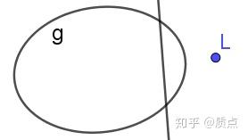
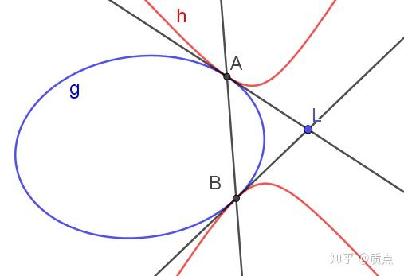
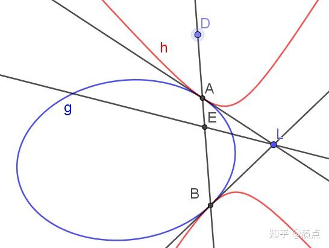
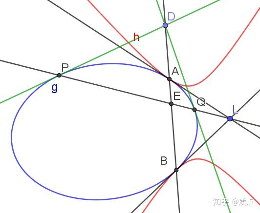
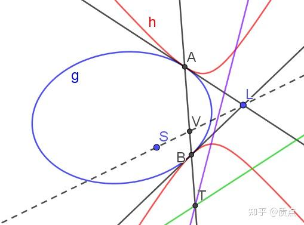
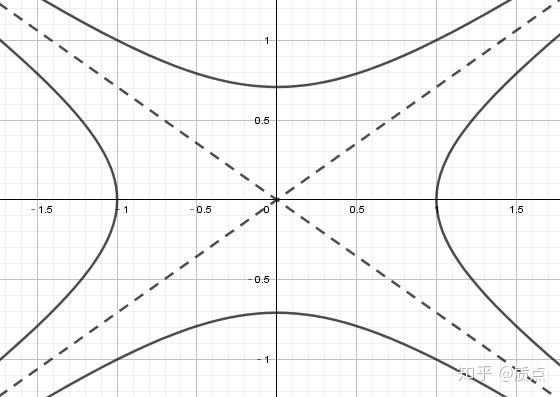
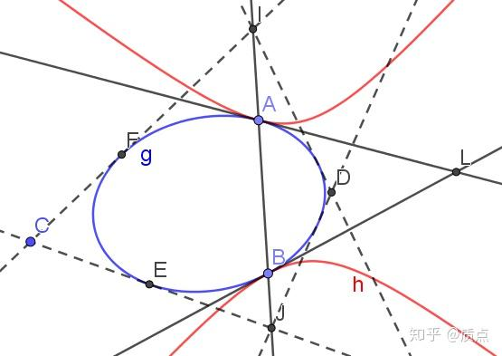
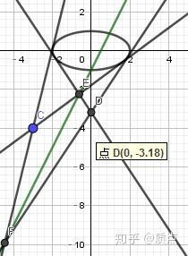

# 圆锥曲线第十六节：I型二次除法与共轭双曲线

目录：质点：圆锥曲线题目的三维矢量解法

在 二次点乘与二次叉乘 的末尾我们看到：映射$h\Rightarrow f=g\times h$ 可逆当且仅当$g$是可逆的。**我们把它的逆运算称为二次除法，简称除法**（*或许这样的称呼并不合适，因为它并不满足乘除法之间应当满足的许多性质。但是我没想到更好的名字*），记为 $h=f/g$ ，或 $h=\frac{f}{g}$ 。除法有意义当且仅当分母可逆。

在二次叉乘中，如果 $g,h$ 是二次点，那么 $f$ 就是二次线，其对应的除法就是“二次线除以二次点”。如果$g,h$ 是二次线，对应的除法就是“二次点除以二次线”。可见，除法中分子与分母是不同类型的张量，除法得到的张量的类型与分母的类型相同。

我们在上一节已经给出过除法的表达式：$f/g=(f:g)g-2g\cdot f\cdot g$。现在我们利用乘法的运算性质写出除法的运算性质。

1.根据除法定义，明显有 $\frac{g\times h}{g}=h,\frac{g\times h}{h}=g$

2.我们考虑如果一条圆锥曲线和自己的逆进行除法会怎样。由于 $g^{-1}/g=(g\times g)/g=g$ ，我们得到了：$g^{-1}/g=g$

3.我们把叉乘的混合积性质改写到除法中。由于$\frac{f}{g}:h=\frac{f}{g}:(\frac{h}{g}\times g)=\frac{h}{g}:(\frac{f}{g}\times g)=f:\frac{h}{g}$ ，我们得到了重要的公式—— $\frac{f}{g}:h=f:\frac{h}{g}$

4.我们把等式$(g\cdot f\cdot g)\times (g\cdot h\cdot g)=g^{-1}\cdot (f\times h)\cdot g^{-1}$改写为除法形式，得到 $\frac{g^{-1}\cdot (f\times h)\cdot g^{-1}}{g\cdot f\cdot g}=g\cdot h\cdot g$ 。然后设 $u=f\times h,v=f$ ，则上式可以改写为 $\frac{g^{-1}\cdot u\cdot g^{-1}}{g\cdot v\cdot g}=g\cdot \frac{u}{v}\cdot g$ 。

如果把 $g,g^{-1}$ 对调，就得到 $\frac{g\cdot u\cdot g}{g^{-1}\cdot v\cdot g^{-1}}=g^{-1}\cdot \frac{u}{v}\cdot g^{-1}$ 。

5.在上一条的基础上，如果我们设 $u=g$ ，则得到 $\frac{g^{-1}}{g\cdot v\cdot g}=g\cdot \frac{g}{v}\cdot g$ ；如果我们设 $v=g^{-1}$ ，就得到 $\frac{g^{-1}\cdot u\cdot g^{-1}}{g}=g\cdot \frac{u}{g^{-1}}\cdot g$

在对角的坐标下计算二次叉乘与二次除法是很方便的。我们在上一节已经给出，二次叉乘在对角的坐标下有如下表达式：

$\text{diag}\left\{ \lambda_1,\lambda_2,\lambda_3 \right\}\times\text{diag}\left\{ \mu_1,\mu_2,\mu_3 \right\}=\text{diag}\left\{ \lambda_2\mu_3+ \lambda_3\mu_2, \lambda_1\mu_3+ \lambda_3\mu_1, \lambda_2\mu_1+ \lambda_1\mu_2 \right\}$

由此可以证明，二次除法在对角坐标下的表达式为：

$\frac{diag\left\{ A,B,C \right\}}{diag\left\{ x,y,z \right\}}=diag\left\{ Bz^{-1}+Cy^{-1}-A\frac{x}{yz},Az^{-1}+Cx^{-1}-B\frac{y}{xz},Bx^{-1}+Ay^{-1}-C\frac{z}{xy} \right\}$

---

从代数角度定义了二次叉乘的逆运算后，我们自然要考察它的几何意义。虽然我们可以简单地说，“ $f/g$ 对应的那条圆锥曲线就是那条与 $ g$ 作二次叉乘后会得到 $f$ 的”，但是这样的描述并不直观。实际上，从除法的角度看待问题会得到一些新的结果，这些结果可以补充二次点乘与二次叉乘的讨论。

我们在讨论二次叉乘 $f=g\times h$ 的几何意义时，根据 $g$ 和 $h$ 是什么型号的二次点进行了分类，观察不同情况下 $f$ 的性质。而同样有必要做（而在那节我们没做）的是，**根据 $f$ 的型号进行分类**，来看看对应的 $h$ 是什么样子。

本节我们研究用 I型二次线 $f=ll$ 除以二次点 $g$ 得到的图像 $h$ 。我们将看到，方程 $g\times h=ll$ 表明， $g$ 与 $h$ 之间有某种紧密的联系，我们把这种联系称为共轭。

图中的点L是直线l的极点

把 $f=ll$ 代入公式$f/g=(f:g)g-2g\cdot f\cdot g$，得到 $h^{ij}=(ll/g)^{ij}=l^2g^{ij}-2l^il^j$ （ $l^i$ 是 $l$ 的极点），或 $h=l^2g-2ll$ 。如果 $l$ 与 $g$ 相切，则 $l^2=0$ ，得到 $ll/g=ll$ 。这是平凡的，我们以后不讨论它。如果 $l$ 与 $g$ 不相切， $h$ 就**不是退化的**（这是因为特征方程 $\det (ll-\lambda l^2g)=0$ 的三个根是 $\lambda=0,0,1$ ，而此处 $\lambda=\frac{1}{2}$ 不是它的根），因此 $h$ 是圆锥曲线。利用曲线系理论（见曲线系、笛沙格对合定理与圆锥曲线光学性质）， $h$ 是 $g$ 与 $ll$ 生成的二次点系，它们拥有共同的4条切线。这四条切线正是点L到g的两条切线（每条切线算了两次）因此我们得知，**$ll/g$ 与 $g$ 必定相切于 $l$ 和 $g$ 的两个交点**，如图：

“相切于 $A,B$ 两点”给出了四个约束，也就是说，这条圆锥曲线**还有一个自由度**。因此我们需要再找到一些性质。

$h$ 在代数上有一个重要的性质： $h_{ij}=(h^{-1})_{ij}$ ，等式左边是用度规 $g$ 对 $h^{ij}$ 降指标的结果，它等于 $l^2g_{ij}-2l_il_j$ 。把它和 $h^{jk}$ 相乘，得到 $h_{ij}h^{jk}=(l^2g_{ij}-2l_il_j)(l^2g^{jk}-2l^jl^k)=(l^2)^2\delta^k_i-2\times 2l^2l_il^k+4l^2l_il^k=(l^2)^2\delta^k_i$ 变成了单位张量，而这恰恰是逆张量的定义。在一般情况下，降指标得到的 $h_{ij}$ 和求逆得到的 $(h^{-1})_{ij}$ 并不相同。

这导致的效果是，**圆锥曲线 $g,h$ 作为二次点的叉乘与作为二次线的叉乘是等价**的。具体来说，我们把上图中 $g,h$ 对应的两条曲线当作已知的。现在我们先把 $g,h$ 取作二次点，那么它们的叉乘 $g\times h=ll$ 是图中的直线 $AB$ ；如果把$g,h$ 取作二次线，那么它们的叉乘是图中的点 $L$ 。 $AB$ 与 $L$ 是关于 $g$ 的极点极线，同时也是关于 $h$ 的极点极线。在这张图中， $g$ 和 $h$ 的地位是完全对等的。

现在我们在AB上取一点D，它关于g的极线为LE，则LE同时也是D关于h的极线。证明如下：因为L关于h的极线经过D，因此D、L关于h共轭；因为E在D关于g的极线上，因此 $A,B,D,E$ 成调和点列，因此D、E关于h共轭；所以D关于h的极线是EL。**因此，限制在 $l$ 上时， $g,h$ 拥有共同的极点极线**。

我们进一步作出 $EL$ 与g的两个交点 $P,Q$ 以及两条切线。

回忆我们在上一节中讲过的知识（二次叉乘的几何意义），因为 $P,Q$ 所连直线经过 $L$ ，所以 $p,q$ 关于 $h$ 共轭（类似地，因为两条切线 $DP,DQ$ 的交点在 $l$ 上，因此 $DP,DQ$ 也关于 $h$ 共轭）。因为 $PQ$ 是 $D$ 的极线，因此 $D,Q$ 也关于 $h$ 共轭。因此我们得到了重要的结论：**$P$ 关于h的极线是 $DQ$ ， $Q$ 关于h的极线是 $DP$** 。

换句话说，如果我们有 $g$ 上的点 $q$ ，想作其关于 $h$ 的极线，那么我们只需要作直线 $QL$ 交g于P，再作P处的切线即可。

在这些结论中 $g,h$的地位是对等的。不过在画图时根据D点的位置不同，如果它能向g作切线，就做不了h的切线。反之亦然。

再来看一个图。

**设S是平面中任意一点，则它关于g的极线（绿线）与它关于h的极线（紫线）的交点T位于 $l$ 上。**

它的证明也不难。作直线 $SL$ ，交 $l$ 于 $V$ 。作 $T$ 使得 $A,B,V,T$ 成调和点列，则$V,T$ 同时关于同时关于 $g,h$ 共轭。又因为 $L,T$ 同时关于 $g,h$ 共轭（因为T位于L的极线上），因此 $S,T$ 也同时关于 $g,h$ 共轭。证毕。

在以上的的讨论中，我们看到，**满足 $g\times h=ll$ 的两条圆锥曲线 $g,h$ 在一起有良好的性质。出于这个原因，我们把这样的 $g,h$ 称为共轭圆锥曲线**。因为平面上的直线有两个自由度，因此与 $g$ 共轭的圆锥曲线也有两个自由度。圆锥曲线共有5个自由度，因此“共轭”这一条件产生了三个约束。

**和我口中的大部分名词不同，“共轭圆锥曲线”这一概念并非完全是我的杜撰**。这是因为在解析几何中可以找到一个十分初等的例子：

图中的两条双曲线的方程分别为 $g:\frac{x^2}{a^2}-\frac{y^2}{b^2}=1$ 和 $h:-\frac{x^2}{a^2}+\frac{y^2}{b^2}=1$ ，它们具有共同的渐近线 $y=\pm\frac{b}{a}x$ ，这样的两条双曲线称为**共轭双曲线**。这一概念其实是“共轭圆锥曲线”的特例。由于 $g,h$ 都已被摆正，计算它们的二次叉乘很容易。 因为$g^{ij}=diag\left\{ a^2,-b^2,-1 \right\}$ , $h^{ij}=diag\left\{- a^2,b^2,-1 \right\}$ ， 所以$(g\times h)_{ij}=diag\left\{ 0,0,-2a^2b^2 \right\}$ ，对角线上有2个零，可见具有 $ll$ 的形式，符合共轭圆锥曲线的定义。

我们回到最初的图：

共轭双曲线的原点就是图中的 $L$ ，直线 $AB$ 是无穷远直线，$LA,LB$ 是两条双曲线共同的渐近线。

**这些讨论启示我们用射影几何方法来研究共轭双曲线，而不必借用坐标系。**

共轭圆锥曲线的性质还可以进一步推广。考虑（1,1）型张量 $\tau^i_k=h^{ij}g_{jk}$ （我们早就指出，不必区分 $h^{ij}$ 与 $(h^{-1})^{ij}$ ），则 $\tau^i_k=(l^2g^{ij}-2l^il^j)g_{jk}=(l^2\delta^i_k-2l^il_k)$ 。 $\tau$ 可以看作把点映射为点的线性映射，这一映射的平方为 $(\tau^2)^i_l=\tau^i_k\tau^k_l=(l^2\delta^i_k-2l^il_k)(l^2\delta^k_l-2l^kl_l)=l^4\delta^i_l$ 。我们在交比、对合与调和点列中早就定义，如果线性映射 $\tau$ 满足 $\tau^2=I$ ，那么 $\tau$ 称为对合变换。我们之前的定义是在二维矢量空间中定义的，而现在我们面对的 $\tau$ 是三维空间中的——这意味着它是对合变换的某种推广。我们接下来就看看 $\tau$ 的几何意义。

在平面上任取一点 $c$ ，记 $\tau c=d$ ，则 $d^i=\tau^i_kc^k=h^{ij}g_{jk}c^k$ 。从这个表达式可以得知， $d$ 是 $c$ 关于 $g$ 的极线关于 $h$ 的极点。

按照下图的方式，可以很方便地作出 $C$ 对应的点 $D$ 。

首先过C点作g的两条切线，分别交l于I、J。然后作I、J到g的切线交于D，即为所求

证明： $C$ 关于 $g$ 的极线是 $EF$ ， $E$ 关于 $h$ 的极线是 $JD$ ， $F$ 关于 $h$ 的极线是 $ID$ ，因此 $EF$ 关于 $h$ 的极点是 $D$ 。证毕。

作为练习，请证明以下几何关系：

**无论 $C$ 位于何处， $C,D,L$ 均在同一条直线上。从另一个角度看，如果给定一条过 $L$ 的直线 $m$ ，并把 $C$ 限制在 $m$ 上，则 $C,D$ 构成了 $m$ 上的一个对合关系，这个对合关系由 $\tau$ 在 $m$ 上的限制给出。这一对合的两个不动点分别是 $L$ 、 $m\times l$ 。此外有必要指出， $m$ 与 $g$ 的两个交点关于 $\tau$ 对合。**

**由此可以体会出“ $\tau$ 是对合变换的推广”这句话的含义。**

---

整篇文章的内容比较几何化，所以最后我们把它们放到坐标系中体会一下。

【例1】有两条双曲线 $g:\frac{x^2}{a^2}-\frac{y^2}{b^2}=1$ 和 $h:-\frac{x^2}{a^2}+\frac{y^2}{b^2}=1$ 。点 $A(x,y)$ ， $B(-x,-y)$ ，满足 $0<x<a,0<y<b$ 。过 $A$ 作 $g$ 的切线，切于 $C,D$ ；过 $B$ 作 $h$ 的切线，切于 $E,F$ 。求证 $C,D,E,F$ 共线。

（这道题可以直接用极点极线的解析式求解，很容易。其背景就是本节讲的共轭双曲线）

【例2】有椭圆 $g:\frac{x^2}{4}+y^2=1$ ，直线 $l:y=2x-1$ 。点 $C(-3,-4)$ ，过 $C$ 作椭圆的两条切线，分别交 $l$ 于 $E,F$ ；再过 $E,F$ 再作椭圆的切线，交于 $D$ ，求 $D$ 点的坐标。

（这道题貌似没有特别简单的解析几何办法。因此我采用张量的方法求解。有兴趣的同学可以尝试一下怎么用解析几何的方法做）：

根据本节的内容，可以用以下公式表达点 $D$ ：

$d=\tau c=\frac{ll}{g}\cdot g^{-1}\cdot c$ 。把二次除法展开，得到 $d^i=(l^2\delta^i_k-2l^il_k)c^k=l^2c^i-2(c\cdot l)l^i$ 。

写出分量： $g^{ij}=diag\left\{ 4,1,-1 \right\}$ ， $c^i=(-3,-4,1)$ ， $l_i=(2,-1,-1)$ 。因此 $c\cdot l=$ $(-3)\times 2+(-4)\times(-1)+1\times (-1)=-3$ 。 $l^2=4\times2^2+1\times(-1)^2-1\times(-1)^2=16$ 。 $l^i=g^{ij}l_j=(8,-1,1)$ 。

因此 $d^i=16(-3,-4,1)+6(8,-1,1)=(0,-70,22)$ 。

即 $D(0,-\frac{70}{22})\approx(0,-3.18)$

