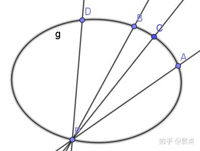
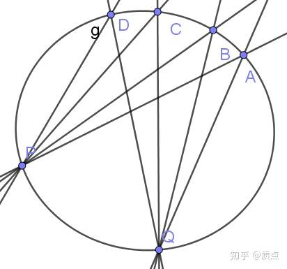
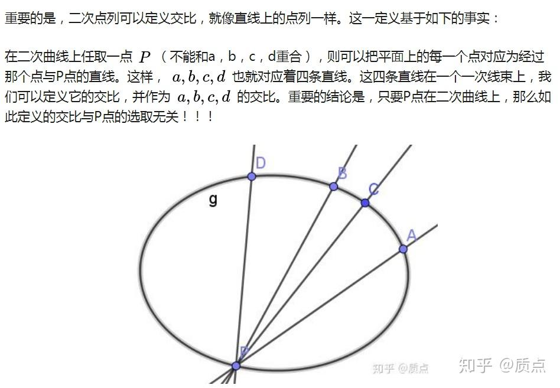
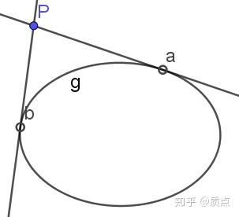
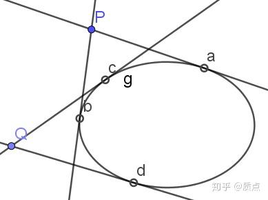

# 圆锥曲线第十八节：指标分裂与二次嵌入

目录：质点：圆锥曲线题目的三维矢量解法

## 写到这篇文章时，我发现我涉及到了一些我不会的知识。因此我以后把那些知识学完后可能会再修改这一节。

首先，我们对引入“指标分裂与二次嵌入”的动机作一个较长的铺垫。

我们在二次点列和二次对合一节已经初步认识了二次点列：二次点列是圆锥曲线上的点集。这类似于，一次点列是直线上的点集。在那一节我们看到，**二次点列与一次点列间有许多相似性**，这具体体现于：

1.二次点列与一次点列具有相同的拓扑 （由于加入了无穷远点，一次点列是紧致的）

2.二次点列中可以定义“交比”、“对合”、“调和点列”，与一次点列一样。

3.通过图中的方式，在圆锥曲线上任取一点 $P$ ，则二次点列和某个一次线束可以一一对应。

4.我们知道，线性子空间上的线性映射被称为射影变换。在经典的射影几何中，一个重要的内容就是讨论多个射影变换的复合——多个射影变换的复合仍然是射影变换。令人困惑的是下图的内容。设我们有两个一次线束 $\Sigma_p,\Sigma_q$ （中心点分别为 $p,q$ ）。现在我们取出 $\Sigma_p$ 中的一个元素，比如 $AP$ 。然后我们先作它与 $g$ 的交点 $A$ （ $AP$ 到 $A$ 的映射记为 $f_1$ ），再作连线 $AQ$ （ $A$ 到 $AQ$ 的映射记为 $f_2$ ），就得到了 $\Sigma_q$ 中的一个元素。通过这样的构造，我们就得到了一个映射 $f:\Sigma_p\rightarrow\Sigma_q$ ，可以写作 $f=f_2\circ f_1$ 。

这个映射是不是射影变换呢？看上去不应该是。 $g$ 作为二次点列并不是线性子空间，因此 $f_1,f_2$ 也不是线性映射。它们的复合映射自然也不必是线性映射，于是 $f$ 不必是射影变换。然而这个结果是错的：由交比的不变性可以证明， $f$ 真的是射影变换！

根据以上四条性质，我们发现，圆锥曲线上的二次点列在作图时可以**无缝融入**一次点列。事实上，经典射影几何的教材中有许多定理正是建立于此。但是，这是为什么？以上四条性质的核心在于这个结论：

我们在二次点列和二次对合中给出了证明。这一证明虽然正确，但是并不自然，就像是某个巧合一样。况且从另一个角度，二次点列与一次点列仍有十分明显的不同之处：

1.一次点列是平面的线性子空间，而**二次点列并不是平面的线性子空间。**

2.之前第4条所说的 $f_1,f_2$ ，虽然和射影变换有相似之处，但毕竟不是射影变换。其核心就是：**一次点列与二次点列间的一一映射是非线性的。**

**这种“非线性”带来的后果就是二次点列的代数意义不明确。它就像是一次点列间射影变换的某个中间产物。**

一次点列的代数意义是很明确的，因为它就是三维线性空间中的二维子空间中的元素。而利用其“二维线性空间”的背景，可以构造出其中的交比、对合与调和点列这些结构。

而二次点列是 $\left\{ a|g_{ij}a^ia^j=0 \right\}$ 。这就是一个方程确定的点集而已，**它根本不是二维线性空间**，**凭什么它能有交比、对合、调和点列这些结构**？

一个启发性的想法是：

**就其本质而言，二次点列  *是*二维线性空间，这使得它具有交比、对合、调和点列这些结构。但在把这个二维线性空间“嵌入”三维线性空间时，这个二维线性空间被“弯曲”成了类似“椭圆”的东西，这导致它丢失了一些线性的性质。**

也就是说，二次点列是“部分线性，部分非线性”的。**其中的线性部分导致它与一次点列相似，非线性部分导致它与一次点列不同**。为了明确讨论，需要对“部分线性，部分非线性”作出明确的定义。

---

**定义：设有流形 $M,N$ 以及映射 $\phi:M\rightarrow N$ 。如果 $\phi$ 是连续的单射，则映射 $\phi$ 称为嵌入**。（数学上的定义比这严格，这里只取了我们会用到的部分）

矢量空间是流形的特例。比如说，设 $U$ 为二维矢量空间， $V$ 为三维矢量空间，则 $U,V$ 都是流形。作为矢量空间，它们有各自的加法运算。我们把 $U$ 中的元素用 $\mathfrak a,\mathfrak b,\mathfrak c,\mathfrak d$ 表示，其加法记为 $\oplus$ ，比如$\mathfrak a\oplus\mathfrak b$。 $V$ 中的元素用 $a,b,c,d$ 表示，其加法记为 $+$ ，比如 $a+b$ 。

对于具有加法运算的流形 $U,V$ ，我们就可以对嵌入映射 $\phi:U\rightarrow V$ 作进一步的分类：

**定义：若嵌入映射 $\phi:U\rightarrow V$ 满足 $\phi(\mathfrak a\oplus \mathfrak b)=\phi(\mathfrak a)+\phi(\mathfrak b)$ ，则 $\phi$ 称为线性嵌入。反之则称为非线性嵌入。**简单地说：**线性嵌入保持了矢量空间的线性运算，非线性嵌入则不然。**

一次点列作为 $U$ 到 $V$ 的嵌入，是属于线性嵌入的。我们今后将看到，二次点列属于非线性嵌入。

---

在20世纪60年代，Penrose等人把几何语言融入了广义相对论，他的一个成果就是在四维时空中引入了**旋量**。我实际上对旋量所知甚少（我在本节引入的旋量和数学的旋量可能并不是一回事），但是我知道它的一个做法是把洛伦兹度规 $t^2-x^2-y^2-z^2$ 下的四维矢量 $a^i=(t,x,y,z)$ 写成了矩阵形式： $A=\left( \begin{array}{cc}  t+x & y +iz\\  y-iz & t-x \\ \end{array} \right)$ 。这样做的效果是， $a^i$ 的模长 $t^2-x^2-y^2-z^2$ 恰好等于其矩阵的行列式 $\det X$ 。现在我们处理的是平面几何，用的是三维矢量空间，为此我们可以简单地把坐标 $z$ 去掉。这样洛伦兹度规就变成了 $t^2-x^2-y^2$ ，点矢 $a^i=(t,x,y)$ 的矩阵就变成 $A=\left( \begin{array}{cc}  t+x & y \\  y & t-x \\ \end{array} \right)$ 。这里的“洛伦兹度规”是什么？是一个不定二次型，换句话说，正是一条圆锥曲线！于是，当平面上有一条圆锥曲线 $g$ 时，我们只需要选取合适的坐标系使 $g$ 的方程成为 $t^2-x^2-y^2=0$ ，就可以用这种方法，把平面上的任意一点**写成2*2的对称矩阵**。我们知道，矩阵的本质是张量，张量可以用指标描述，比如矩阵 $A$ 可以用指标语言写成 $A^{\alpha \dot \alpha}$ （这里指标 $\alpha,\dot\alpha$ 的取值范围为 $1,2$ ，与 $a^i$ 中 $i$ 的取值范围为 $1,2,3$ 不同）。通过类似的方法，可以把 $a_i=g_{ij}a^j=(t,-x,-y)$ 写为对称张量 $A_{\alpha \dot \alpha}=\left( \begin{array}{cc}  t-x & -y \\  -y & t+x \\ \end{array} \right)$ 。进一步可以把任意的张量，例如 ${f^{ij}}_k$ ，改写为 ${f^{\alpha \dot \alpha\beta \dot \beta}}_{\gamma \dot \gamma}$ 。这样一来，任何张量都可以写为新的张量，原张量的每个指标都被取值为 $1,2$ 的两个对称指标代替。我把这种写法称为“**指标分裂**”，取其“一分为二”之义。新张量所在的线性空间是一个二维的矢量空间，称为 $g$ 的旋量空间，记为 $S$ 。因为二维矢量空间中的二阶对称张量代表一个对合变换，因此可以说，**平面上任何一个点矢都对应了 $S$ 中的一个对合变换**。

注意到 $a$ 与 $A$ 的关系是线性的，这意味着可以通过一个线性映射来对它们之间进行转换。这个线性映射可以写为 $A^{\alpha \dot \alpha}=\sigma^{\alpha \dot \alpha}_ia^i$ ，其中 $\sigma^{\alpha \dot \alpha}_i$ 称为转换符，它的非零分量是： $\sigma^{11}_1=\sigma^{22}_1=\sigma^{11}_2=\sigma^{12}_3=\sigma^{21}_3=1,\sigma^{22}_2=-1$ 。反过来的转换可以用 $a^i=\sigma_{\alpha \dot \alpha}^iA^{\alpha \dot \alpha}$ ，其中 $\sigma^{11}_1=\sigma^{22}_1=\sigma^{22}_2=1,\sigma^{11}_2=\sigma^{12}_3=\sigma^{21}_3=-1$ 。由于 $a,A$ 的联系十分密切（中间仅仅差了一个转换符），因此干脆节省字母，把矩阵 $A$ 也记为 $a$ ，仅仅通过指标来区分两种不同情况。

张量 $a^{\alpha \dot \alpha}$ 是对称的，而二维矢量空间中的对称张量总可以写为对称积的形式： $a^{\alpha \dot \alpha}=\mathfrak a^\alpha\mathfrak b^\dot\alpha\oplus\mathfrak b^\alpha\mathfrak a^\dot\alpha$ ，简写为 $a=(\mathfrak a\mathfrak b)$ 。 $\mathfrak a,\mathfrak b$ 称为 $a$ 的旋量坐标。它们实际上是这一对合变换的不动点。

注意到点 $a$ 在 $g$ 上的条件是 $g_{ij}a^ia^j=0$ 。如果 $a^i=(t,x,y)$ ，那条件写为 $t^2-x^2-y^2=0$ ，这意味着 $\det a^{\alpha \dot \alpha}=0$ ，即 $a^{\alpha \dot \alpha}$ 退化。当 $a^{\alpha \dot \alpha}$ 退化时，它就不能写成两个不同旋量的对称积 $(\mathfrak a\mathfrak b)$ ，而只能写为**单个旋量**与自己的乘积： $a=\mathfrak a\mathfrak a$ 。此时把 $\mathfrak a$ 称为 $a$ 的旋量坐标。

**由此我们看出，圆锥曲线上的点 $a$ 与旋量 $\mathfrak a$ 有着一一对应。** 圆锥曲线上的点是三维矢量空间 $V$ 的子集，而 $S$ 是二维矢量空间。于是 $a=\phi(\mathfrak a)=\mathfrak a\mathfrak a$ 作为$\phi:S\rightarrow V$是嵌入。这一嵌入是非线性的。更准确地说， $\phi(\mathfrak a)=\mathfrak a\mathfrak a$ 是关于 $\mathfrak a$ 的二次函数。出于这个理由， $\phi$ 称为“**二次嵌入**”：**$S$ 作为矢量空间可以二次嵌入到圆锥曲线 $g$ 上**。

用 $\mathfrak a$ 来表达 $g$ 上的点是有明显好处的。首先是可以证明，$\mathfrak a$作为二维矢量，它构造出的交比、对合、调和点列正是我们之前对二次点列所定义的。其次，如果用三维矢量 $a$ 来表示圆锥曲线上的点，就必须加上一个方程 $a^2=0$ 作为对它的约束。当遇到多个圆锥曲线上的点时，这多个约束就让人无从下手。而利用旋量就不必引入这一约束。

尽管旋量的使用有其方便之处，但是要用它处理问题，就必定要涉及更多张量计算，这将在下一节中讲述。接下来我们将看一看如何把旋量直观地画出来。

---

如果我们要在平面上画出一个元素，那么这个元素必须得属于这个平面。然而 $\mathfrak a$ 是旋量空间 $S$ 的元素，并不属于平面 $V$ 。于是严格地说，并不能在平面上画出旋量。但是另一方面， $\mathfrak a$ 在平面上的嵌入 $\phi (\mathfrak a)$ 是圆锥曲线上的一个点，它是属于 $V$ 的。因此**我们可以画出 $\phi(\mathfrak a)$ 来代表 $\mathfrak a$** 。

设 $g$ 外有一点 $p$ ，它的旋量坐标是 $\mathfrak a ,\mathfrak b$ （即 $p=(\mathfrak a\mathfrak b)$ ），那么可以证明（略）， $\phi(\mathfrak a) ,\phi(\mathfrak b)$ 是 $p$ 到 $g$ 的两条切线的切点。即

旋量用空心圈来表示

（如果 $p$ 在 $g$ 内部，那么$\mathfrak a ,\mathfrak b$的坐标是虚数，画不出来。）

如图， $p=(\mathfrak a\mathfrak b),q=(\mathfrak c\mathfrak d)$ 。 $a,b,c,d$ 成调和的二次点列等价于 $(\mathfrak a\mathfrak b):(\mathfrak c\mathfrak d)=0$ ，而根据代数的直觉（下节再证明），应该有 $(\mathfrak a\mathfrak b):(\mathfrak c\mathfrak d)=p\cdot q$ 。于是$a,b,c,d$ 成调和的二次点列也就等价于 $p,q$ 共轭。这一结论在二次点列和二次对合中证明时并不自然，而现在我们自然地得到了。

---

通过乘以系数，旋量空间中的元素可以化为标准规范，比如 $\mathfrak a=(u,1),\mathfrak b=(v,1)$ 。于是平面上的任意一点 $p=(\mathfrak a\mathfrak b)$ 可以用 $u,v$ 表出，这相当于是给出了平面的另一种坐标系（称为旋量坐标系）。这一坐标有时会比直角坐标 $x,y$ 具有一些优点。

具体地，因为$\mathfrak a=(u,1),\mathfrak b=(v,1)$，所以 $a^{\alpha \dot \alpha}=\left( \begin{array}{cc}  2 u v & u+v \\  u+v & 2 \\ \end{array} \right)$ 。对比 $\left( \begin{array}{cc}  t+x & y \\  y & t-x \\ \end{array} \right)$ ，就可以得到方程组 $\begin{cases}  t+x=2 u v \\  t-x=2   \\  y=u+v  \end{cases}$ ，解得 $\begin{cases}  t= u v +1\\  x=uv-1  \\  y=u+v  \end{cases}$ 。

我们取仿射规范把 $t$ 化为1（此时 $g:t^2-x^2-y^2=0$ 就对应了单位圆），就得到了

$\begin{cases}    x=\frac{uv-1}{uv+1}  \\  y=\frac{u+v}{uv+1}  \end{cases}$ 。这就是直角坐标与旋量坐标的转换关系（这是圆的旋量坐标，稍加修改就可以得到椭圆的旋量坐标）。旋量坐标特别适合处理切线问题。这是因为，当 $u$ 固定时， $\mathfrak a$ 也便随之固定，因此上图中的点 $P$ 也就只能在过 $a$ 的切线上动。即，固定任何一个旋量坐标就会得到圆锥曲线的一条切线。此外，只要令 $u=v$ ，那么便有 $\mathfrak a=\mathfrak b$ ，此时 $p$ 在 $g$ 上。这时的转换关系 $\begin{cases}    x=\frac{u^2-1}{u^2+1}  \\  y=\frac{2u}{u^2+1}  \end{cases}$ 可以看作圆的参数方程。这一参数方程可以用圆的经典参数方程与万能公式得到。实际上， $u=\tan \frac{\theta}{2}$ ，其中 $\theta$ 是 $OP$ 与 $x$ 轴的夹角。

目录：质点：圆锥曲线题目的三维矢量解法
