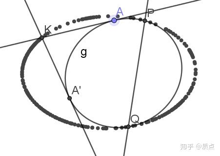
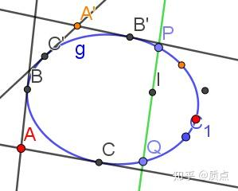
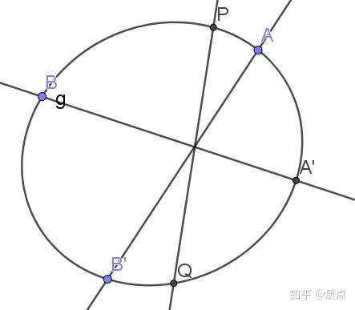
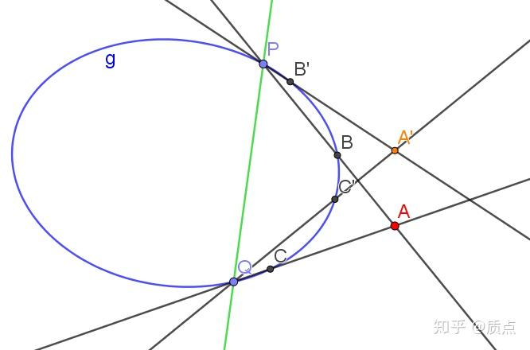

# 圆锥曲线第二十节：洛伦兹变换与帕斯卡定理

目录：质点：圆锥曲线题目的三维矢量解法

这一节我们将讨论 $g$ 的旋量空间上的一般线性映射 $\varphi$ ，它表示二次点列上的一个射影变换。代数上，它由一个旋量张量 ${t^\alpha}_\beta$ 表示，其特点是 $t_{\alpha\beta}$ 并非对称（对称的情况是对合，我们在二次点列和二次对合已经讨论过），因此其指标不能写成矢量形式。对这类问题，只有借助旋量才能处理。

这一节差不多到了这一系列文章的末尾，因此在这一节中，将会直接陈述若干命题作为练习。读者可以尝试自行证明，也可以在最后查看答案。

**命题1： $\varphi$** 可以从二次点列上的射影变换**线性延拓为全平面上的射影变换，**这一射影变换**保持 $g$ 以及点乘不变。**反过来，每一个**保持圆锥曲线的像不变**的射影变换都可以用这样的 $\varphi$ 表示。**出于它和物理的相似性，我们把它称为洛伦兹变换。**

命题1 其中一个可能的应用是在相对论粒子碰撞中。射影平面，作为四维动量商掉模长，代表了粒子的速度空间（商掉静质量）。 $\varphi$ 代表了所有可能的参考系变换。 $g$ 上的点代表光子， $g$ 内部的点代表有静质量的粒子。这样对于一个粒子碰撞问题，就有可能画出它的速度图，进一步运用命题2、3、4处理问题。

**命题2：设 $a$ 为 $g$ 上的动点，**则直线 $a\times a'$ （我们约定用 $a'$ 表示 $\varphi(a)$ ）的极点 $K$ 的轨迹**构成一条圆锥曲线 $h$ ， $h$ 与 $g$ 必定相切于两点 $p,q$ 。反之，每给定一条与 $g$ 相切于两点的圆锥曲线 $h$ ，就可以通过这种作图方法构造出对应的线性映射 $\varphi$ 以及 $\varphi^{-1}$ 。**

映射 $\varphi$ 以及洛伦兹变换是抽象的，不容易看出其几何含义。但是借助于命题2，我们就可以借助一类特殊的椭圆来构造 $\varphi$ ，从而将其变得直观。

**命题3：**设 $a$ 为 $g$ **外**一点，则可以通过如下方式得到 $a'$ ：

**1.作 $a$ 到 $g$ 的两条切线，切点分别为 $b,c$**

**2. $\varphi$ 在 $g$ 上是有定义的，因此可以作出 $b',c'$**

**3. $b',c'$ 的切线的交点即为 $a'$** 。

命题3给出了$\varphi$的延拓的一种作图方式。

**命题4：用** $C$ 表示所有**与**$g$**相切于**$p,q$**两点的圆锥曲线构成的集合。对任意一点** $a$ ，**在 $C$ 中存在唯一一条经过 $a$ 的圆锥曲线**（记作 $c(a)$ )，并且恒有 $c(a)=c(a')$ 。

**或者直接说，映射 $\varphi$ 把任意与 $g$ 相切于 $p,q$ 两点的圆锥曲线映射为自身**。于是所有这样的圆锥曲线在平面上划出一族“ $\varphi$ 轨道”。

**命题5：**设 $a$ 不在 $g$ 上，可以通过以下方式作出 $a'$ ：

**1.作直线 $a\times p$ ，交 $g$ 于 $b$**

**2.作出 $b'$**

**3.作直线 $b'\times p$ ，与 $c(a)$ 的交点即为 $a'$**

命题4、5使得 $\varphi$ 在全平面上的行为更加可视化。

**命题6（帕斯卡定理）：**

**1.** $g$ **上的三对对应点 $a,a',b,b',c,c'$ 能唯一确定射影变换 $\varphi$ 使得**$a'=\varphi(a),b'=\varphi(b),c'=\varphi(c)$ 。

**2. $s=p\times q$ 称为 $\varphi$ 对应的帕斯卡线。设 $a,b$ 为 $g$ 上的任意两点，则点 $(a\times b')\times (a'\times b)$ 必定在帕斯卡线上。**

帕斯卡定理是圆锥曲线论中的重要定理。

---

现在我们给出证明步骤。

命题1： $\varphi$可以从二次点列上的射影变换线性延拓为全平面上的射影变换，这一射影变换保持 $g$ 以及点乘不变。反过来，每一个保持圆锥曲线的像不变的射影变换都可以用这样的 $\varphi$ 表示。出于它和物理的相似性，我们把它称为洛伦兹变换。

证：根据 $\varphi$ 的定义， $\mathfrak a'^\alpha=t^\alpha_\beta\mathfrak a^\beta$ 。设 $a=\mathfrak a\mathfrak a$ ，则根据旋量与类光矢量的对应关系有 $a'=\mathfrak a'\mathfrak a'$ ，即 $a'^{\alpha\dot \alpha}=t^\alpha_\beta\mathfrak a^\beta t^\dot\alpha_\dot\beta\mathfrak a^\dot\beta=t^\alpha_\beta t^\dot\alpha_\dot\beta a^{\beta\dot\beta}$ ，是关于 $a^{\beta\dot\beta}$ 的线性映射。此时 $a^{\beta\dot\beta}$ 作为定义域只包含 $\det a^{\beta\dot\beta}=0$ 的部分，但线性映射 $t^\alpha_\beta t^\dot\alpha_\dot\beta a^{\beta\dot\beta}$ 可自然地把定义域 $ a^{\beta\dot\beta}$ 延拓到所有的对称旋量张量，因此也就延拓到了平面上的所有点。用矢量指标写出来，就是 $a'^i=\sigma^i_{\alpha\dot\alpha}t^\alpha_\beta t^\dot\alpha_\dot\beta \sigma_j^{\beta\dot\beta}a^j$ ，可见确实延拓成了全平面上的射影变换。

因为 $\varphi$ 把 $g$ 上的点映射为 $g$ 上的点，因此它是保持 $g$ 的像（指圆锥曲线对应的点集）不变的。因为圆锥曲线张量可以由它的像完全确定，因此 $g$ 作为张量也是关于 $\varphi$ 不变的。进一步由 $g_{ij}$ 定义的点乘也是关于 $\varphi$ 不变的。因为在二维空间一维时间中保持时空距离不变的参考系变换是三维的（两个boost和一个空间旋转），二维矢量空间中的射影变换也是三维的，因此它们恰好能一一对应。

命题2：设 $a$ 为 $g$ 上的动点，则直线 $a\times a'$ （我们约定用 $a'$ 表示 $\varphi(a)$ ）的极点 $K$ 的轨迹构成一条圆锥曲线 $h$ ， $h$ 与 $g$ 必定相切于两点 $p,q$ 。反之，每给定一条与 $g$ 相切于两点的圆锥曲线 $h$ ，就可以通过这种作图方法构造出对应的线性映射 $\varphi$ 以及 $\varphi^{-1}$ 。

证：我们只需要想办法用 $t_{\alpha\beta}$ 表示出 $h_{\alpha\beta\gamma\delta}$ 即可。换句话说，我们要找到这样的 $h_{\alpha\beta\gamma\delta}$ 使得对任意的 $\mathfrak c$ ，均有 $h_{\alpha\beta\gamma\delta}t^\beta_\dot\beta t^\delta_\dot\delta\mathfrak c^\alpha\mathfrak c^\dot\beta\mathfrak c^\gamma\mathfrak c^\dot\delta=0$ 。

首先注意到，射影变换 $t^{\alpha}_\beta$ 的不动点方程是二次的，因此必定有两个不动点，分别记为 $\mathfrak a,\mathfrak b$ ，即 $\mathfrak a^\alpha=t^{\alpha}_\beta\mathfrak a^\beta$ ， $\mathfrak b^\alpha=t^{\alpha}_\beta\mathfrak b^\beta$ 。现在先考虑第一个方程，把它降指标，就有 $\mathfrak a_\alpha=t_{\alpha\beta}\mathfrak a^\beta$ 。左右两边乘以 $\mathfrak a^\alpha$ ，利用 $\mathfrak a^\alpha\mathfrak a_\alpha=0$ ，得到 $t_{\alpha\beta}\mathfrak a^\alpha\mathfrak a^\beta=0$ 。我们把 $t$ 对称化：设 $s_{\alpha\beta}=t_{\alpha\beta}+t_{\beta\alpha}$ ，那么就有 $s_{\alpha\beta}\mathfrak a^\alpha\mathfrak a^\beta=0$ 。类似地 $s_{\alpha\beta}\mathfrak b^\alpha\mathfrak b^\beta=0$ 。注意到 $s_{\alpha\beta}$ 是对称的，因此它表示一个对合变换，其不动点恰好是$\mathfrak a,\mathfrak b$。这就导致 $s=(\mathfrak a\mathfrak b)$ ，即 $t_{\alpha\beta}+t_{\beta\alpha}=(\mathfrak a\mathfrak b)_{\alpha\beta}$ 。很容易看出，这两个不动点分别对应了 $p,q$ 。于是 $s_{\alpha\beta}$ 就对应了直线 $p\times q$ 。

因为 $g,h$ 相切于两点，因此 $g,h,ss$ 构成二次线系，所以可以设 $h=ss+\lambda g$ ，用分量写出来就是 $h_{\alpha\beta\gamma\delta}=s_{\alpha\beta}s_{\gamma\delta}+\lambda g_{\alpha\beta\gamma\delta}$ 。把它代入$h_{\alpha\beta\gamma\delta}t^\beta_\dot\beta t^\delta_\dot\delta\mathfrak c^\alpha\mathfrak c^\dot\beta\mathfrak c^\gamma\mathfrak c^\dot\delta=0$ ，得到 $(s_{\alpha\beta}s_{\gamma\delta}t^\beta_\dot\beta t^\delta_\dot\delta+\lambda g_{\alpha\beta\gamma\delta}t^\beta_\dot\beta t^\delta_\dot\delta)c^\alpha\mathfrak c^\dot\beta\mathfrak c^\gamma\mathfrak c^\dot\delta=0$ 。小括号里的第一项，

$s_{\alpha\beta}s_{\gamma\delta}t^\beta_\dot\beta t^\delta_\dot\delta=(t_{\alpha\beta}+t_{\beta\alpha})(t_{\gamma\delta}+t_{\delta\gamma})t^{\beta\beta'} t^{\delta\delta'}e_{\beta'\dot\beta}e_{\delta'\dot\delta}$

$=({{t^2}_{\alpha}}^{\beta'}+\delta_\alpha^{\beta'})({{t^2}_{\gamma}}^{\delta'}+\delta_\gamma^{\delta'})e_{\beta'\dot\beta}e_{\delta'\dot\delta}$

$=({t^2}_{\alpha\dot\beta}+e_{\alpha\dot\beta})({t^2}_{\gamma\dot\delta}+e_{\gamma\dot\delta})$ 。它乘以 $\mathfrak c^\alpha\mathfrak c^\dot\beta\mathfrak c^\gamma\mathfrak c^\dot\delta$ 的结果是，其中含有类似 $e_{\alpha\dot\beta}\mathfrak c^\alpha\mathfrak c^\dot\beta$ 的项都因为 $e$ 的反对称而等于0，因此留下来的只有 ${t^2}_{\alpha\dot\beta}{t^2}_{\gamma\dot\delta}\mathfrak c^\alpha\mathfrak c^\dot\beta\mathfrak c^\gamma\mathfrak c^\dot\delta$ ，进一步等于 $({t^2}_{\alpha\dot\beta}\mathfrak c^\alpha\mathfrak c^\dot\beta)^2$ 。小括号中的第二项

$g_{\alpha\beta\gamma\delta}t^\beta_\dot\beta t^\delta_\dot\delta=(e_{\alpha\gamma}e_{\beta\delta}+e_{\alpha\delta}e_{\beta\gamma})t^\beta_\dot\beta t^\delta_\dot\delta$

$=(e_{\alpha\gamma}t_{\delta\dot\beta}+e_{\alpha\delta}t_{\gamma\dot\beta}) t^\delta_\dot\delta$

$=e_{\alpha\gamma}e_{\dot\delta\dot\beta}-t_{\alpha\dot\delta}t_{\gamma\dot\beta}$

第一项乘以$\mathfrak c^\alpha\mathfrak c^\dot\beta\mathfrak c^\gamma\mathfrak c^\dot\delta$后得到0，因此只留下后一项。最后我们把方程 $(s_{\alpha\beta}s_{\gamma\delta}t^\beta_\dot\beta t^\delta_\dot\delta+\lambda g_{\alpha\beta\gamma\delta}t^\beta_\dot\beta t^\delta_\dot\delta)c^\alpha\mathfrak c^\dot\beta\mathfrak c^\gamma\mathfrak c^\dot\delta=0$ 改写成了 $({t^2}_{\alpha\beta}\mathfrak c^\alpha\mathfrak c^\beta)^2-\lambda({t}_{\alpha\beta}\mathfrak c^\alpha\mathfrak c^\beta)^2=0$ ，其中张量 $t^2$ 定义为 ${{t^2}^\alpha}_\gamma={{t}^\alpha}_\beta{{t}^\beta}_\gamma$ 。

表面上看，无论 $\lambda$ 如何取值也不能使其成为恒等式。但实际则不然。 $2\times 2$ 的矩阵 $A$ 必定满足恒等式： $I \text{tr} A-A=(\det A)A^{-1}$ ，在两边同乘 $A$ 就得到 $A \text{tr} A-A^2=(\det A)I$ 。把这个等式应用于 ${t^\alpha}_\beta$ ，就得到 ${t^\alpha}_\beta{t^\mu}_\mu-{{t^2}^\alpha}_\beta=(\det t) \delta^\alpha_\beta$ ，也就是 $t_{\alpha\beta}{t^\mu}_\mu-{t^2}_{\alpha\beta}=(\det t) e_{\alpha\beta}$ 。两边同乘 $\mathfrak c^\alpha\mathfrak c^\beta$ 后得到 ${t^\mu}_\mu({t}_{\alpha\beta}\mathfrak c^\alpha\mathfrak c^\beta)=({t^2}_{\alpha\beta}\mathfrak c^\alpha\mathfrak c^\beta)$ 。利用这个结论，我们只需要令 $\lambda=({t^\mu}_\mu)^2$ 就使 $h_{\alpha\beta\gamma\delta}t^\beta_\dot\beta t^\delta_\dot\delta\mathfrak c^\alpha\mathfrak c^\dot\beta\mathfrak c^\gamma\mathfrak c^\dot\delta=0$ 成为了恒等式，从而证明了 $ a\times a' $ 的极点确实在圆锥曲线 $h$ 上。其中 $h_{\alpha\beta\gamma\delta}=(t_{\alpha\beta}+t_{\beta\alpha})(t_{\gamma\delta}+t_{\delta\gamma})+({t^\mu}_\mu)^2 g_{\alpha\beta\gamma\delta}$ 。

最后注意到圆锥曲线有5个自由度，两个相切条件产生2个约束，因此这样的 $h$ 共有3个自由度，等于射影变换的自由度个数。因此它们是相互对应的。

命题3：设 $a$ 为 $g$ 外一点，则可以通过如下方式得到 $a'$ ：

1.作 $a$ 到 $g$ 的两条切线，切点分别为 $b,c$

2. $\varphi$ 在 $g$ 上是有定义的，因此可以作出 $b',c'$

3. $b',c'$ 的切线的交点即为 $a'$ 。

证：利用 $\varphi$ 保点乘的特性。因为 $a\cdot b=0$ ，因此 $a'\cdot b'=0$ 。同理 $a'\cdot c'=0$ 。因此 $a'=b'\times c'$ 。

命题4：用 $C$ 表示所有与 $g$ 相切于 $p,q$ 两点的圆锥曲线构成的集合。对任意一点 $a$ ，在 $C$ 中存在唯一一条经过 $a$ 的圆锥曲线（记作 $c(a)$ )，并且恒有 $c(a)=c(a')$ 。

或者直接说，映射 $\varphi$ 把任意与 $g$ 相切于 $p,q$ 两点的圆锥曲线映射为自身。于是所有这样的圆锥曲线在平面上划出一族“ $\varphi$ 轨道”。

证：5点确定一条圆锥曲线。“相切”可以看作同时经过切点附近切线上无限接近的两个点，从而命题中的问题可以转化为五点确定一条圆锥曲线的问题，因此 $c(a)$ 是唯一的。

凡是这样的 $c(a)$ 必定可以用形如 $c_{\alpha\beta\gamma\delta}=s_{\alpha\beta}s_{\gamma\delta}+\lambda({t^\mu}_\mu)^2 g_{\alpha\beta\gamma\delta}$ 的方程描述，其中 $\lambda$ 是新的一个待定实数（见命题2的证明）。因此 $c_{\alpha\beta\gamma\delta}'=s_{\alpha\beta}’s_{\gamma\delta}'+\lambda({t^\mu}_\mu)^2 g_{\alpha\beta\gamma\delta}'$ 。因为 $g$ 以及 $s=p\times q$ 都是在 $t$ 作用下不变的（最多差一个确定的倍数），因此 $c_{\alpha\beta\gamma\delta}'=\alpha s_{\alpha\beta}s_{\gamma\delta}+\beta \lambda({t^\mu}_\mu)^2 g_{\alpha\beta\gamma\delta}$ ，其中 $\alpha,\beta$ 为待定常数。这样我们可以证明 $c(a')\in C$ ，但是要证明 $c(a')=c(a)$ ，就还得证明 $\alpha=\beta$ 。为了证明这一点，我们取 $\lambda=1$ ，这样就回到了命题3的情况。在命题3中，因为 $h_{\alpha\beta\gamma\delta}'=\alpha s_{\alpha\beta}s_{\gamma\delta}+\beta ({t^\mu}_\mu)^2 g_{\alpha\beta\gamma\delta}$ ， $h_{\alpha\beta\gamma\delta}= s_{\alpha\beta}s_{\gamma\delta}+ \lambda({t^\mu}_\mu)^2 g_{\alpha\beta\gamma\delta}$ 且 $h=h'$ ，所以$\alpha=\beta$。这就完成了证明。

注： $C$ 中的元素中有2个是退化的，其中一个是 $ss$ ，一个是 $p,q$ 的两条切线的对称积。后者两条切线的交点设为 $r$ ，则 $r$ 是 $s$ 的极点。在整个平面上， $\varphi$ 的不动点有且仅有3个： $p,q,r$ 。

命题5：设 $a$ 不在 $g$ 上，可以通过以下方式作出 $a'$ ：

1.作直线 $a\times p$ ，交 $g$ 于 $b$

2.作出 $b'$

3.作直线 $b'\times p$ ，与 $c(a)$ 的交点即为 $a'$

证：只需要证明，经过

*1.作直线 $a\times p$ ，交 $g$ 于 $b$*

*2.作出 $b'$*

*3.作直线 $b'\times p$*

的作图后， $a'$ 位于 $b'\times p$ 上。证明如下：等式 $(b\times p)\cdot a=0$ 经射影变换（Levi-Civita记号是射影不变的）后变成 $(b'\times p')\cdot a'=0$ ，而 $p'=p$ 。因此 $(b'\times p)\cdot a'=0$ ，证毕。

注：注意到 $p$ 只是其中的一个不动点，我们还有另一个不动点 $q$ 。对于 $q$ 采取类似的做法：

*1.作直线*$a\times q$*，交*$g$*于*$c$

*2.作出*$c'$

*3.作直线* $c'\times q$

同样可以证明 $(c'\times q)\cdot a'=0$ 。因此 $a'=(b'\times p)\times(c'\times q)$ ，如图：

命题6（帕斯卡定理）：

1. $g$ 上的三对对应点 $a,a',b,b',c,c'$ 能唯一确定射影变换 $\varphi$ 使得 $a'=\varphi(a),b'=\varphi(b),c'=\varphi(c)$ 。

2. $s=p\times q$ 称为 $\varphi$ 对应的帕斯卡线。设 $a,b$ 为 $g$ 上的任意两点，则点 $(a\times b')\times (a'\times b)$ 必定在帕斯卡线上。

证：令圆锥曲线上任意点 $d$ 的像 $d'$ 满足 $a,b,c,d$ 的交比等于 $a',b',c',d'$ 的交比，这便唯一地确定了映射 $\varphi$ 。

根据上一节末尾的结论，图中的三条直线共点当且仅当存在对合 $f$ ，使得 $p,q$ 、 $a,b'$ 、 $a',b$ 均关于 $f$ 对合。

用旋量语言， $a=\mathfrak a\mathfrak a,a'=\mathfrak a'\mathfrak a',b=\mathfrak b\mathfrak b,b'=\mathfrak b'\mathfrak b'$ ，则 $a\times b'=(\mathfrak a\mathfrak b'),a'\times b=(\mathfrak a'\mathfrak b)$ 。（回忆上一节命题1，任意点的旋量表示）。在本节的命题2的证明中已经得到 $s_{\alpha\beta}=t_{\alpha\beta}+t_{\beta\alpha}$ 。于是对合的三个方程分别为：

$f_{\alpha\beta}\mathfrak a^\alpha\mathfrak b'^\beta=0$ 、 $f_{\alpha\beta}\mathfrak a'^\alpha\mathfrak b^\beta=0$ 以及 $f_{\alpha\beta}t^{\alpha\beta}=0$ 。前两个方程进一步展开为 $f_{\alpha\beta}\mathfrak a^\alpha {t^\beta}_\dot\beta\mathfrak b^\dot\beta=0$ 和 $f_{\alpha\beta}{t^\alpha}_\dot\alpha\mathfrak a^\dot\alpha\mathfrak b^\beta=0$ 。

为了证明这三个方程可以同时成立，我们先令第三个方程成立，再证明此时前两个方程等价。

我们改设 ${h_{\alpha}}^\gamma=f_{\alpha\beta}t^{\beta\gamma}$ ，那么第三个方程$f_{\alpha\beta}t^{\alpha\beta}=0$便改写为 ${h_{\gamma}}^\gamma=0$ ，前两个方程则分别改写为 $h_{\alpha\dot\beta}\mathfrak a^\alpha\mathfrak b^\dot\beta=0$ 以及 $h_{\beta\dot\alpha}\mathfrak a^\dot\alpha\mathfrak b^\beta=0$ （注意改写第二个方程时利用了 $f_{\alpha\beta}=f_{\beta\alpha}$ ！）而通过 ${h_{\gamma}}^\gamma=0$ 可以导出  $h_{\alpha\gamma}=h_{\gamma\alpha}$ （2维矩阵的结论，零迹决定了对称），这样前两个方程确实就完全等价了！这样只剩下两个方程，而两个方程是可以确定唯一的对合变换的。证毕。

目录：质点：圆锥曲线题目的三维矢量解法
