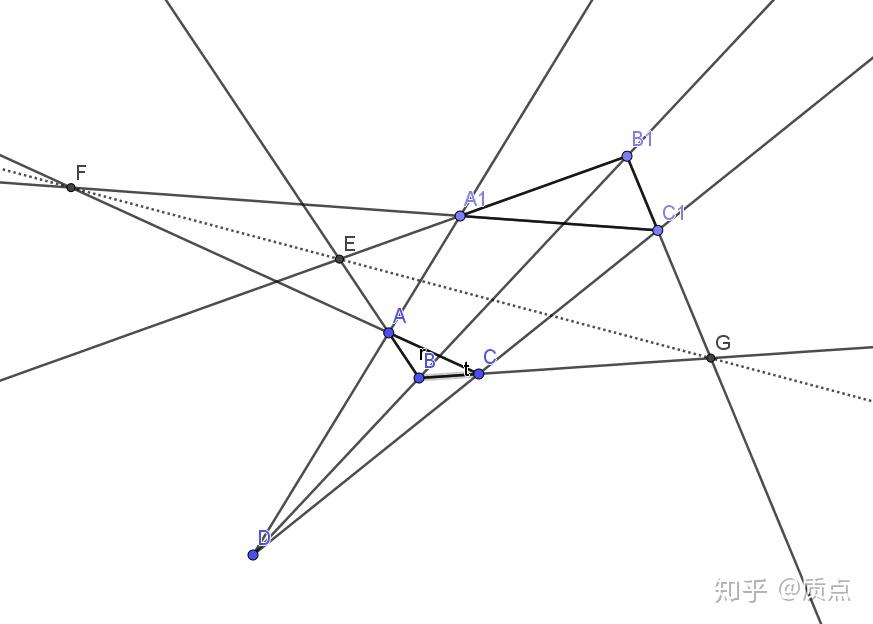

# 圆锥曲线第五节：点矢量和线矢量

目录：质点：圆锥曲线题目的三维矢量解法

在上一节的末尾，我们提到，我们只关心**矢量不依赖于坐标系的运算对应的几何关系**。因此我们的讨论也从这类运算出发。从现在开始，我们更改一下符号：一般用小写字母 $a,b,c,d,p,q,s$ 表示矢量，用 $k,l,m,n,u,v$ 表示对偶矢量。 $f,g,h$ 表示张量。 $A$ 一般表示 $a$ 对应的点，等等。

首先要讨论的是矢量的加法。然而在矢量的加法上，我们却立刻遇到了一些麻烦。

我们现在有两个不共线的矢量 $a,b$ ，它们分别表示平面上的点 $A,B$ 。我们想知道， $a+b$有什么几何意义？

比如说，在平面解析几何中，我们取这两个点 $A(0,0),B(1,0)$ 。那么矢量 $a^i=(0,0,1);b^i=(1,0,1)$ 可以分别表示点 $A,B$ 。那么有 $(a+b)^i=(1,0,2)$ 。应用上一节的规则，它表示的点的坐标是 $(0.5,0)$ 。

问题是，我们并不一定要用**这两个**矢量来表示点 $A,B$ 。因为三维矢量到平面点的映射是多对一的，我们可以用任意形如$a^i=(0,0,\lambda);b^i=(\mu,0,\mu)$，其中 $\lambda,\mu$ 是非零实数，来代表相同的点。这样以来，$(a+b)^i=(\mu,0,\lambda+\mu)$，它对应的点是 $(\frac{\mu}{\lambda+\mu},0)$ 。随着两个参数取不同的值，它对应的点是不同的！

这意味着，仅仅已知 $a,b$ 两个矢量对应的点，是不能确定 $a+b$ 对应的点的。要想把它确定，就不能允许这两个矢量在它们的方向上任意地变长变短。为此，我们需要一些附加的条件来限制这些矢量。这种限制的条件被称为规范。

比如说，和平面几何联系最紧密的规范是令矢量在某参考系下的第三个分量为1。这个规范被称为标准规范。

有的关系是在选取一个特定的规范下才成立的；有的定义是在选取一个特定的规范下才有意义的。然而，有一类关系，无论选取哪种规范，它都成立。这种关系被称为规范不变的。对这类关系我们往往更感兴趣。

具体一点，比如说我们有若干个元素， $a,b,c,l,m,n,g$ 。它们之间满足一些等式，这里就举一个最简单的等式作为例子，比如 $l\cdot a=k$ ,其中 $k$ 是一个实数。如果其中的任何一个矢量（或者对偶矢量）变成自己的若干倍后（这就是说，这个矢量仍然表示同一个点），等式仍然可以成立，那么这个等式就是规范不变的。例如， $l\cdot a=0$ 是规范不变的，$l\cdot a=1$不是规范不变的。一个等式是规范不变的，意味着这个等式能够描述平面几何中元素的关系（确切地说，是平面射影几何中的元素）。如果它不是规范不变的，它就有可能只能描述三维矢量的关系。

如果我们通过各种运算，用一些元素$a,b,c,l,m,n,g$构造出了一个实数。如果其中任意一个元素变成自己的若干倍时，构造出的实数不变，那么构造出的实数是具有几何意义的。比如，混合积 $[abc]$ 是没有几何意义的。但是很容易验证，表达式 $\frac{[abc][ade]}{[abd][ace]}$ 是有几何意义的。

如果我们通过各种运算，用一些元素$a,b,c,l,m,n,g$构造出了一个矢量或者张量。如果其中任意一个元素变成自己的若干倍时，构造出的元素也变为自己的若干倍，那么构造出的这个东西是具有几何意义的。比如， $a+b$ 是没有几何意义的，但叉乘 $a\times b$ 是有几何意义的。

如果我们有若干个元素，并且用它们构造出了一个命题。如果任意矢量或张量元素变为自己的若干倍，命题仍成立，则这个命题是有几何意义的。

比如如下命题：“三个矢量 $a,b,a+b$ 对应的点一定共线”。虽然在不同的规范下 $a+b$ 是不同的点，但无论取什么规范，这个命题都成立。这个例子我们稍后会进一步讨论。

明确了怎么样才有几何意义后，我们改为从一些几何意义明确的运算入手。于是我们来讨论等式$l\cdot a=0$。根据我们在齐次坐标一节中建立的关系，矢量$a$代表一个点，但是目前还不知道对偶矢量 $l$ 代表什么。因此，我们把等式展开，设 $l_i=(A,B,C),a^i=(X,Y,Z)$ ,则 $l\cdot a=AX+BY+CZ=0$ 。将两边除以Z，再利用 $x=\frac{X}{Z},y=\frac{Y}{Z}$ ,得到 $Ax+By+C=0$ 。这正是直线的标准方程。这意味着，$l\cdot a=0$意味着 $a$ 在由 $l$ 的分量确定的直线上。因为矢量和对偶矢量的点乘是坐标系无关的，可以说，对偶矢量$l$代表了一条直线。

因此我们有以下事实：

**1.矢量 $a$ 表示一个点。出于这个理由，我们以后把矢量叫做点矢**

**2.对偶矢量 $l$ 表示一条线。出于这个理由，我们以后把对偶矢量叫做线矢**

**3. $a\cdot l=0$ 意味着点在直线上，或者说直线经过点**

值得注意的是，**对偶矢量和矢量是具有相同的地位的。因此直线和点也是具有相同地位的**。

两个点矢的叉乘 $a\times b$ 是一个线矢，它是规范不变的。我们猜想它必定有几何意义。注意到， $(a\times b)\cdot a=(a\times b)\cdot b=0$ ，因此$a\times b$对应的直线经过a，b两点。因为两点确定一条直线，所以我们得知：

**4.两个点矢叉乘得到线矢，这个线矢表示过这两个点的直线**

类似地，两个线矢的叉乘 $m\times n$ 是一个点矢，且 $(m\times n)\cdot m=(m\times n)\cdot n=0$ 因此这个点矢对应的点同时在两条直线上。因此:

**5.两个线矢叉乘得到点矢，这个点矢表示这两条直线的交点**

如果 $a\cdot l=0,b\cdot l=0$ ,那么对于任意的 $\lambda$ , $l\cdot (a+\lambda b)=0$ 。因此，当$\lambda$取遍所有实数时 $a+\lambda b$ 取遍所有直线上的点。这条直线上的所有点构成的集合称为点列。有时为了和圆锥曲线上的点集区分，称之为一次点列。

注意：1无论规范如何选取，$a+\lambda b$总能取遍所有直线上的点 2严格地说， $b$ 点不能写为$a+\lambda b$的形式。因此我们不严格地定义，当 $\lambda$ 等于无穷大时，$a+\lambda b$表示 $b$ 点。

类似地， $m+\lambda n$ 取遍过m、n交点的所有直线。这些直线构成的集合称为一次线束，也称线束。

如果三个点矢的混合积$[abc]=0$ ，那么 $a\times b\cdot c=0$ ，即经过ab的直线过c点，换言之，abc三点共线。

类似地，如果三个线矢的混合积为0，那么这三条线共点。

现在我们来做一些练习，来加深矢量运算的熟练度。

第一题：证明Desargues定理：两个三角形ABC和A'B'C'，如果对应点所连直线三线共点（D点），则对应边的交点EFG三点共线。

证：设ABC三点的点矢量为 $a,b,c$ 。因为ABC不共线，因此 $[abc]\ne 0$ ,可以把$a,b,c$作为三个基矢构造坐标系。因此 $a^i=(1,0,0),b^i=(0,1,0),c^i=(0,0,1)$ 。设 $d^i=(x,y,z)$ 。因为 $A,A',D$ 共线，因此可以设 $a'=d+\lambda a$ ,即 $a'^i=(x+\lambda,y,z)$ 。类似，设 $b'^i=(x,y+\mu,z),c'^i=(x,y,z+\sigma)$ 。在这个坐标系下定义叉乘，则 $(a\times b)_i=(0,0,1)$ ,

$(a'\times b')_i=(-\mu z,-\lambda z,\lambda y-\mu x +\lambda \mu)$, $e^i=(a\times b)\times(a'\times b')=(\lambda z,-\mu z,0)$

同理， $f^i=(0,\mu x,-\sigma x),g^i=(-\lambda y,0,\sigma y)$ ,因此 $[efg]=\begin{vmatrix}   \lambda z&-\mu z&0\\ 0 &\mu x&-\sigma x\\ -\lambda y&0&\sigma y\\  \end{vmatrix}=xyz\begin{vmatrix}   \lambda &-\mu &0\\ 0 &\mu &-\sigma \\ -\lambda &0&\sigma \\  \end{vmatrix}=0$ ,证毕

目录：质点：圆锥曲线题目的三维矢量解法
