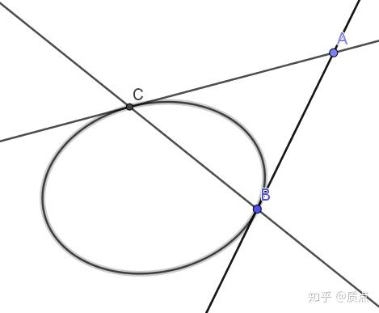
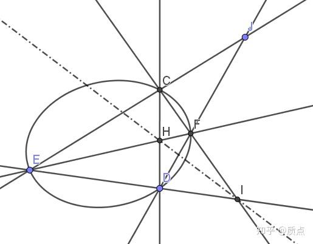
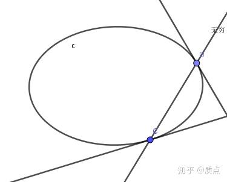

# 圆锥曲线第七节：椭圆、双曲线和抛物线;极点极线

目录：质点：想整理一篇关于高中的圆锥曲线的文章

现在我们来引入圆锥曲线（有时也叫做二次曲线）的概念。

定义：**一个不定的对称可逆的（0,2）型张量**$g_{ij}$**被称为圆锥曲线张量**。

通过$g_{ij}$，我们可以得到它的逆张量 $(g^{-1})^{ij}$ 。当且仅当我们把$g_{ij}$作为度规时，$(g^{-1})^{ij}$可以简写成 $g^{ij}$ 。如果我们只处理一条圆锥曲线，我们当然可以把它作为度规，但如果我们要处理多条圆锥曲线时，就没法把所有圆锥曲线都选成度规。这时就只能使用$(g^{-1})^{ij}$这一写法了。

我们还给这个张量附加了一个条件“不定的”，复习一下，这个条件是指对于任意的非零矢量 $a$ , $g_{ij}a^ia^j$ 既可能是正的，也可能是负的，也可能是0.之所以我们需要这个条件是因为在我们之前的理解中，圆锥曲线是一条曲线，相当于曲线上所有点的集合。而

**定义：若点矢**$a$**满足**$g_{ij}a^ia^j=0$ （注意，这个等式是规范不变的）**,则称**$a$**对应的点在**$g$**对应的圆锥曲线上。**

（从这个定义可以看出：如果我们不要求 $g$ 是不定的，那么上面的方程没有非零解，意味着这条曲线并不存在。比如说， $x^2+y^2=-1$ 这种曲线就是不存在的。但实际上，我们在很多场合并不认真考虑这一要求，而是默认讨论的所有张量都是不定的。）

如果熟悉相对论的话，会知道狭义相对论中的时空拥有一个不定度规。我们现在用三维矢量空间表示平面上的点，并附加了一个圆锥曲线作为度规，这样得到的结构就十分类似于三维时空（由一维时间和二维空间构成）。这种类似性并不重要，但可以带来一些直观的体验，本节末尾会略微讨论这种相似性。

**定义：若线矢**$l$**满足**$g^{ij}l_il_j=0$**，则称**$l$**对应的直线与**$g$**对应的圆锥曲线相切。**

注：这么定义相切是为了体现定义的对称性。通过这个定义可以证明，如果$l$与$g$相切，那么只存在一个点同时位于$l$与$g$上（换句话说，它们只有一个交点）。在以前，我们都是通过只有一个交点这个性质来定义相切的。

当我们在图上画一条二次曲线的时候，我们一般会随手画一个椭圆（而不画另外两种）

现在我们把圆锥曲线定义为一个二阶张量，并且完全对称地给出了圆锥曲线上的点和切线的定义，这已经是十分优美的了。接下来我们要十分自然地引入圆锥曲线的极点和极线。

在有了$g$后，我们可以用它作为度规来升降指标。点矢 $a^i$ 降指标后得到其对偶的线矢 $a_i=g_{ij}a^j$ ，线矢 $l_i$ 升指标后得到其对应的点矢 $l^i=g^{ij}l_j$ 。因此，如果一个点的点矢和一条线的线矢可以通过升降指标互相转化，那么这个点和这条线一定满足十分自然的关系。

**定义：对任意（矢量或者对偶矢量）元素**$a$**，**$a^i$**对应的点和**$a_i$**对应的直线互相称为对方的极点和极线**

利用这一定义可以在解析几何中写下极点和极线的解析式。比如，对于点 $(x_0,y_0)$ 和椭圆 $\frac{x^2}{a^2}+\frac{y^2}{b^2}=1$ ，它的极线方程为 $\frac{xx_0}{a^2}+\frac{yy_0}{b^2}=1$ 。

在有了度规后，我们可以随时随地升降指标，因此当我们提到元素$a$时，我们并不需要管它是点还是直线。或者说，它**同时代表了一个点和一条线**，这两个点互为极点和极线。

花费巨大的篇幅后，我们终于给出了极点和极线的定义。然而这些篇幅并不是无用功，因为通过几何手段花费大量功夫证明的关于极点极线的性质，在这个定义下完全是显而易见的。

例题：证明，如果A的极线经过B，则B的极线经过A

证：设A，B的点矢为 $a,b$ 。“A的极线经过B”这一命题表述为 $a_ib^i=0$ ，“B的极线经过A”这一命题表述为$a^ib_i=0$。这两个等式都相当于 $g_{ij}a^ib^j=0$ ，或借助点乘，写作 $a\cdot b=0$ 。因此，这两个命题毫无疑问是同一件事情！

方便起见，如果$a\cdot b=0$，那么我们**称**$a,b$**关于这条圆锥曲线共轭**。

例题：证明，**如果一个点在圆锥曲线上，那么它的极线是它在这点的切线**

证：如果 $a$ 在曲线上，那么 $a^2=0$ 。如果把a当成极线，那么这条直线与曲线相切的条件同样是 $a^2=0$ ，必定成立。因为 $a^2=0$ ，所以 $a\cdot a=0$ 。如果把左边的a当作极线，右边的a当作极点，点线之间点乘为0意味着点在线上，因此极点a在极线a上。因此，极线a恰好是极点a处的切线。（这个证明说的简直都是废话！）

例题：证明，如果点A在椭圆外，可以通过如下的方法构造A的极线BC

证：B的极线是B的切线。A在B的切线上，因此 $a\cdot b=0$ 。同理， $a\cdot c=0$ 。因此BC两点都在A的极线上，因此直线BC就是A的极线。

反过来，如果有一条直线与圆锥曲线相交，也可以这样作出它的极点。

定义：如果 $a\cdot b=b\cdot c=c\cdot a=0$ ,则称ABC三点构成自极三点形。这个名字的意义是，很容易验证，A的极线是BC，B的极线是AC，C的极线是AB。一条圆锥曲线的自极三点形可以理解为在三维矢量空间选了一组关于圆锥曲线张量的度规正交的基矢。

例题：对于任意一点J，可以这样作J的极线IH。其中JCE、JFD是任意过J的直线。

证：我们只需要证明 $j\cdot h=j\cdot i=0$ 。先看 $j\cdot h=0$ 。我们设出椭圆上的四点 $c,d,e,f$ ,并用它们表示出 $j=(c\times e)\times (d\times f)$ , $h=(c\times d)\times (e\times f)$ ,因此 $j\cdot h\\=[(c\times e)\times (d\times f)]\cdot[(c\times d)\times (e\times f)]\\ =[(c\times e)\cdot(c\times d)][(d\times f)\cdot(e\times f)]-[(c\times e)\cdot(e\times f)][(d\times f)\cdot(c\times d)]\\=(c\cdot d)(c\cdot e)(d\cdot f)(e\cdot f)-(c\cdot e)(e\cdot f)(d\cdot c)(f\cdot d)=0$

其中在第三个等号时利用了 $c^2=d^2=e^2=f^2=0$ 。因此$j\cdot h=0$，同理 $j\cdot i=0$ ,因此IH是J的极线。

**从这个证明中我们看出，用三维矢量进行证明，最重要的是设出合适的元素作为参量，再用这些参量表达所有的几何元素及其关系。在这里，如果不设**$c,d,e,f$**并用它们表示**$h,i,j$**，而是反过来，用**$j$**求出**$c,d,e,f$**，将是十分困难的。**

极点极线的进一步知识需要调和点列的概念，因此放到以后讲。本节的剩下一件事是对圆锥曲线进行分类。

事实上，对称二阶张量唯一与坐标系无关的性质就是它的号差，然而圆锥曲线的号差必定是两个+1、一个-1（或者两者相反），并不能再做什么区分了。我们之所以能把圆锥曲线区分成椭圆、抛物线、双曲线，是因为我们附加了一个结构——无穷远结构 $l_{\infty}$。

直观上，椭圆的所有点都在有限的区域内，没有任何一个点在无穷远；双曲线在两条渐近线的方向延伸到无穷远，因此它有两个点在无穷远；而抛物线的开口只朝向一个方向，因此它有一个点在无穷远。

因此我们如此定义：**和**$l_{\infty}$**相离的圆锥曲线称为椭圆，和**$l_{\infty}$**相交的圆锥曲线称为双曲线，和**$l_{\infty}$**相切的圆锥曲线称为抛物线。**

通过$l_{\infty}$，可以很自然地构造出一个量：$l_{\infty}$的极点。用解析几何的方法很容易验证：对于椭圆和双曲线，$l_{\infty}$的极点正是它们的对称中心（对于抛物线，这一极点在无穷远，因此我们往往看不到抛物线的中心）。因此，**圆锥曲线的中心是在无穷远结构上派生出来的**。因此，比如你在一道题中看到了椭圆的中心，你就会意识到，这道题很有可能不能仅仅用射影几何做，而是需要在你已有的参量中，添加一个确定的元素：$l_{\infty}$。

顺便指出一件事：如果无穷远直线和双曲线交于CD两点，那么CD两点处的切线正是双曲线的两条渐近线，它们相交于双曲线的中心。

目录：质点：想整理一篇关于高中的圆锥曲线的文章

*附录：接下来比较一下“平面上的圆锥曲线”与“三维时空”的相似性。取光速 $c=1$ 。*

平面上的点用共线的三维矢量表示 $\Leftrightarrow$ 三维时空中的点用三维矢量（的分量） $t,x,y$ 表示

在标准形式下，圆锥曲线的方程可以写作 $z^2-x^2-y^2=0$ $\Leftrightarrow$ 光锥由 $t^2-x^2-y^2=0$ 表示

圆锥曲线张量 $g_{ij}$ $\Leftrightarrow$ 闵氏度规 $\eta_{ij}$

点在圆锥曲线内 $\Leftrightarrow$ 类时矢量

点在圆锥曲线外 $\Leftrightarrow$ 类空矢量

点在圆锥曲线上 $\Leftrightarrow$ 类光矢量

直线与椭圆相离 $\Leftrightarrow$ 类时平面

直线与椭圆相交 $\Leftrightarrow$ 类空平面

直线与椭圆相切 $\Leftrightarrow$ 类光平面
