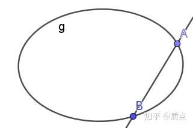
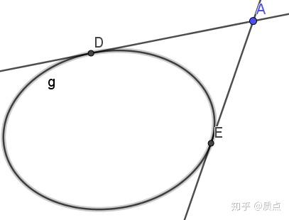

# 圆锥曲线第八节（新）：退化圆锥曲线

目录：

*因为 @心潮逐浪 同学 的新观点 https://zhuanlan.zhihu.com/p/113949979 ，我对第八节的内容进行了大量修改，以便自然地过渡到新的观点。同时我润色了一下语言，使得论述更加清晰。我之后会用新的一节来更充分地介绍这一观点。*

先来回顾一下圆锥曲线的定义：

**一个不定的对称可逆的（0,2）型张量$g_{ij}$被称为圆锥曲线张量。用 $g_{ij}$ 可以得到它的逆张量 $(g^{-1})^{ij}$ ，把g作为度规时可写成 $g^{ij}$ 。 $g_{ij}a^ia^j=0$ 则点在圆锥曲线上， $(g^{-1})^{ij}l_il_j=0$ 则线与圆锥曲线相切。**

**圆锥曲线要求张量** $g_{ij}$ **是可逆的，但是那些不可逆的张量同样有重要的用处**。比如说，双曲线 $\frac{x^2}{a^2}-\frac{y^2}{b^2}=k$ 在 $k=0$ 时会变成两条直线。这“两条直线”可以看作一种特殊的圆锥曲线，或者说“退化圆锥曲线”。自然，由于点与线的对偶性，“两个点”也属于这一类（它实际上是被压扁成一条线段的椭圆，“两个点”就是它的两个端点）。我们有必要找到一种方式把“两条直线”、“两个点”与圆锥曲线一起研究。事实上，我们恰好可以用那些不可逆的张量来表示它们。

另一个重要的例子是，想象一条直线与一个椭圆交于两个点 $a,b$ ，或者过一个点作椭圆的两条切线。**这两个点（或线）是不能拆开的，它们具有完全相同的地位，必须把它们放在一起看待**（这句话的含义目前还不是特别明确，请先往后看）。这时，用某个不可逆的二阶张量（而不是用两个点矢 $a,b$ ）表示它们是最好的方式。

为了容纳退化圆锥曲线，我们作出以下定义：

**1.不定对称的（2,0）型张量$f^{ij}$ 称为二次点张量，它对应的几何元素称为二次点。**（有时我们会省略“张量”两字，比如直接称$f^{ij}$为二次点。和圆锥曲线一样，我们并不认真讨论“不定”这一性质。）

**2.不定对称的（0,2）型张量$h_{ij}$ 称为二次线张量，它对应的几何元素称为二次线。**

**3.二次点与二次线统称二次型，或者二次曲线。**

**4.如果** $f^{ij}l_il_j=0$ **，称直线 $l$ 经过二次点 $f$ 。**（如果 $f$ 是圆锥曲线，这一称呼等价于 $ l$ 与 $f$ 相切）**满足此方程的所有 $l$ 称为一个二次线束。如果 $f$ 是不可逆的，则称为退化二次线束。**

**5.如果 $h_{ij}a^ia^j=0$ ，称点 $a$ 在二次线 $h$ 上。满足此方程的所有 $a$ 称为一个二次点列。如果 $h$ 是不可逆的，则称为退化二次点列。**

有一个上指标是点，两个对称的上指标是二次点。一个下指标是线，两个对称的下指标是二次线。可见“二次点、二次线”这一说法是点与线的推广。

二次型可以是可逆的，也可以是不可逆的。圆锥曲线 $g_{ij}$ 是二次线的可逆特例，它自然生成了一个二次点 $(g^{-1})^{ij}$ 。而不可逆的二次线就不能生成某个二次点，反之同理。

---

现在我们来讨论不可逆二次型的几何意义。

按照二次型矩阵的秩，也就是号差中0的个数，可以把二次型分为三类：没有0、有1个0、有2个0。

没有0意味着可逆，也就是说它是圆锥曲线；有1个0或者2个0的二次型是不可逆的。我们之后将会证明，1个0的二次型对应“两个点”或“两条线”；2个0的二次型对应“单个点”或者“单条线”。我们现在以“二次线”为例给出具体计算，对“二次点”可以进行直接的类比。

应用线性代数的知识，如果 $h_{ij}$ 的号差中有1个0，那么关于 $x^i$ 的线性方程 $h_{ij}x^j=0$ 的解空间是一维的。也就是说，**存在一个非零点矢s，使得**$h_{ij}s^j=0$**，并且使得**$h_{ij}x^j=0$**成立的所有点矢x均与s共线，即** $x^i=\lambda s^i$ 。请注意，$h_{ij}s^j=0$不仅仅意味着$h_{ij}s^is^j=0$，而意味着对任意矢量a,均有 $h_{ij}a^is^j=0$ 。

因为 $h_{ij}s^is^j=0$ ，根据定义， $s$ 在二次线上。我们假设另一个点A也在二次线上，那么根据定义，$h_{ij}a^ia^j=0$。直线SA上的所有点均可写为 $s+\lambda a$ 的形式，而 $h_{ij}(s+\lambda a)^i(s+\lambda a)^j=h_{ij}s^is^j+2\lambda h_{ij}s^ia^j+\lambda ^2h_{ij}a^ia^j=0$ ，因此整条直线都在曲线 $h$ 上。换句话说，**在 $h$ 上的点集包括一个定点s以及若干条（设为n条）穿过s的直线上的所有点**。我们可以证明，唯一的可能是 $n=2$ 。我们在平面上任意取 $p,q$ 两点作直线，直线上的所有点都具有 $p+\lambda q$ 的形式。而 $h_{ij}(p^i+\lambda q^i)(p^j+\lambda q^j)=0$ 是关于 $\lambda$ 的二次方程，一般有两个解。这说明任意一条直线一般有2个点在 $h$ 上。因此 $h$ 的点集在两条直线上（它们各自与过$p,q$的直线有1个交点）。

如果$h_{ij}$ 的号差中有2个0，那么关于 $x^i$ 的线性方程 $h_{ij}x^j=0$ 的解空间是一维的。也就是说，存在两个不共线的点矢 $s,t$ 使得$h_{ij}s^j=0$，$h_{ij}t^j=0$。很明显， $s,t$ 以及这两点连线上的所有点都在 $h$ 上。除此之外，没有任何点在 $h$ 上了。这是因为，如果 $p$ 不在 $s,t$ 连出来的直线上，那么 $p,s,t$ 三个矢量构成三维空间的基底，从而任何点都能用 $a=\lambda p+\mu s+\sigma t$ 表示。 $h_{ij}p^ip^j=0$  导致$h_{ij}a^ia^j=h_{ij}(\lambda p^i+\mu s^i+\sigma t^i)(\lambda p^j+\mu s^j+\sigma t^j)=0$ ，从而任何点都在$h$ 上。这显然是荒谬的。因此点在$h$ 上 当且仅当它们在s，t的连线上。

经过以上讨论，我们得知：

**在二次线 $h_{ij}$ 上的所有点构成圆锥曲线（可逆时）或两条直线（号差有1个0时）或一条直线（号差有2个0时）**

对偶地，对二次点，我们有

**经过二次点 $f^{ij}$ 上的所有直线相切于圆锥曲线（可逆时）或经过两个定点（号差有1个0时）或经过一个定点（号差有2个0时）**

---

经过前面的讨论，我们把退化二次型与我们熟悉的点与直线之间建立了联系。现在我们要更具体地建立代数上的联系：如何用（1个或2个）点矢/线矢表示出二次型 $f,h$ ？

先来看如何用两个线矢 $m_i,n_i$ 表示号差有1个0的二次线 $h_{ij}$ 。仅仅用两个线矢，我们要构造出一个**对称**二阶张量，能怎么做？十分自然的构造是，令 $h_{ij}=m_in_j+m_jn_i$ ——这正是我们想要的。事实上，因为我们能够使用的工具仅仅是两个线矢而已，我们能尝试的构造并没有太多选择。

证明：如果a在直线m上，那么 $m\cdot a=0$ ,因此 $h_{ij}a^ia^j=(m_in_j+m_jn_i)a^ia^j=(m\cdot a)(n\cdot a)+(n\cdot a)(m\cdot a)=0$ ，符合点在二次线上的定义。对n的证明是类似的。

特别地，对于点 $s=m\times n$ ,有 $m\cdot s=n\cdot s=0$ ,因此$h_{ij}s^j=m_in_js^j+m_jn_is^j=(n\cdot s)m_i+(m\cdot s)n_i=0$。证毕。

对于二次点 $f^{ij}$ 的讨论是相似的，$f^{ij}=a^ib^j+a^jb^i$。

再来看如何用一个线矢 $l_i$ 表示号差有2个0的二次线 $h_{ij}$ 。很显然的构造是 $h_{ij}=l_il_j$ 。它的证明更加简单：如果 $a$ 在 $l$ 上，那么 $a^il_i=0$ ，那么 $h_{ij}a^ia^j=l_il_ja^ia^j=(l_ia^i)^2=0$ ，证毕。我们一般把二次线写成 $ll$ ，二次点写成 $aa$ 。

**点矢和线矢可以用特殊的二次点与二次线来表示，但全部的二次点与二次线包含圆锥曲线等丰富得多的几何对象。我们可以给这些几何对象之间赋予代数运算来表达多样的几何关系，这些代数运算有比矢量运算更多的内容，而矢量间的点乘与叉乘仅仅成为其特例。**更多的内容将会在另一节中讲述，这里仅仅举一个例子：

点 $a$ 在直线 $l$ 上可以用 $a:l=l_{ij}a^{ij}=(a^il_i)^2=0$ 表示，而点 $a$ 在圆锥曲线 $g$ 上可以用 $a:g=g_{ij}a^{ij}=g_{ij}a^ia^j=0$ 表示。前者是后者的特例。

---

**今后我们会遇到复杂的表达式，面对这些表达式，有时候省略指标的书写会轻松一些。因此在某些场景，我会使用不加指标的形式来表示张量运算。运算规则是：**

1.如果我把两个元素直接并列，则意味着我让两个元素的指标**直接并列**，不缩并。比如， $ga$ 的分量是 $g_{ij}a^k$

2.如果我把两个元素之间加了一个点，则表示我让两个元素的**相邻指标缩并**。比如， $g\cdot a$ 的分量是 $g_{ij}a^j$ ; $f\cdot g\cdot a$ 的分量是 $f^{ij}g_{jk}a^k$ 。

3.如果我在两个元素之间加了一个冒号，则表示我在两个元素之间**缩并两个相邻的指标。**这一般只用于一个二次点和一个二次线之间。比如， $f^{ij},g_{ij}$ 加冒号后会得到一个实数： $f:g=f^{ij}g_{ij}$ 。 $h_{ij},g_{ij}$ 之间可以进行两种缩并： $h^{-1}:g=g:h^{-1}=(h^{-1})^{ij}g_{ij}$ 以及 $g^{-1}:h=(g^{-1})^{ij}h_{ij}$ 。注意，这两个数并不相等！如果其中一个是0，另一个未必也是0。

通过这样的记号，$f^{ij}=a^ib^j+a^jb^i$可以写成 $f=ab+ba$ 。因为这个例子十分重要，我单独使用一个符号，把这个张量记成 $f=(ab)$ ，称为这**两个点的对称积**。同理也可以定义两条线的对称积 $h=(mn)$ 。

---

我们在本节开头提到，二次点 $(ab)$ 或二次线 $(mn)$ 中的两个点（或线）是不能拆开的，它们具有完全相同的地位，必须把它们放在一起看待。这时，用某个不可逆的二阶张量（而不是用两个点矢 $a,b$ 或线矢 $m,n$ ）表示它们是最好的方式。这句话的意思是，虽然号差中有1个0的二次点 $f$ 唯一对应了两个点 $a,b$ ，但却很难把这两个点表示出来。

当我们已知 $a,b$ 时，我们可以很轻松地用坐标系无关的张量运算表示出它们的二次点： $f^{ij}=a^ib^j+a^jb^i$ 。然而，我们却不可能仅仅用张量积、缩并的语言用 $f$ 表示出 $a$ （或 $b$ ）。这是因为，张量积以及缩并都是单值函数。如果你有单值函数 $F$ 使得 $a^i=F(f^{ij})$ ，那么我就可以问，既然 $a,b$ 在 $f$ 中具有平等的地位，凭什么你表示出的是 $a^i$ 而不是 $b^i$ ？因此必须也得有$b^i=F(f^{ij})$。这就导致 $a^i=b^i$ ，出现了矛盾。事实上，要用 $f$ 表示 $a,b$ ，必须得开根号，开根号的一个正根和一个负根恰好分别表示出了 $a,b$ 。**然而，我们使用张量语言的初衷是仅仅用张量运算来处理几何问题，给分量的函数开根号明显违反了我们的初衷。这使得我们在很多情况下，只能同时处理两个点的对称积，而不能对它们分别处理**。与两个点的情况不同，我们可以用 $a^{ij}$ 来表示出通过 $a^{ij}=a^ia^j$ 生成它的点 $a^i$ 。这是因为，我们可以任取某个线矢 $l_i$ ，使得 $l_ia^{ij}=l_ia^ia^j=(l\cdot a)a^j$ ，而系数 $l\cdot a$ 是不重要的（只要不是0）。换句话说，如果我们有一个点A对应的二次点，我们只需要把它和一个不通过A的直线缩并掉一个指标，就得到了A对应的点矢。

我们来看一个典型的例子：

**例题：**有一条直线 $l$ 与圆锥曲线 $g$ 交于AB两点，求AB两点构造的二次退化线束。

解：如果一条直线m在二次退化线束上，那它一定经过A点或者B点。换句话说，它和直线 $l$的交点或者是A点，或者是B点。这意味着，**m和l的交点位于**$g$**上**。因此有 $(m\times l)^2=0$ 。左式可以改写为 $m^2l^2-(m\cdot l)^2=0$ 。从这一方程中，我们可以看出，我们需要的张量是$f^{ij}=l^2g^{ij}-l^il^j$ (注意，这里 $l$ 的指标都是在上面的），简写为 $f=l^2g-ll$ 。

（补充一句，$f_{ij}=l^2g_{ij}-l_il_j$表示的是A、B处的切线构成的退化二次点列（图上未画出），有时候这比 $f^{ij}$ 更便于应用）

（再补充一句， $f$ 可以看作 $g$ 在 $l$ 上的诱导度规（这句话不理解也没关系））

这一结论是十分有意思的。因为我们知道，联立直线和椭圆求交点涉及到一个二次方程，需要复杂的运算。然而我们竟然用如此简单的方法构造出了完全由A、B两交点确定（而和椭圆无关）的张量！我们把它称为**联立二次点**。

我们用解析几何来看看这个等式的意义。采用常用的规范，记 $a^i=(x_1,y_1,1),b^i=(x_2,y_2,1)$ ,则 $(ab)=\begin{pmatrix}   x_1x_2&x_1y_2+x_2y_1&x_1+x_2\\ x_1y_2+x_2y_1&y_1y_2&y_1+y_2\\  x_1+x_2&y_1+y_2&2\\ \end{pmatrix}$ 。可见，我们构造出来的矩阵的元素全是由二次方程中两根和以及两根积表示的。而我们知道，**虽然二次方程的解要开根号，但两根和以及两根积是不用开根号的，这正是韦达定理**。因此，我们的等式$f=l^2g-ll$是韦达定理的一个推广结论。

为了避免这篇文章完全不涉及高考内容，我们把这个东西略微整理一下。表达式 $x_1y_2+x_2y_1$ 通常不便于应用。因此我们引入 $k_1=\frac{y_1}{x_1},k_2=\frac{y_2}{x_2}$ ,它表示这个点与原点所连直线的斜率。上式可以改写为 $(ab)=\begin{pmatrix}   x_1x_2&x_1x_2(k_1+k_2)&x_1+x_2\\ x_1x_2(k_1+k_2)&x_1x_2k_1k_2&y_1+y_2\\  x_1+x_2&y_1+y_2&2\\ \end{pmatrix}$ 。引入ab两点的中点M，有 $x_M=\frac{x_1+x_2}{2},y_M=\frac{y_1+y_2}{2}$ 如果把最后一个数归一,则可以写成$(ab)=\begin{pmatrix}   x_1x_2/2&x_1x_2(k_1+k_2)/2&x_M\\ x_1x_2(k_1+k_2)/2&x_1x_2k_1k_2/2&y_M\\  x_M&y_M&1\\ \end{pmatrix}$。这基本解决了求中点的问题。

知乎上经常讨论的是称为“齐次化联立”的技巧，它可以把联立方程写为斜率的二次方程，从而得到 $k_1+k_2,k_1k_2$ 。现在我们看到，只要计算联立二次点的分量，一切问题都解决了。

下面看一道例题，这是我高二时数学老师留的作业。这道题用极坐标有简单的做法，但这里我们看利用联立二次点进行齐次化联立的做法

例：有椭圆 $\frac{x^2}{a^2}+\frac{y^2}{b^2}=1$ ，原点O。一条动直线与椭圆交于两点AB，使得OA与OB垂直。求动直线的包络线。

解：椭圆张量 $g_{ij}=\begin{pmatrix}   \frac{1}{a^2}&0&0\\ 0& \frac{1}{b^2}&0\\0 &0&-1\\ \end{pmatrix}$,$g^{ij}=\begin{pmatrix}   a^2&0&0\\ 0&b^2&0\\0 &0&-1\\ \end{pmatrix}$。设直线 $mx+ny=1$ ，则 $l_i=(A,B,C)$ 。 $l^i=(a^2A,b^2B,C)$ , $l^2=l_il^i=a^2A^2+b^2B^2-C^2$ 。

注意一点：**关于**$l^2$**的这一十分简洁的表达式可以用来判断直线是否与椭圆有交点**。只需要注意到，当直线与椭圆相切的时候，有 $l^2=0$ ,而很容易看出，当有交点时， $l^2>0$ ,当没有交点时， $l^2<0$ 。**出于这个理由，**$l^2=a^2A^2+b^2B^2-C^2$**称为直线与椭圆联立的判别式，它的地位相当于关于点和椭圆的判别式** $\frac{x^2}{a^2}+\frac{y^2}{b^2}-1$ （它可以判断点在椭圆内、外还是椭圆上）**。这个判别式的使用是十分方便的。**

我们写下联立二次点的矩阵： $f^{ij}=l^il^j-l^2g^{ij}=\begin{pmatrix}   a^4A^2&a^2b^2AB&a^2AC\\ a^2b^2AB&b^4B^2&b^2BC\\a^2AC&b^2BC&C^2\\ \end{pmatrix}-(a^2A^2+b^2B^2-C^2)\begin{pmatrix}   a^2&0&0\\ 0&b^2&0\\0 &0&-1\\ \end{pmatrix}\\=\begin{pmatrix}   a^2(C^2-b^2B^2)&a^2b^2AB&a^2AC\\ a^2b^2AB&b^2(C^2-a^2A^2)&b^2BC\\a^2AC&b^2BC&0\\ \end{pmatrix}$

。对比系数，应该取第2行第2列与第1行第1列的数之比（这是与原点连线的斜率的两者乘积），并令它等于-1。因此有 $a^2(C^2-b^2B^2)+b^2(C^2-a^2A^2)=0$ ,化简成为 $A^2+B^2=(\frac{1}{a^2}+\frac{1}{b^2})C^2$ 。注意到，原点到直线的距离公式为 $\frac{0x+0y+C}{\sqrt{A^2+B^2}}=\frac{ab}{\sqrt{a^2+b^2}}$ 竟然是一个常数。所以，我们要讨论的包络线是一个圆。换句话说，这条动直线恒定与一个圆相切。

和直线与椭圆联立一样，自然也可以考虑它的对偶命题：过椭圆外一点A作椭圆g的两条切线，这两条切线构成的二次线可以写成 $h_{ij}=a^2g_{ij}-a_ia_j$ ，或者简写成 $h=a^2g-aa$ 。（补充一句，$h^{ij}=a^2g^{ij}-a^ia^j$表示的是两个切点构成的退化二次线束，有时候这比 $h_{ij}$ 更便于应用）

我们写出联立二次线的分量式。设 $m_i=(k_1,-1,b_1),n_i=(k_2,-1,b_2)$ ,则 $h_{ij}=\begin{pmatrix}   k_1k_2&-(k_1+k_2)&k_1b_2+k_2b_1\\ -(k_1+k_2)&2&-(b_1+b_2)\\ k_1b_2+k_2b_1&-(b_1+b_2)&b_1b_2\\ \end{pmatrix}$

我们一般只会用到前四个分量（用的时候不要忘记归一化）

我们再来看一个例题，这个例题是知乎上多次讨论的蒙日圆问题。

例题：有一个椭圆$\frac{x^2}{a^2}+\frac{y^2}{b^2}=1$，椭圆外有一个点c，过c作椭圆的两条切线互相垂直。求点c的轨迹。

解：设 $c^i=(x,y,1)$ ，椭圆张量 $g_{ij}=\begin{pmatrix}   \frac{1}{a^2}&0&0\\ 0& \frac{1}{b^2}&0\\0 &0&-1\\ \end{pmatrix}$，则 $c_i=(\frac{x}{a^2},\frac{y}{b^2},-1)$ , $c^2=c_ic^i=\frac{x^2}{a^2}+\frac{y^2}{b^2}-1$ . $h_{ij}=c^2g_{ij}-c_ic_j=(\frac{x^2}{a^2}+\frac{y^2}{b^2}-1)\begin{pmatrix}   \frac{1}{a^2}&0&0\\ 0& \frac{1}{b^2}&0\\0 &0&-1\\ \end{pmatrix}-\begin{pmatrix}   \frac{x^2}{a^4}&\frac{xy}{a^2b^2}&\frac{x}{a^2}\\ \frac{xy}{a^2b^2}& \frac{y^2}{b^4}&\frac{y}{b^2}\\\frac{x}{a^2} &\frac{y}{b^2}&1\\ \end{pmatrix}\\$

偷懒我就不写出最后的结果了，因为我们只需要关心这个张量的第(1,1)个分量除以第(2,2)个分量——这是斜率的乘积，需要等于-1。前者的值为 $\frac{1}{a^2}(\frac{y^2}{b^2}-1)$ ,后者的值为 $\frac{1}{b^2}(\frac{x^2}{a^2}-1)$ 。它们的比值为-1，可以改写为 $\frac{1}{a^2}(\frac{y^2}{b^2}-1)+\frac{1}{b^2}(\frac{x^2}{a^2}-1)=0$ ,也就是 $x^2+y^2=a^2+b^2$ 。这是一个圆。

细心的同学会意识到，我们在这一节里举了两道例题，这两道例题十分相似。之后在我们讲垂直结构的时候，我们会看到，如果把点和线的地位互换，两道题就互相变成了对方。在讲垂直结构中，我们还会回答这样的问题：“圆和椭圆都是二次曲线，在射影几何层面并没有区别，那么在这道题中通过椭圆恰好构造出来了一个圆呢？”这是因为，圆是可以用垂直来定义出来的。我们还将用垂直张量来给出蒙日圆不依赖坐标系的表达式。

目录：

质点：圆锥曲线题目的三维矢量解法
