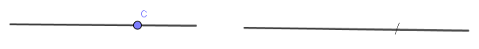
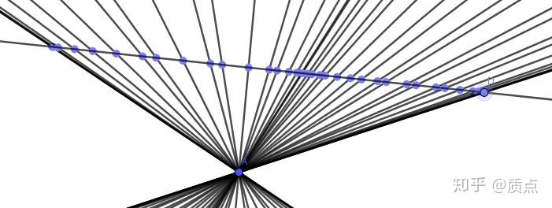
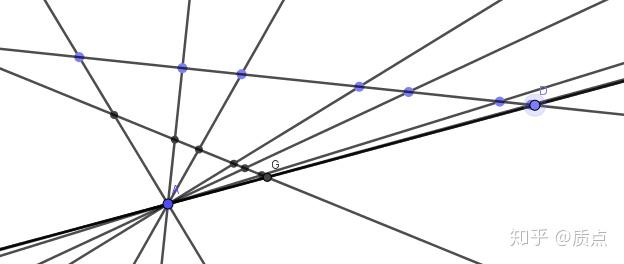
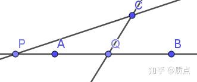
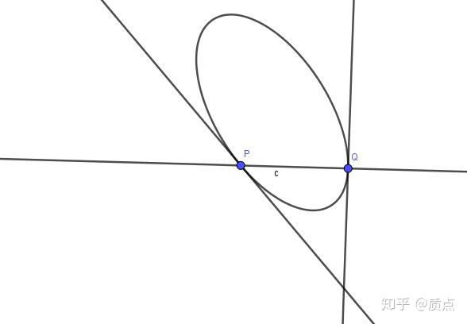
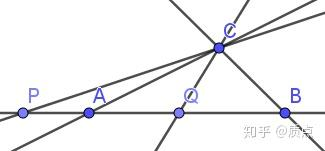

# 圆锥曲线第九节（新）：交比、对合与调和点列

目录：质点：圆锥曲线题目的三维矢量解法

*原稿中有些人表示不明白什么是“限制”，因此我进行了重写，把子空间的概念写得再详细了一些，并且在全文中减少了一些逻辑跳步，让阅读障碍少了一点。与此同时，文章的长度也增加了。因为我在保存很长的文章时知乎会出现奇怪的问题，我只好删去了一些内容。*

*我们在第七节的时候把相对论与圆锥曲线做了一些类比。本文末尾将会继续类比。*

我们之前讨论的都是三维的矢量，对应于平面上的点、线。但是有时候我们需要专门处理一条线上的一系列点，或者过一个点的一系列线（即点列或者线束）。平面点集是二维的，我们用三维矢量表示；而直线上的点集是一维的，我们自然想到，最好的方法是用二维矢量进行描述。

解析几何中的点我们已经用三维矢量空间 $V$ 中的点矢 $a$ 进行描述。如果我们要求点在一条固定直线 $l$ 上，就得满足 $a\cdot l=0$ 。这在立体几何中表示过原点的一个平面 $S$ ，它满足： $S$ 是 $V$ 的子集，并且 $S$ 中元素间的加法、数乘运算仍属于 $S$ 。这时，我们称 $S$ 是三维空间的**子空间。**在研究子空间时，我们可以把$S$当作一个独立的二维空间来看待，并赋予一个“嵌入映射”来把 $S$ 中的点映射到 $V$ 中的那个平面上。并不需要强调 $S$ 中的某个元素 $a$ “就是” $V$ 中的那个元素 $a$ 。换句话说，我们只关心到同构的层面。

我们通过**嵌入**来把 $S$ 中的（二维）**点矢**映射到 $V$ 中的（三维）**点矢**。从几何上，这相当于你把直线上的点在平面上画出来。我们指出这一映射纯粹是为了明确概念，我们几乎不会主动用到它。

我们通过**限制**来把$V^*$ 中的（三维）**线矢**映射到$S^*$ 中的（二维）**线矢。**它的定义是比较抽象的：在第一节中我们讲过，线矢，也就是对偶矢量，其本质是矢量的线性函数： $V^*$ 中的线矢 $f$ 把 $V$ 中的点矢映射为实数， $S^*$ 中的线矢 $f_S$ 把 $S$ 中的点矢映射为实数。当我们有 $V$ 上的函数 $f$ 时，因为 $S$ 是 $V$ 的子空间，我们可以限制 $f$ 的定义域为 $S$ ，这样我们自然地得到了 $S$ 上的函数，因此便得到了$S^*$ 中的线矢 $f_S$。一句话：**“限制映射”就是限制了线矢（作为函数）的定义域**。这一概念的使用会比嵌入更频繁一些。

**嵌入**和**限制**具有对称的地位，但它们都不直观。与之相比颇为直观的是**射影**。

现在我们有 $l$ （以及它对应的子空间）。对任意一条直线 $m$，可以作它和 $l$ 的交点 $a=l\times m$ ，效果是把 $V^*$ 的**线矢**映射到 $S$ 上的**点矢**，这一映射我们称之为**射影。**如果设 $e^{jk}=\epsilon^{ijk}l_i$ ，就有 $a^k=m_je^{jk}$ 。可见 $e^{jk}$ 作为一个反对称的二阶张量，表达了这一射影映射。注意，限制和射影把三维元素映射成了二维元素，因此它们都是不可逆的。

我们之前讨论的是平面中的点列。只要把矢量和对偶矢量的地位互换，就可以讨论平面中的线束，以及属于它们的嵌入、限制和射影。这里略去。

*对于点列上的几何问题，我读到的射影几何教材先借助几何给出射影变换的概念，然后证明射影变换当且仅当保证交比不变，然后把交比为-1的点称为调和点列，最后把两次射影变换后还原的射影变换称为对合变换。但我的逻辑中，这些概念的关系是这样的：*

*对点矢、线矢的线性映射是对这些几何元素的射影变换。从分量的变换形式上讲，对矢量的线性映射与换坐标系等价（注意这两者的实质却是完全不同的。前者是坐标系不变矢量变，后者是矢量不变坐标系变），因此，只要我们构造出坐标系无关的标量（即通过张量积以及缩并得到的实数），那么它自动在射影变换下不变（当然还要求它规范无关，这样才能有几何意义）。从这个意义上讲，交比并没有十分特殊的性质，仅仅是构造出了一个规范、坐标系无关的实数而已。从表面上看，“调和点列”以及“对合变换”分别是从“交比”以及“射影变换”派生出来的概念，并且它们的定义也有些莫名其妙。事实并非如此，这两个概念的关系十分密切，并且具有十分重要的地位：对合变换“变换两次后还原”给出了点和像点之间重要的对称性。我们之后将会在代数上看到这一点。*

---

二维矢量的基本概念，比如矢量和对偶矢量、上下指标，是和三维矢量完全相同的。但不同之处在于空间的维数少了一个，这导致它与三维矢量具有不同的性质。

例如，在三维中对于一个确定的线矢 $n$ ，满足 $n\cdot a=0$ 的点有无穷多，分布在一条直线上。在二维中却被限制住了，**只有一个点**满足这个等式。我们调整a的长短，可以把a写成 $a^i=(x,1)$ 。于是$n_ia^i=0$是一个一元一次方程，x只有唯一的解。

再比如，三维中很重要的是圆锥曲线的点集 $g_{ij}a^ia^j=0$ 。然而把a写成 $a^i=(x,1)$时，会发现$g_{ij}a^ia^j=0$是一个一元二次方程（因为g是不定的，它有两个实根），因此只有两个点满足要求。

同时 $\epsilon_{ijk}$ 将不再有意义。它的非零分量要求 $i,j,k$ 都不相等，然而在二维情景指标的取值范围只有1和2，因此这个张量必定是0。很容易想到，替代它的是一个**反对称二阶**张量，分别记为 $e_{ij}$ 和 $e^{ij}$ ，满足 $e_{ij}e^{ij}=2$ 。它同样有一个待定常数作为系数，如果在某个坐标系取其为1的话，张量的分量为 $\begin {pmatrix}0&1\\-1&0\end{pmatrix}$ ，即 $e_{12}=1$ 。容易验证， $e_{ij}e^{ik}=\delta^k_j$ 。 $e_{ij}$ 是二维空间中最基本的张量之一。

在指标个数少了1的情况下，叉乘的意义就发生了变化。二维矢量的叉乘定义为 $a\times b=a^ie_{ij}b^j$ ，是一个**标量**，简记为 $[ab]$ 。用一个矢量 $a^i$ 可以构造出一个对偶矢量 $a^ie_{ij}$ 。我把这个对偶矢量记为 $a_j$，即 $a_j=a^ie_{ij}$ 。反过来， $a^i=e^{ij}a_j$ 。这虽然和用度规升降指标十分类似，但其实是不同的，不同之处在于我们使用了一个反对称的二阶张量而不是对称的二阶张量，这导致**需要小心地区分 $e_{ij}$ 两个指标的左右**。我采用这样的画法在图中区分 $a^i$ 和 $a_i$ ：

如图，左边用来表示二维点矢，右边用来表示二维线矢。

$a_i$ 和 $a^i$ 的关系类似于**限制**与**射影**的关系。比方说你有一个 $l$ 和一个 $m$ 。当你把 $m$ **限制**在 $l$ 上时（得到二维线矢），你相当于把直线 $m$ 不属于 $l$ 的那些部分都“丢掉”了，只留下了交点那里的“一小段线”，这正是我用右图表示的原因（当然，这些只是形象化的语言）。如果你要给 $l,m$ 作交点，即**射影**（得到二维点矢），就相当于得到了左图。

$a^i$ 和 $a_i$ 通过$e_{ij}$ 和 $e^{ij}$可以互相转化，这体现在图中，那个点和那段线也可以相互转化，纯粹是画法不同而已。

从反对称性得到 $a\times a=0$ 。注意到在二维情景中 $a^il_i=0$ 的解只有一个（不考虑矢量的长短），因此可以直接说：**“$a^il_i=0$的解为 $a=l^i$ 。”**这一结论从图上看是明显的。

---

一般情况下，求一个矩阵的逆矩阵是比较复杂的，但在二维情景中却比较简单。比如，对矩阵 $M=\left( \begin{array}{cc}  a & b \\  c & d \\ \end{array} \right)$ ，其伴随矩阵（等于逆矩阵乘以行列式）为 $M^*=\left( \begin{array}{cc}  d & -b \\  -c & a \\ \end{array} \right)$ 。

$M,M^*$ 的关系似乎只是把其中的元素交换了位置。这意味着我们有可能用简单的张量运算来对它进行表达。简单的运算证明，有矩阵等式 $\left( \begin{array}{cc}  0 & -1 \\  1 & 0 \\ \end{array} \right).\left( \begin{array}{cc}  a & b \\  c & d \\ \end{array} \right).\left( \begin{array}{cc}  0 & 1 \\  -1 & 0 \\ \end{array} \right)=\left( \begin{array}{cc}  d & -c \\  -b & a \\ \end{array} \right)$ 。这意味着如下张量等式成立： $-e^{ij}M_{jk}e^{kl}=(M^*)^{li}$ （注意其中的转置）。我们已经约定用 $e^{ij}$ 升指标，于是等式左边恰好是 $M^{il}$ （注意负号被消掉了）！这说明， $M_{ij}$ 与 ${M^T}^{ij}$ 永远互为伴随矩阵，即 $M_{ij}M^{kj}=\delta^k_i$ 与 $M_{ji}M^{jk}=\delta^k_i$ 。需要注意的是：1.为了方便，我们让 $\det M=1$  2.注意 $M$ 不一定是对称矩阵，也不一定是反对称矩阵，所以不能交换指标的位置： $M_{ij}M^{jk}\ne\delta^k_i$ ！

也可以再做一点变形：联立 $M^{jk}e_{kl}={M^j}_l$ 与 $M_{ji}M^{jk}=\delta^k_i$ ，得到 $M_{ji}{M^{j}}_l=\delta^k_ie_{kl}=e_{il}$ 。类似的还有 ${M_j}^k{M^j}_l=-\delta^k_l$ 。

---

完成了二维矢量的讨论后，我们可以来处理点列或线束间的射影变换了。在第二章已经讲过，(1,1)型张量是矢量映射到矢量的线性映射。我们用 $F(a)$ 表示二维矢量空间上的线性映射，它的张量写作 ${f^i}_j$ ,则 $F(a)^i={f^i}_ja^j$ 。我们要求F是可逆的。

线性映射的典型例子是：

如图，我们有一个定点A和一条定直线。对于定直线上的动点D，我们把它射影为动直线AD；对于动直线AD，我们把它射影为交点D。这是点列和线束之间的线性映射。

多个线性映射的复合还是线性映射。比如下图，“把D映射到G”可以看成先作直线AD，再作交点G。这是两个线性映射的复合，仍然是线性映射。线性映射总可以通过一系列的射影来完成，因此我们也称它为射影变换。

如果一个射影变换把一条直线映射到自身，则这个变换一般会有两个不动点。

有了以上的工具后，我们可以开始定义交比了。我们经过尝试后发现，要想用若干个二维点矢构造出一个坐标系无关、规范无关的实数，至少需要使用四个点矢 $a,b,c,d$ ，构造出来的函数为$J_{ab,cd}=\frac{[ac][bd]}{[ad][bc]}$，称为四点的交比。不引起混淆时可以简写为 $J$ 。在上图中，如果两条直线上各取四个点，且它们满足图示的射影变换，那它们的交比自然就是相同的。

用三维行列式的方法可以证明，二维空间中有一个重要的恒等式： $[ab]c+[bc]a+[ca]b=0$ （记忆方式，它们都是 $a,b,c$ 的循环）。等式两边再对任意矢量 $d$ 作叉乘，就得到另一个恒等式： $[ab][cd]+[ac][db]+[ad][bc]=0$ （记忆方式：它们都是abcd的偶置换）。再结合我们早就知道的 $[ab]=-[ba]$ ，就可以证明以下性质：

1.交换 $a,b$ 或交换 $c,d$ ，交比变为 $\frac{1}{J}$ ；

2.交换 $a,d$ 或交换 $b,c$ ，交比变为 $1-J$ ；

可见，如果 $a,b,c,d$ 均不相同，那么交比的值有3个实数不可能取到： $0,1,\infty$ （如果取为0，意味着 $[ac]=0$ 或 $[bd]=0$ 。而另外两种情况时，可以交换一些元素使得新的交比变为0。）

**如果** $J_{ab;cd}=-1$ **，则称a、b与c、d互相调和分割。**很快我们会看到这有什么特殊之处。

射影变换中有一类特殊的变换，称为对合变换。它的特性是，任意一个矢量变换两次后变回自身（这里同样不关心矢量的长度），即 $F(F(a))\equiv \lambda a$ ， $\lambda$ 是一个不重要的实数。**对合变换的意义是，它在所有的矢量之间进行了两两配对**， $a,F(a)$ 配成一对，此时这两个元素称为互相对合。如果我们的 $F$ 不是对合变换，那么当我们有两个元素$a,F(a)$时，我们就可以区分出哪个是原像，哪个是像；而如果$F$ 是对合变换则不然：它们同时既是原像，又是像——用 $F$ 作用于这两个元素时，它们同时变成对方。此时，$a,F(a)$两个元素具有完全相同的地位，它们千真万确地被“配对”了。既然对合变换中原像和像的地位完全对称，我们自然猜测对合变换可以写成某种“特别对称”的形式。结论是：

**一个对合变换可以由（0,2）型对称可逆张量** $g$ （按照定义，这种张量可以作为度规）**决定：矢量** $a,b$ **相互对合的条件是** $g_{ij}a^ib^j=0$ **。**我们在上一节已经指出，**（0,2）型对称张量是我们主要研究的几何对象，而对合变换恰恰可以用它来表示。这意味着，对合变换具有明显的几何意义**。

“对合”的特性体现在$g$是**对称张量**上。证明如下：

如果把这个方程中的b看作已知矢量a的函数，由$g_{ij}a^ib^j=0$可以得到b的一个解 $b^k=g_{ij}a^i\epsilon^{jk}$ ，因此b关于a的函数是线性的。

把b写成 $b=F(a)$ ，则 $g_{ij}a^iF(a)^j=0$ 。由于g是对称的，交换两者的指标， $g_{ij}F(a)^ia^j=0$ 。再根据定义，有 $a=F(F(a))$ 。证毕。

如果$g_{ij}a^ia^j=0$，那么 $a=F(a)$ ，即a和自己对合。这表明，**$g_{ij}a^ia^j=0$确定了对合的不动点**。我们假设 $g$ 是不定的，因此它对应的二次方程有两个解，即，**有两个对合的不动点，我们用** **$p,q$** **表示**。

如果按照通常的规范， $a^i=(x_1,1),b^i=(x_2,1)$ ，则对合一般可以表示成 $Ax_1x_2+B(x_1+x_2)+C=0$ 。可以看到，这和韦达定理有一定关系。它的两个不动点 $(x,1)$ 中的 $x$ 就是方程 $Ax^2+2Bx+C=0$ 的解。

在处理一维线束时，我们一般可以把线矢的坐标化为 $m_i=(k_1,1),n_i=(k_2,1)$ 。则对合可以表示成 $Ak_1k_2+B(k_1+k_2)+C=0$ 。

对于一个对合变换，我们有它的不动点$p,q$。现在我们挑出一对互相对合的点$a,b$并计算它们的交比$J_{pq,ab}$。因为线性变换是不改变交比的，因此$J_{pq,ab}=J_{F(p)F(q),F(a)F(b)}=J_{pq,ba}=\frac{1}{J_{pq,ab}}$,所以$J_{pq,ab}^2=1$。而对于不重合的四点，交比是不等于1的，因此必须$J_{pq,ab}=-1$，即这四点成调和点列。

调和点列的条件 $\frac{[pa][qb]}{[pb][qa]}=-1$ 可以改写为 $[pa][qb]+[qa][pb]=0$ ，进一步可以改写为 $g_{ij}a^ib^j=0$ 的形式，其中$p_iq_j+p_jq_i$。采用简写，$g=(p\times, q\times)$ ，其中的小括号表示对称张量积。因此，**对合变换由它的两个不动点完全确定： $g$ 是对合的两个不动点的投影的对称积**。把“二次点”的概念类比到二维矢量空间，我们也可以这么说：“ 对合的不动点构成了一个二次点，它经过投影便得到了$g$。”）

值得注意的是，在等式$[pa][qb]+[qa][pb]=0$中，不仅原像和像 $a,b$ 间是对称的，两个不动点 $p,q$ 间是对称的， $(ab),(pq)$ 绑定起来交换也是对称的。换句话说，如果把对合的$a,b$作为不动点确定新的对合变换，那么$p,q$关于新的对合变换恰好是对合的。

以上我们只讨论了直线上的点列。对过定点的线束的讨论是完全相同的，比如可以定义四条直线的交比。

---

我们学会了子空间上的交比、对合以及调和点列，又学会了如何在子空间与平面间进行嵌入、限制与射影。这使得我们能够利用前者的知识来研究平面几何。我们从退化二次曲线入手。

如图，有一条定直线 $l$ ， $a,b$ 两点在 $l$ 上。有两条直线 $m,n$ 分别交 $l$ 于 $p,q$ 。在什么条件下， $a,b,p,q$ 形成调和点列？

运用二维矢量的语言，可以把它写成 $(p_iq_j+p_jq_i)a^ib^j=0$ 。目前这个等式中的元素都是二维矢量，我们需要改写成三维矢量的等式。因为 $a,b$ 是嵌入在平面上的点，因此可以原封不动的把它们当成三维矢量（换句话说，我们不用管它）。而 $p_i,q_i$ ，本质上分别是 $m_i,n_i$ 在 $l$ 上的限制！既然仅仅是限制了定义域，它们作用在相同定义域上的矢量 $a,b$ 的结果自然是相同的。因此，这一等式可以改写成 $(m_in_j +m_jn_i)a^ib^j=0$ 。这一表达式中的所有东西就都是三维矢量了。

这个等式极其重要的一点，在于$m,n$是以二次线 $(mn)=mn+nm$ 的形式出现的。我们设 $h=(mn)$ ，则 $h_{ij}a^ib^j=0$ 当且仅当 $h$ 代表的两条直线与 $a\times b$ 的交点被 $a,b$ 调和分割。

我们把线矢 $m_i,n_i$**限制**在 $l$ 上得到 $p_i,q_i$ 。推广地说，我们也可以对（0,2）型张量定义**限制**：（0,2）型张量可以看成把两个矢量映射为实数的“二元函数”，而对二元函数，我们自然可以类似地限制其定义域。运用这种观点， $(pq)_{ij}$ 其实就是 $h_{ij}$ 的限制。

退化二次线 $h_{ij}$ 限制后可以给出 $l$ 上的对合。自然的推广是，如果 $h$ 不是退化的，而是圆锥曲线 $g$ ，那么 $g$ 在 $l$ 上的限制能否给出二次对合呢？答案是肯定的。

很容易证明，对三维（0,2）型对称张量 $g_{ij}$ 进行限制得到的二维（0,2）型张量 $g'_{ij}$ 仍然是对称的，因此它代表了一个对合关系。假设 $g$ 与 $l$ 有两个交点 $p,q$ ，则从点在圆锥曲线上的条件可以得到 $g_{ij}p^ip^j=g_{ij}q^iq^j=0$ 。因为 $p,q$ 都在 $l$ 上，可以把 $g$ 用它的限制 $g'$ 替换，得到 $g'_{ij}p^ip^j=g'_{ij}q^iq^j=0$ ，这正是对合变换的不动点的定义。因此，我们有以下结论：

**圆锥曲线 $g$ 在 $l$ 上的限制给出了 $l$ 上的对合变换，对合的两点 $a,b$ 由 $a\cdot b=g_{ij}a^ib^j=0$ 确定。如果 $g$ 与 $l$ 有两个交点 $p,q$ ，那它们是对合的不动点。（如果 $g$ 是退化二次线，结论类似）**

**对偶命题同样成立：**

**圆锥曲线**$g$**在**$a$**上的限制给出了**$a$**上的对合变换，对合的两条线**$m,n$**由**$m\cdot n=g^{ij}a_ib_j=0$**确定。如果**$g$**与**$a$**有两条切线**$p,q$**，那它们是对合的不动点。（如果**$g$**是退化二次点，结论类似）**

这一结论给出了极点极线的重要性质：

**若关于 $g$ ，有$a\cdot b=0$ （即a在b的极线上，或b在a的极线上），则 $a,b$ 调和分割直线 $a\times b$ 与 $g$ 的两个交点 $p,q$ 。**

*许多书通过完全四点形等纯几何手段给出了这一证明，而从代数上，通过对圆锥曲线进行“限制”来得到这一结论显得更加自然而且漂亮。*

限于篇幅，更多的细节本节不再给出。我们以两个附注进行结尾：

1.

不同的圆锥曲线在子空间上的限制可能是相同的。典型的例子是：

图中的椭圆 $g$ 在直线上限制得到的对合变换由交点 $p,q$ 确定，而任何与直线 $l$ 交于$p,q$的二次曲线都能限制出相同的对合变换。典型的例子是 $p,q$ 两处的切线构成的二次线 $h$ 。从几何角度上看， $h$ 与 $l$ 的两个交点正是 $p,q$ ；从代数角度看， $h_{ij}=l^2g_{ij}-l_il_j$ 。第一项的限制正比于 $g$ 的限制，而第二项的限制恒等于0,。因此自然 $h$ 给出与 $g$ 相同的限制。

2.在前文的图中不仅仅是 $p,q,a,b$ 构成调和点列，它们与C点所连的四条线还构成调和线束。因为它们通过射影变换相联系，所以它们是同时成立的。如果在 $h=(mn)$ 之外，再引入 $f=(ab)$ ，则图中的这一关系可以更简洁地用 $f:h=0$ 表示。

目录：

---

结合《微分几何入门与广义相对论》第四章第四节的内容，还可以再做一些说明。

我们在这一节把圆锥曲线对应的度规 $g$ 限制在了直线 $l$ 上得到了 $h$ 。用几何的话说， $h$ 是 $g$ 在超曲面 $l$  的**诱导度规。**我们求出的公式 $h=l^2g-ll$ 等价于书上的公式（4-4-2）。直线上的点相当于超曲面上的点， $l$ 的地位相当于超曲面的**法余矢**。超曲面的类时、类空、类光对应了直线与椭圆相离、相交、相切。超曲面上的类光方向对应了直线与椭圆的交点。类光超曲面的诱导度规是退化的，对应了椭圆在相切的直线上限制得到的对合变换是退化的。
